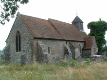

## A village story

Maggie Moore Alexander

Chris and I live in the tiny little village of Binsted in the south of England known as the South Downs. There are about 30 houses on Binsted Lane, the single track road that makes a horseshoe off and back onto the main highway, along with several farms, a 12^(th) century church, and a pub. That’s it. That’s Binsted. But when we came here in April of 2003, I was introduced to the richest community experience I have ever known.

There are a few families who have always been conscious that we need to stick together as a community. Ron and Jo Withers we are very fortunate to have as our closest neighbors. John and Peg North raised there family here, while John worked on the largest farm most of his adult life. John looks after our place now. Rosemary and David Tristram live in the Old Rectory and own a plant nursery on the lane. Their son Mike and his family live next door. From the moment we arrived, these people were quietly and unobtrusively at our door, offering welcome and inclusion in the life of Binsted Lane. And very gradually I came to know, and be a part of, the subtle structure that holds Binsted Lane together as a community.

The mainstay is the Friends of Binsted Church. It’s a beautiful little place in which we all gather at special times during the year. (My favorites are the Harvest Festival in September and Christmas.) Many years ago Rosemary and David created a charity to raise money for maintaining the church, an expensive proposition for such an old building, and asked neighbors to serve as board members. The main fund-raising activity is the Strawberry Faire, which happens every July. A wider circle of neighbors gather to plan and host the event in an old structure on the Tristram property, now known as the Strawberry Faire Barn. Faires are a lovely village tradition that serve as family entertainment in England, so many people come from miles around. Half the money we raise goes to the Friends of Binsted Church. The other half goes to another charity close by that is selected every year. Enough money accumulated in the last few years to make extensive repairs on the church, and also to build a new lych-gate on the front path. The year before that, neighbors formed a “book club” and collected stories, photographs, and family histories. They produced a book called *Binsted and Beyond*, now in its second printing.

Every year when September approaches, we plan the Harvest Dinner for everyone on the lane, usually in conjunction with Harvest Festival at Binsted Church. We’d call it a potluck in the US. It’s held in the Strawberry Faire Barn, and it’s organized by neighbors who provide decorations and food and prizes. There’s a small donation accepted for dinner, and we sell raffle tickets. All the proceeds go into a little metal box that Jo keeps, until the Christmas season begins and we plan the Binsted Christmas Party.

The Christmas party is held at Marsh Farm in a grand old farmhouse. Neighbors provide decorations and food, and everyone brings a bottle or two. Within a week or ten days there is carol singing at Binsted Church, followed by minced pies and mulled wine at the Old Rectory. Christmas is celebrated quietly and gently on Binsted Lane.

This simple, subtle structure, almost invisible unless you’re looking for it, invites everyone here to know each other and be connected through the rhythm of the seasons. With each gathering I get to know a neighbor better. The process of inclusion happens slowly, but steadily and sure-footedly. It’s been almost four years now that we’ve been here. I am among the most fortunate on earth to have found the place that I belong, far from where I was born in southern California, but completely, surprisingly, mine. I am proud to be the treasurer of the Friends of Binsted Church, and on call for the next planning meeting, whatever the topic. Perhaps my neighbors feel that way, too – eager to give back to the place that welcomes them home.

*From* Building Living Neighborhoods *by Christopher Alexander, Maggie Moore Alexander, Randy Schmidt and Nick Littlestone, with Bev Behrman and Howard Davis. © Center for Environmental Structure. [Original page](https://www.livingneighborhoods.org/extras/a-village-story.htm).*
