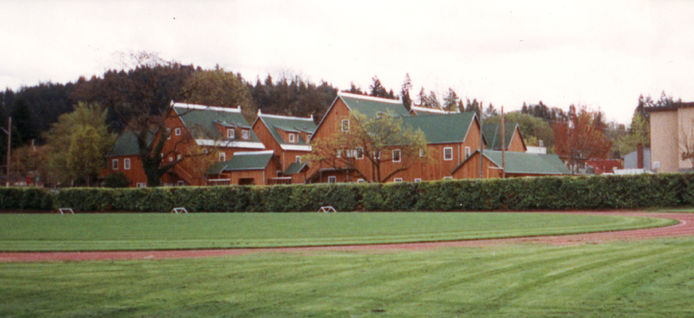
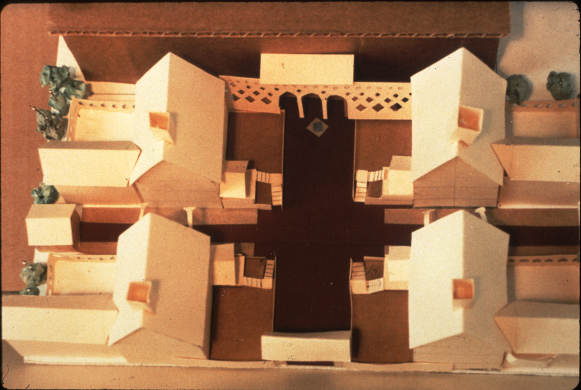
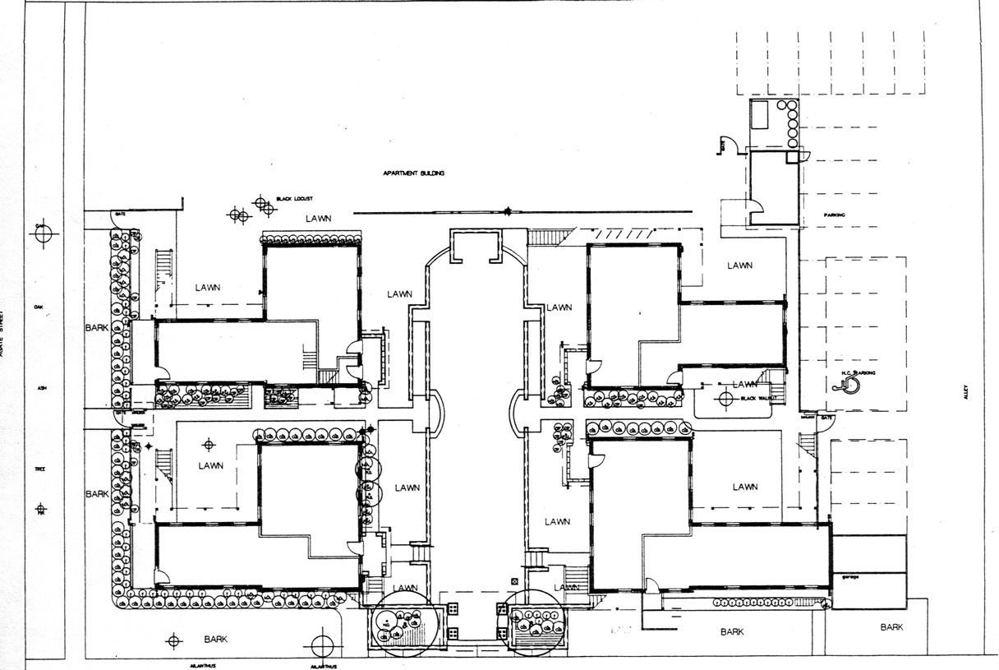
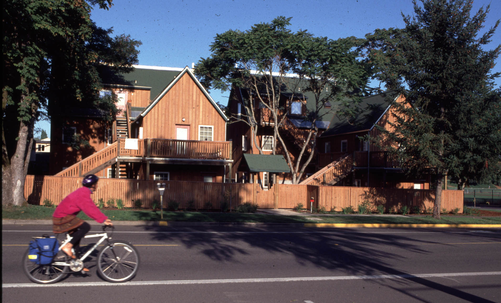

## Oregon eugene, Agate student housing

## A neighborhood for the University of Oregon

## Project history

**Agate Student Housing**

This mini-neighborhood contains 20 married student apartments, in four buildings, with common land between them, and private terraces and gardens.

The entire neighborhood was built (in 1993) for \$800,000 -- \$40,000 per apartment -- and came in exactly on budget.

To generate this design, we used a generative code that was originally developed for high density, low rise housing in Japan. A version of the Japanese neighborhood is shown below. It contained the following instructions:

**Cycle 1** In the first cycle the basic plan layout, outdoor space, and volume pattern was created.

**Cycle 2** Use of the fifteen properties, sharpening of the design, and intensification of main centers.

rative sequence, in this instance, is **only** a list of elements, without further elaboration. This may seem something short of "generative," but it is important to note that the environment of a place is very much defined by the list of entities which are repeated there. Thus in this case the rather exotic list of entities speaks volumes about a special kind of place, also visible in the large colored drawing: **and thus defines the living character this place will have**. In similar fashion, if someone lists the entities they want in a place, this list of entities will define a very large portion of the environment that is generated. --

Further discussions of the generative code for this project

[First generative pattern Sequence for the stepwise conception and layout of the new Center of Samarkand](samarkand.md) 3 pages

[Second generative pattern Sequence](samarkand.md)

*From* Building Living Neighborhoods *by Christopher Alexander, Maggie Moore Alexander, Randy Schmidt and Nick Littlestone, with Bev Behrman and Howard Davis. © Center for Environmental Structure. [Original page](https://www.livingneighborhoods.org/ht-0/agate.htm).*
