## Texas, back of the Moon neighborhood

A beautiful emphasis on the common land which binds the neighborhood together

This page is dedicated to the families who worked with us, Mike and Patricia Goddu, Geoffrey and Linda Gioja, Jim and Sylvia Heisey; and to Barton Coffman, Saul Pichardo, and Randy Schmidt who ran our construction works in Texas.

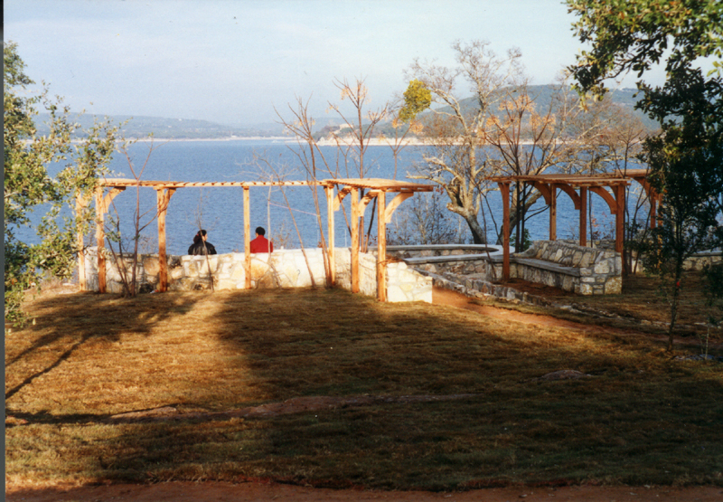

Project history a group of families, living in Austin, Texas, asked us to build a community of houses for themselves. They had a piece of land about seven acres, on a small street known as "Back of the Moon."

To start with, each family chose a rough area on the land, where they wanted to be. Each family then began to lay out their own house, using a patternlanguage (different for each house, according to the family's wishes). This initial design was done in two one-hour sessions, by phone, one hour to help the family choose their pattern language, and one hour for the unfolding of the house design.

The houses did not have their own individual lots, but rather each had access to the land as a whole, which was held in common, and there was no sharp division between areas "belonging" to individual houses and the common land.

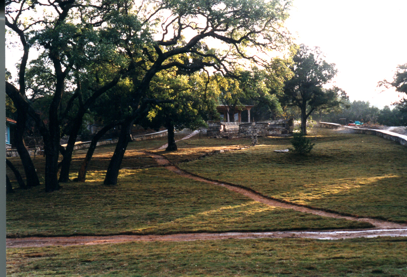

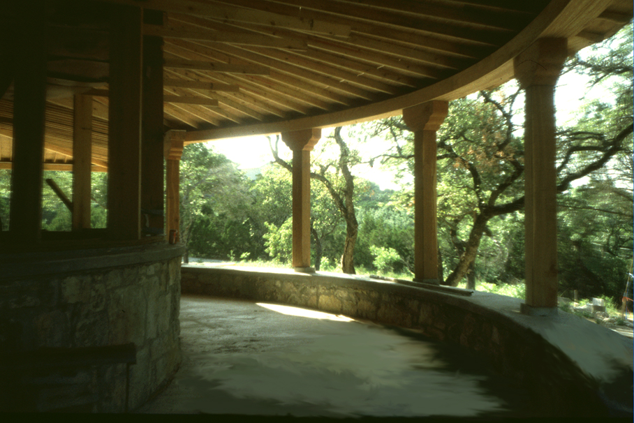

Houses surrounding the common land of the community

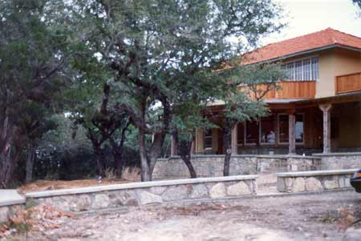

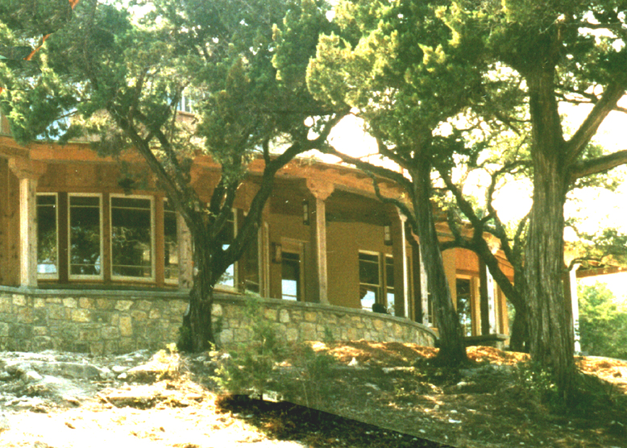

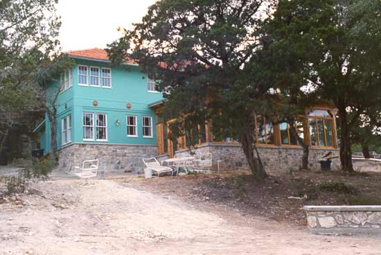

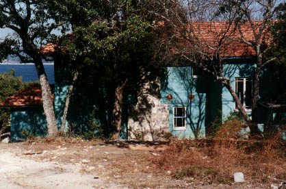

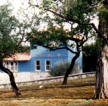

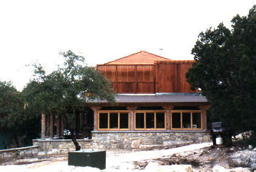

On the right: interiors of the houses

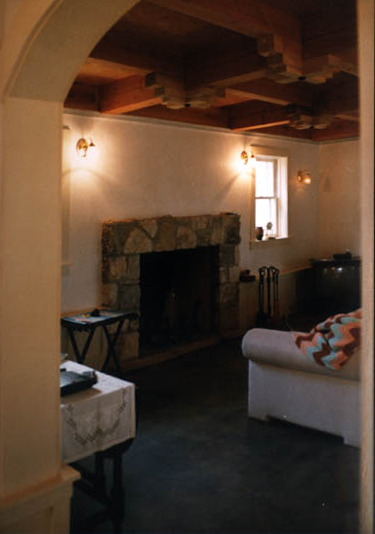

On the right: Our masons building the stone plinths

POINTS OF SPECIAL INTEREST IN THIS NEIGHBORHOOD All the houses were built with the same generic system of construction: each is entirely different in shape, feeling, and character, because of the differences in family wishes, and the results of the different whole leading to different details as the house evolved.

The common land is immensely successful: even though families found it difficult to allow us to spend 17% of the project budget on what we built in the common areas, it paid off a hundred times over.

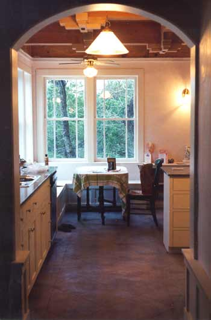

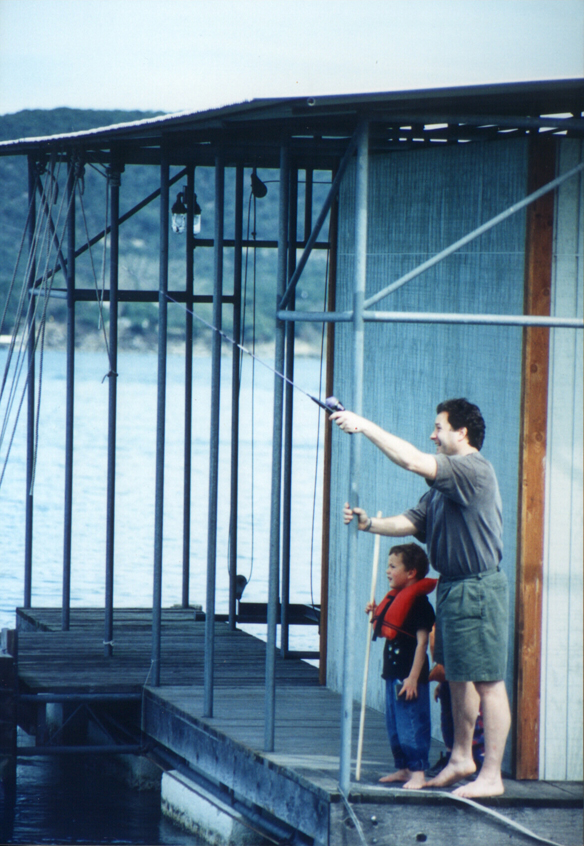

Right: Mike Goddu and his son on the lake

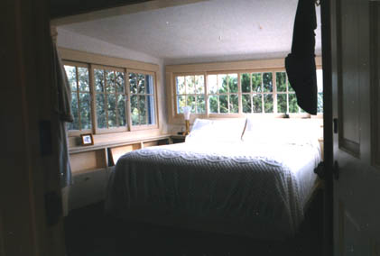

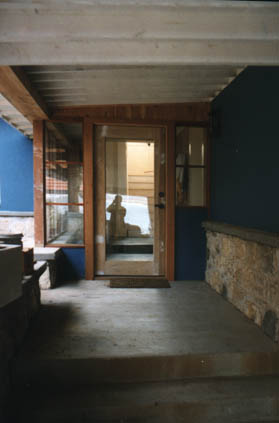

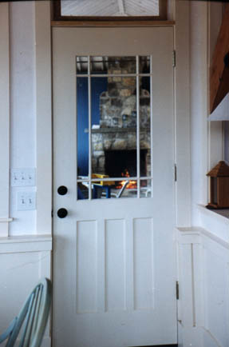

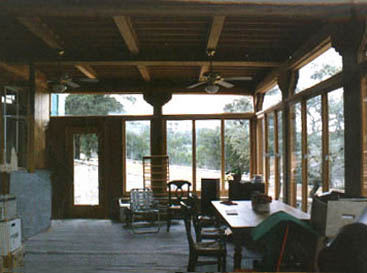

Inside other houses

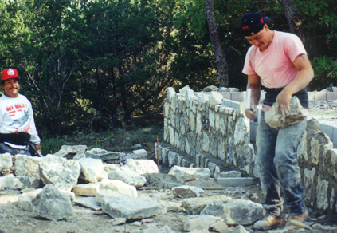

## Window unfolding movie (applet no longer runs)

## Study the steps of the unfolding

This window-design process follows the steps below

***First, let the computer run the playback** of the unfolding automatically:  click here  . You can dynamically see the steps as they come into play.*

***Or, you may control the playback** of the unfolding: VERY slowly **mouse-over the list** of steps to view the unfolding at your own pace.*

*From* Building Living Neighborhoods *by Christopher Alexander, Maggie Moore Alexander, Randy Schmidt and Nick Littlestone, with Bev Behrman and Howard Davis. © Center for Environmental Structure. [Original page](https://www.livingneighborhoods.org/ht-0/texas.htm).*
