## California the Fresno farmers' market

## A commercial market community bringing neighborhood

## And commercial space together

This page is dedicated to Richard Erganian, and to the farmers who have brought their produce to market here, for the last twenty years.

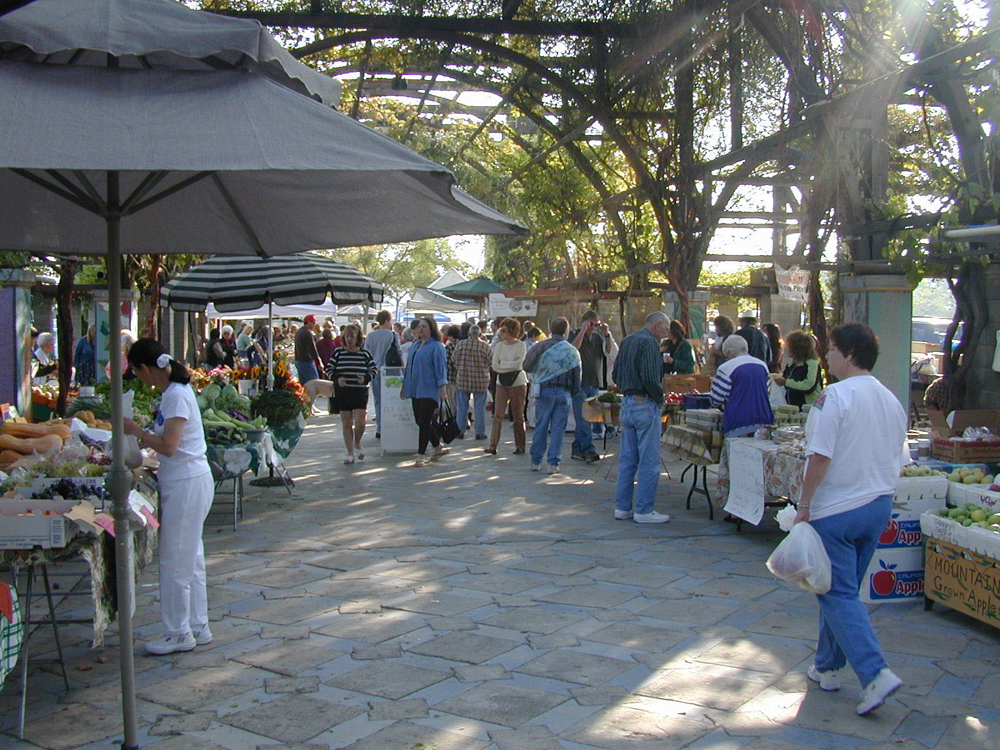

The atmosphere that typically occurs in the market. The fresh fruit is delicious, you can buy pomegranate juice there, dried fruits; the farmers' pickup trucks are parked against the structure and they load and unload direct into the main structure -- where shoppers are strolling up and down. They are so nice, and the food so good, that it is very hard to leave without buying something.

## Project history

The Fresno market is on a prominent city block in Fresno, California, at the intersection of Shaw and Blackstone. The block is 800 feet by 600 feet.

The first market building, which we built about 20 years ago, forms the core of the 12-acre site, and will be the core of the commercial buildings that are built around it. We began work on plans for the whole market area about 20 years ago, and, at Richard's request, first built the structure to house the main market. It is an arched timber structure on concrete block piers, 120 feet long, and 40 feet wide. Richard set to work and planted vines all over it, and they now provide a leafy shade. Fresno can be very, very hot.

Not long after we built the market, Richard moved his mother's old house from downtown Fresno, and put it on blocks to the west of the structure. See the map below.

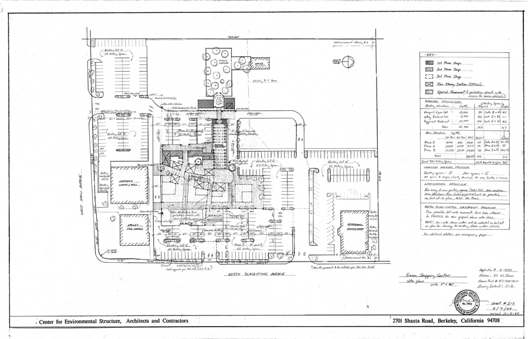

An early sketch map of how the commercial, shops, and workshops might grow around the Farmer's market as their focus. The market structure is visible in the middle of the drawing. Three buildings around the edge, have been standing there, from the time before we started. The remaining buildings shown on this sketch are hypothetical, simply to allow us to get a grasp on where this neighborhood would go, and how it might become lively and beautiful. This plan, like all such plans,is now quite obsolete, and is being replaced by a generative code. (See below).

Once the market was built, Richard began to explore his life-long dream to create a city block in modern ,urban California, that was able to preserve, and encourage, the human community, the mutual respect, the informal way of living, and the importance of human relations and friendliness. Many times during the ensuing years he expressed frustration with the deadly "development game" and its pressure to replace flesh and blood with plastic, but he has hung in their, never losing sight of this dream.

**Views of construction, streets and public places within the market**

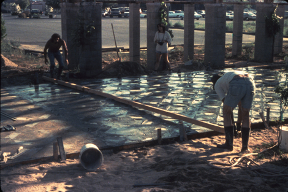

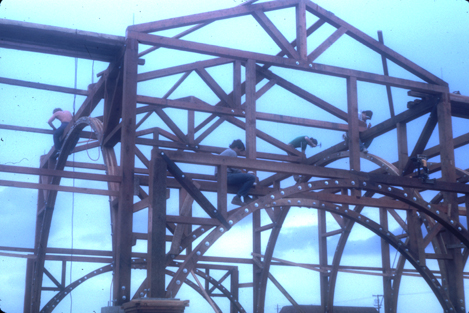

The barn raising to get the main structure up, after we had prefabricated all the timber arches in our warehouse near Berkeley, about 200 miles from the site.

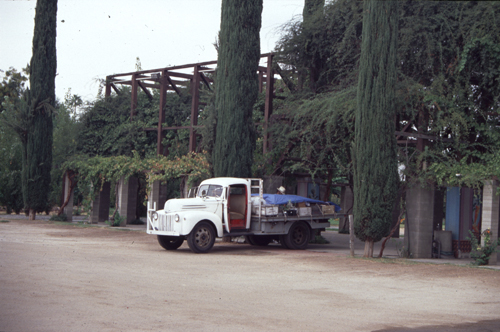

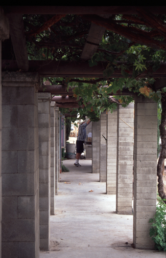

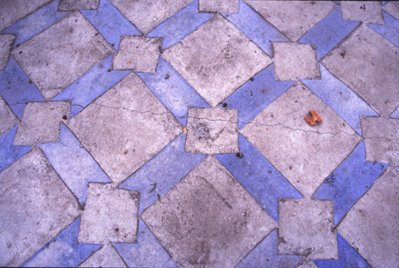

Special hand made fish-tail tiles on the floor of the market. Each tile is about 15 inches long and 6 inches wide, in thin dense concrete about 1/2 inch thick. These tiles were cast on the ground with a blue pigment in the mix. To save money they were dropped into the slab, the same afternoon we cast the slab, when the concrete had been screeded off, and was setting up, just stif enough to support the tiles, and still plastic enough to let the tile sink in just the right amount. The technique generated a pleasant unevenness in the tiled surface.

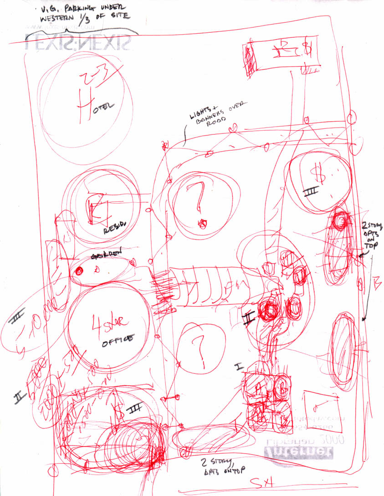

A sketch by Richard Erganian showing one of the early conceptions of the way the overall site might develop.

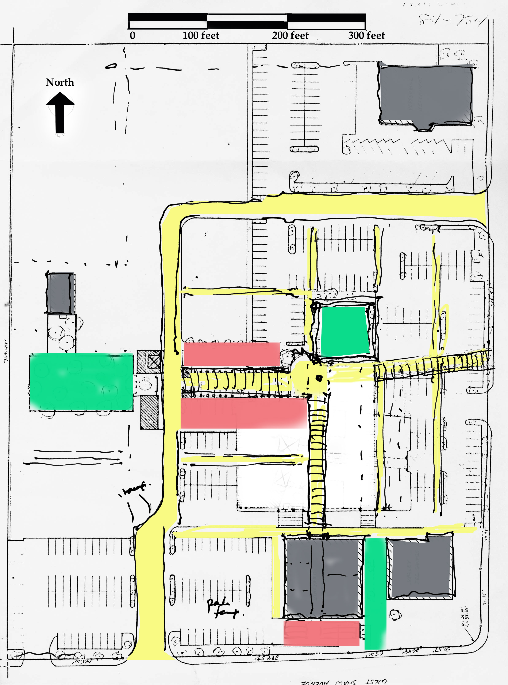

A more recent drawing in which we began to sketch the way that the ongoing growth of the market and its associated neighborhood of buildings could now extend to cover the entire 12 acre site.

## Points of special interest in this project

This project is especially interesting because of its relationship to time. Richard, from the beginning, has been determined to do this well. He wants to show what is possible, when things are being done **well** and when one manages to avoid the traps of business-as-usual development. As a result, it has taken him a very long, long time to prepare his mind, and work out a sure path.

At the bottom of the page, you will find discussion of this particular challenge for a generative code that needs to create a flexible response to an uncertain commercial situation.

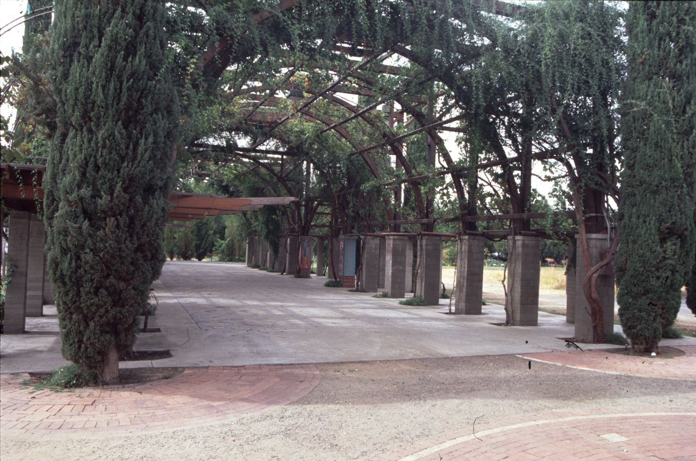

The structure as it was first built 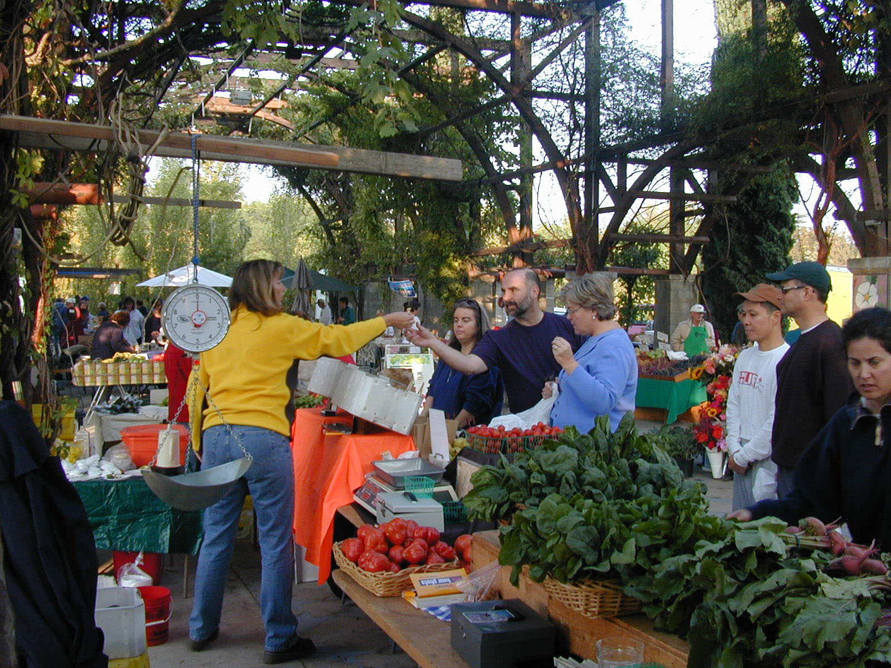 An ordinary day at market

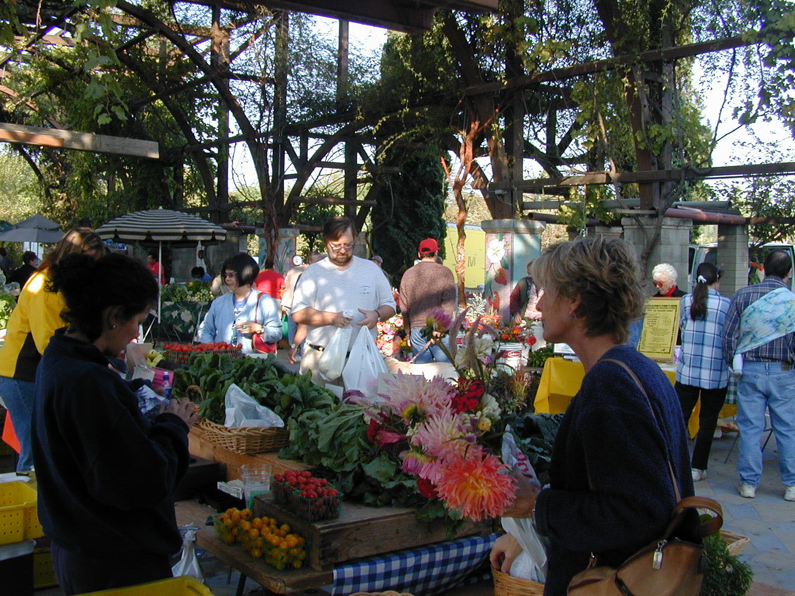

The market has been so successful that a few years ago a book was written to record its story, and the source of community which the building and the market have generated. A watercolor made for a recent book which celebrates the 20-year continued existence of this market, as a human and social phenomenon, created by the strong bonds of feeling between Richard Erganian and the farmers he works with, and his habits of caring and responsibility and genuine, folksy, warmth and style. **Abundant Harvest**: Scenes, Stories, and Recipes from Fresno's Vineyard Farmers Market by Sharon Young (Paperback - Jan 1995) 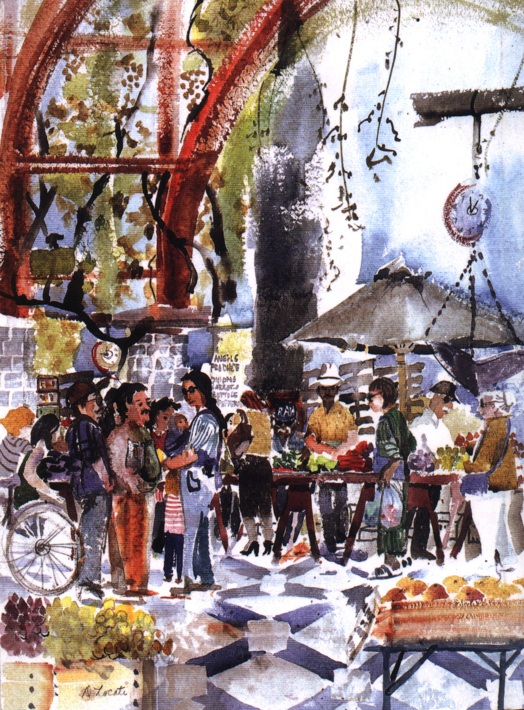 One of the watercolors from the book **Abundant Harvest**.

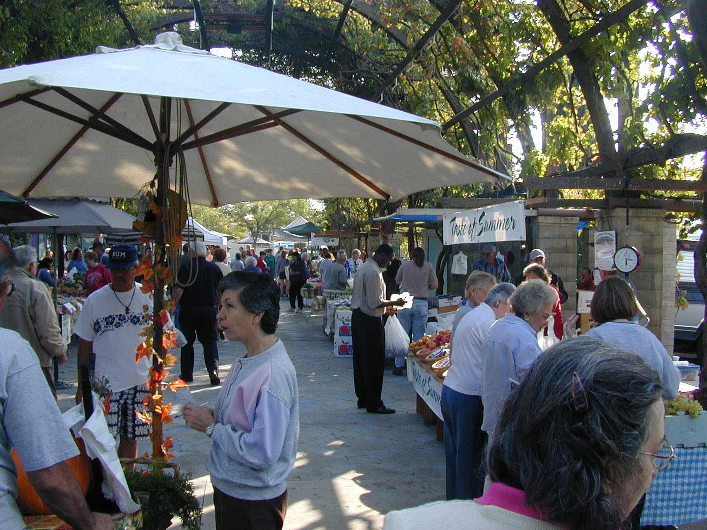

Below, the Fresno market from the distance, just before nightfall, surrounded by cypress trees.

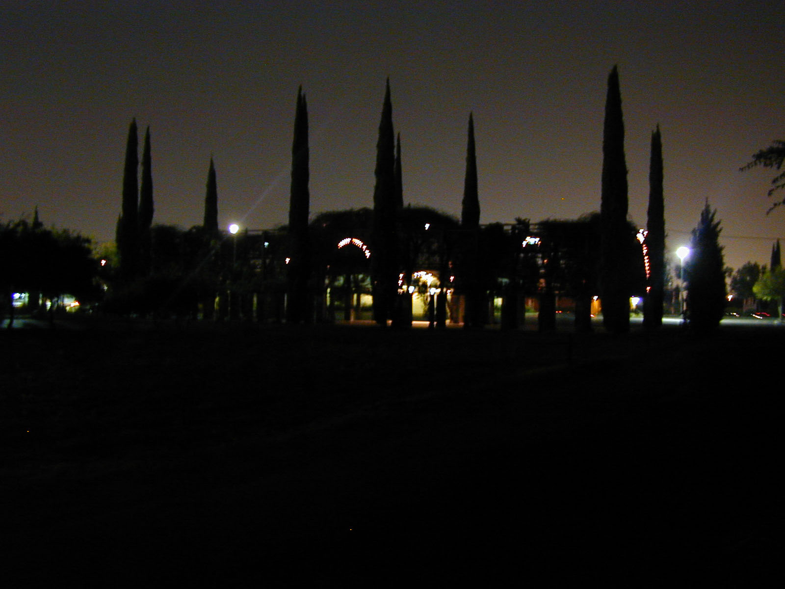

## Further discussion of the Fresno generative code

**A GENERATIVE CODE FOR GROWTH OF A COMMERCIAL AREA**

A code for the stepwise construction of the Fresno market buildings

Richard's aim has always been to build something truly beautiful -- a place for community, and vivid life, as much as a place of commerce. In the course of his work, he is constantly having to juggle tenants, keep them happy, try to meet their requests, even knowing that this tenant will want this and such, while the next tenant who comes will very likely want something else. Needs for parking, built space, entrances, visibility from the highway, all change continuously. No conventional form of "design" can solve these problems successfully.

The more we have worked on the problem, we have arrived at the notion that the key ingredients are, in this order:

- A fundamental use of trellised, leafy structures, most likely arched, smaller than the main farmer's market, but providing the pedestrian "streets" of the shopping center.

- These trellised structures will run along as-yet unknown paths, all over the site.

- The trellises should form a very approximate grid -- not a rigid grid, but a "soft" grid which can go where it needs, and yet give people an easy way to navigate the site.

- Off the trellised walks, there will be buildings, often free-standing, with gardens between them, forming a kind of checkerboard of green space and buildings, and encouraging the friendly informal life Richard wants to support for his customers and clients.

- Some of the buildings will have roofed open arcades on their edges, which connect with the trellised paths, together forming the overall pedestrian network.

- Some small parking lots will be allowed to appear between the buildings, but the total area of these parking areas will never exceed 25% of the site area. Further parking will be provided underground.

- There will be a single road which does pass through the site, and which will perhaps serve a hotel to be built in the back (north-west) corner of the site. Richard visualizes this road as lined by carnival-like lights strung back and forth overhead, above the road.

A very rough conception of the way the trellises, road, parking, and gardens interleaved with buildings, will work. Although this drawing dowes not show the actual structure which will be built, still, it illustrates the probable effect of the generative rules defined above.

## Future discussion

Further ongoing discussion of the generative code for the stepwise conception and layout and construction of the Fresno neighborhood, and how its future can be made to unfold successfully, while dealing with the financial uncertainties of a small-town developer, will be presented in an open document that can be accessed here. 10 pages

*From* Building Living Neighborhoods *by Christopher Alexander, Maggie Moore Alexander, Randy Schmidt and Nick Littlestone, with Bev Behrman and Howard Davis. © Center for Environmental Structure. [Original page](https://www.livingneighborhoods.org/ht-0/fresno.htm).*
