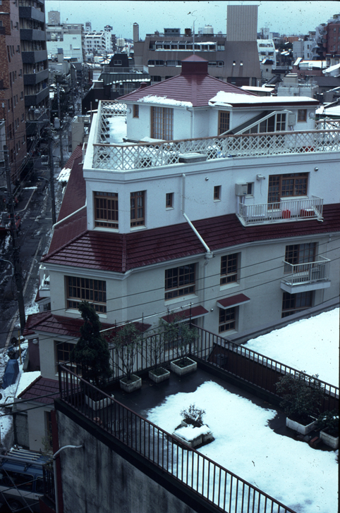
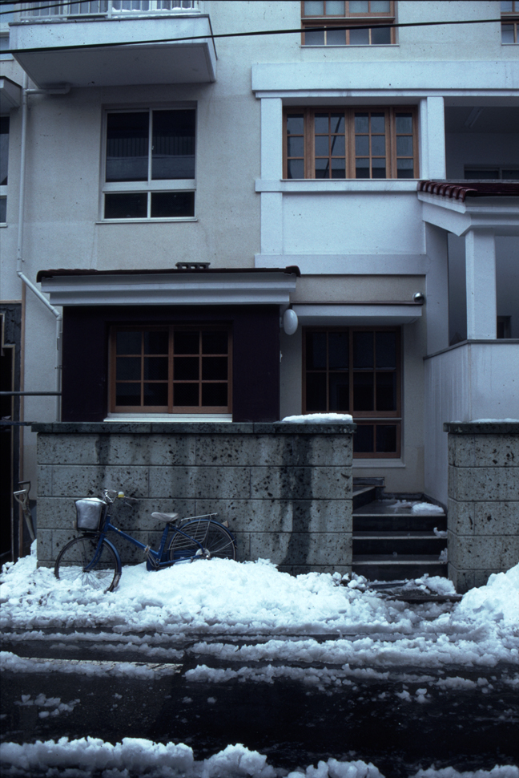
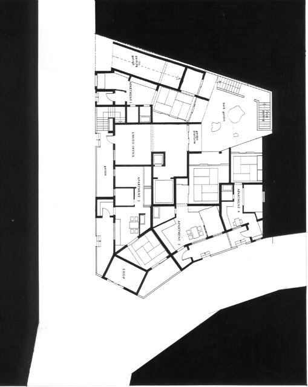
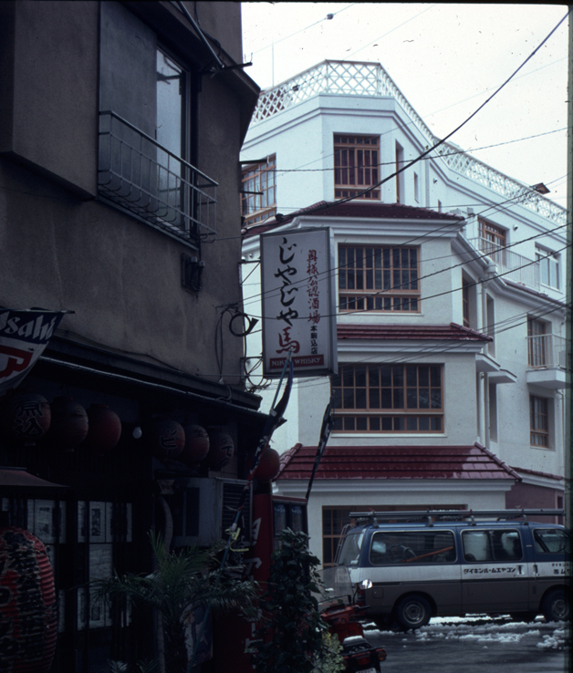
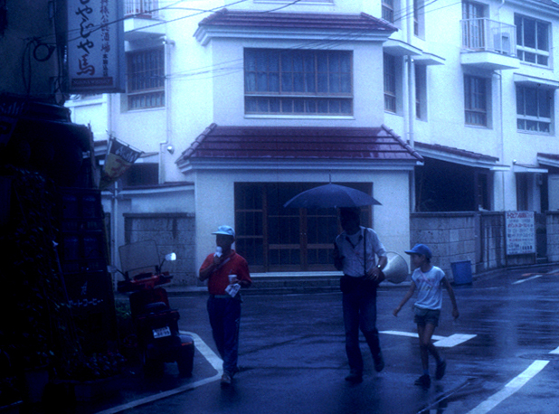

## Japan Komagome district

## Project history

Five story apartment building laid out to enhance the two streets of the neighborhood. This project was done in a neighborhood of Komagome, not far from downtown Tokyo. The Emoto family who owned theland, and a building previously standing there -- asked us to build a new building, which would have about 20 small apartments, two or three of them for members of the family.

One private apartment with entrance at street level

## Project history

caption

View of the fork in the streets, and the positive space created by the building at this important neighborhood corner.

Strolling in the space formed by the building and the streets, a fairly safe and narrow street in the middle of Tokyo

Further discussion of the generative code for this project

[The Nature of Order, Book 3, chapter 5, pages 167-173](../assets/library/emotopages-b3-chapt-5.pdf) 12 pages, 24 color/bw illustrations

[Read on screen](../assets/library/emotopages-b3-chapt-5.pdf) [Download and Print](../assets/library/emotopages-b3-chapt-5.pdf)

*From* Building Living Neighborhoods *by Christopher Alexander, Maggie Moore Alexander, Randy Schmidt and Nick Littlestone, with Bev Behrman and Howard Davis. © Center for Environmental Structure. [Original page](https://www.livingneighborhoods.org/ht-0/emoto.htm).*
