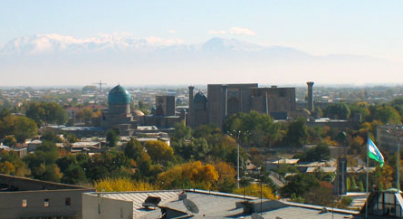
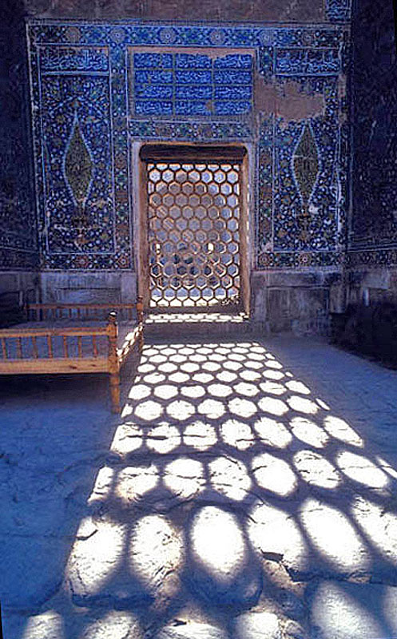
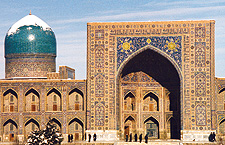
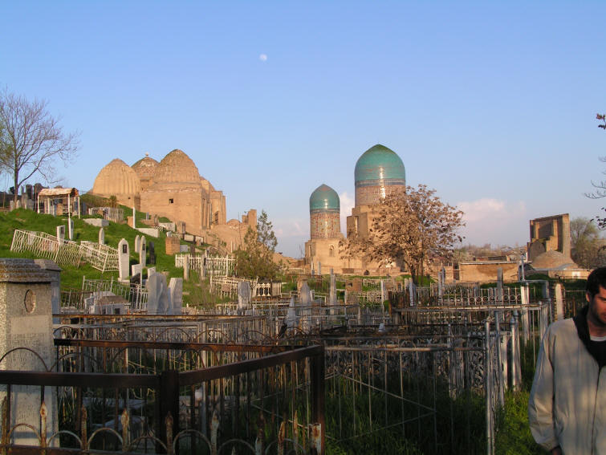
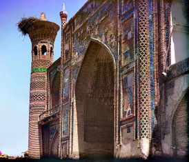
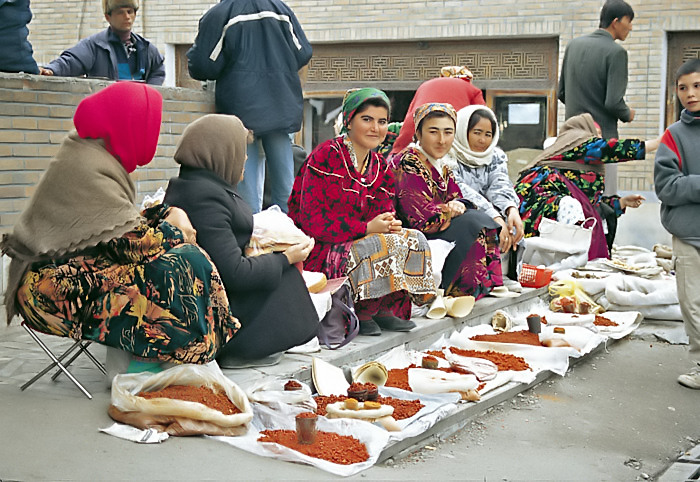
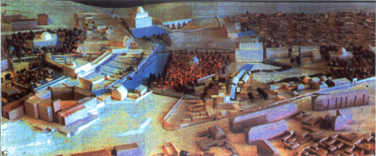
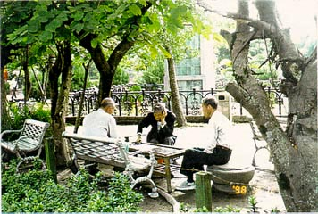
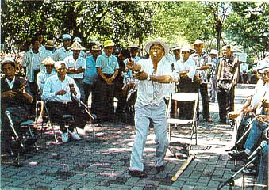
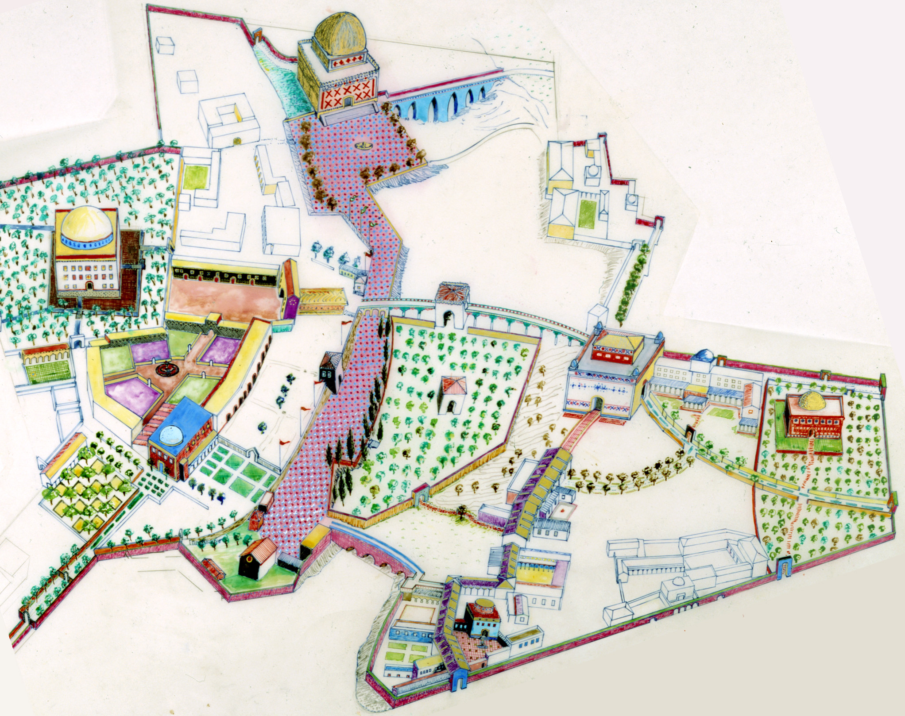

## Uzbekistan, Samarkand

A new city center, re-vivifying modern feelings and ancient values in modern form

## Project history

The Aga Khan fund invited architects to take part in a competition, to define a new city center for the ancient city of Samarkand -- especially since the beauty of the ancient city had been brutalized by Soviet construction.

## Points of special interest in this neighborhood

**Ancient parts of Samarkand**

**Below, view of our proposed new City Center for Samarkand**

Various places comprising our proposal for the new Samarkand city center, in a derelict valley between the ancient Timurid sites. Below is an overview showing many new public buildings, including a mosque, a hospice, a school, an observatory, an orchard, a bridge, a theater, a craft-school, a bazaar, small hotels, a music school.

It should be noted that the [generative sequence](samarkand.md), in this instance, took a very simple form -- it contains **only** a list of elements, without further elaboration. This may seem something short of "generative," but it is important to remember that the environment of a place is very much defined by the list of entities which are built and repeated there. In this case of Samarkand, the rather exotic list of entities which appear in both versions of the generative code (see below) speaks volumes about a very special kind of place, also visible in the large colored drawing. **The living character this place has comes about largely because of the list of elements**.

In similar fashion, if someone lists the entities they want in a place, the list of entities **alone** will often go far to define a very large portion of the environment that is generated.

*The seemingly odd (and archaic) layout of this plan (shown above), comes from the direct application of the generative sequence. It has the effect that each important building is placed to be the focus of a well-shaped spatial center.*

Further discussions of the two generative codes for Samarkand

[First generative pattern sequence for the stepwise conception and layout of the new Center of Samarkand](samarkand.md) 3 pages

[Second generative pattern sequence](samarkand.md)

## The poem

I wrote the following ‘‘poem’’ — a list of partially formed centers — at the very beginning of our work on the Samarkand city center, almost the day we began, long before we had worked it through.

**1. It is a sequence of public squares, gardens, and buildings, which will form the new center of the city of Samarkand, uniting historic and traditional buildings and quarters.**

**2.** **There is a new dimension here, a center of spiri­tual life. It is not a commercial center, not a cultural center, not a religious center in the old idea. It is not a convention center. Somehow, this new center of the city of Samarkand, unites old and new, weaves to­gether the thread of the silk road, the tomb of Timur the Great, with the modern world, and a vision of the world in which comfortable human concern, and a spiritual awareness of the importance of life, is vis­ible, felt, and active.**

**3.** **It is an inspiring place to go. A place of pilgrimage, which will receive visitors from the five continents, in increasing thousands.**

**4.** **A network of beautiful paths, formed by columns, colonnades, brick walls, buildings, gardens. This network of paths, which passes across the whole area, is formed by the building masses which arise out of it, and by formal gardens.**

**5.** **Do the paths open into courtyards, ponds, gardens, hidden places? Are they formed only by mysterious buildings, rising in color, tile, and marble? Are there figures, statues, animals, Gods, people, statues stand­ing at the places where the paths cross?**

**6.** **Are the animals themselves covered with mysteri­ous animals?**

**7.** **Is there any reference to voyages?**

**8.** **The main thing one is aware of is a network of green and beautiful jewel-like streets. Each has lush trees, seats, platforms, streams.**

**9.** **These green streets, made by their trees, benches, sitting platforms, and edges, form a lacework of places to walk. They are like parks, long and nar­row, you can explore for many hours, walking around these streets.**

**10.** **Each one of the streets arrives on some new trea­sure. Each building is like a treasure, arrived at by the green streets.**

**11.** **Samarkand, historically, and in the time of Ulugh Beg, was a crossroads of the world. In the Tang dynasty period, every conceivable exotic sub­stance, or idea, or artifact, or art on earth, came through Samarkand. No matter where it went, or where it came from, it went through Samarkand.**

**12.** **Somehow, then, one may imagine these green heavenly paths, as a network—almost a mythical bazaar in which reference to these many exotic sub­stances exists.**

**13.** **The blue tile work of the Timurids, the hand-painted blue tiles, with small black, yellow, and white detail, on mud brick—these tiles, and the yel­low bricks are in evidence on walls, domes, court­yards throughout the center. It is a thread which connects.**

**14.** **The whole network of paths is almost like a forbidden city. A place which is walled, punctured at very occasional places which allow one to enter, a special area that contains its own magic.**

See what the poem generated

## The first pattern list

This was the second list I wrote for the project. After trying to understand the system of patterns as a whole, and as we worked on it, the list was then transformed as a whole to modify the global feeling and content of what this place was going to be — as it matured in our under­standing. We kept on thinking of the *whole* way of life which would be created by these patterns, and then changed the patterns, intensified them, improved them, made the centers more explicit, as our understanding of this whole increased. We kept on working at it until the living whole revealed itself, as fully as we could manage, in the list of centers. After much more work, the list — or pattern language — for the project ended up with the following centers: Note, the earlier statements are written in the active form, in italics, which sketches the content of each possible center. The second, longer list which follows is given in small capital letters, to indicate  that by this stage the ideas had materialized and solidified as *centers*— as potentially solid objects which were reliable and recognizable as entities.

the main bridge

the forbidden city

massive surrounding wall

the festival promenade

view to registan

the observatory

the orchard of peach trees

main terrace

 outdoor theater

craft school and bazaar

 the inner city

small hotels

walled path

music school

inner city gate

five small walled gardens

chaikhanas

main street from the registan

fountains and streams

exhibition hall

covered bazaar

the library

the manuscript museum

arched bridge

soccer and games

wall of arches

gates in the outer wall

the hospice or kulliye

inner part of the forbidden city

blue-tiled walks

the mosque

The lower photograph shows the model we made for the project, on the basis of this pattern language.

This example gives an idea of the vital role which generic centers can play in creating a whole. In this example these centers, *the list alone*, creates an almost magical atmosphere. As soon as we name them, *just from naming them*, we begin to feel the aura of the place. The patterns are evoca­tive. It doesn’t even matter in what order we take the centers. The mere list, itself, already conveys a profound atmosphere, and defines, in great de­gree the atmosphere of the place which will be made up of these centers. It creates the atmo­sphere right away. It is these centers which play the defining role. In Book 3, chapter 4, I show a drawing I made with my apprentices to show the physical character of this system of centers when they are realized.

## Blow-up of the drawing

A blow-up of the Samarkand drawing, showing more detail of the individual structures

*From* Building Living Neighborhoods *by Christopher Alexander, Maggie Moore Alexander, Randy Schmidt and Nick Littlestone, with Bev Behrman and Howard Davis. © Center for Environmental Structure. [Original page](https://www.livingneighborhoods.org/ht-0/samarkand.htm).*
