## Colombia, Santa Rosa de cabal

## Families building their own houses for themselves

This page is dedicated to our volunteers who gave their own time freely to help the people of Santa Rosa: Jeanie Radcliffe, Fanta Lawrence, Ingrid King, Seth Wachtel, and Kleoniki Tsotropoulou

## Project origins: the not-so-good, old way

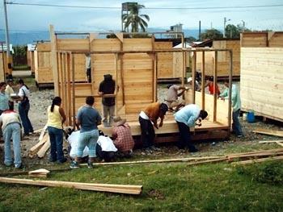

Colombian families working together under Construyamos to nail together each identical house as a very tiny standard box.

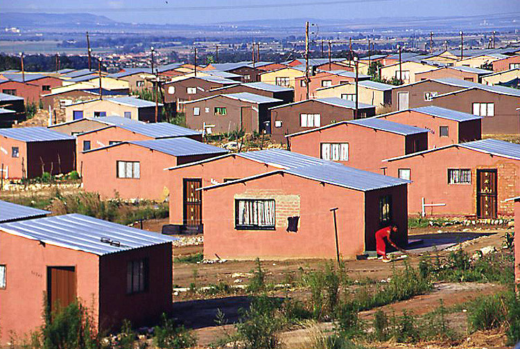

What the resulting "communities" of shacks look like -- this example from Soweto in South Africa.

Originally our project in Santa Rosa started as a neighborhood for 70 families in the inland mountains of Colombia. We were asked to do it by Construyamos, one of the largest self-help housing cooperatives in Latin America, with an excellent track record of building mass-produced, low-cost housing. Their usual plan of action was to have eighteen families at a time, forming a group. An architect would draw up a standard small house plan (a modular shack, almost), repeated eighteen times, identically repeated. The families would work on all the houses together at the same time, by a kind of people's mass production. But no one knew which house was going to belong to which family. When the houses were all finished, the houses were assigned to the families by drawing numbers out of a hat.

This was supposed to make sure everyone worked hard on all the houses equally; what it accomplished, more often, was an alienated feeling of creating a commodity, separated from the feeling of the families.

## Our project with construyamos: a better way

When we began working with Hernan Mesa, the head of Construyamos, we persuaded him that we would manage a different process, in which the seventy families would lay out their neighborhood together; and we taught them, afterwards to lay out their individual houses, and then got them built, sometimes by self help, sometimes by paying masons and carpenters to help them. In short, with management by our volunteers, we taught the seventy families to build a neighborhood for themselves, in the mountains of central Colombia.

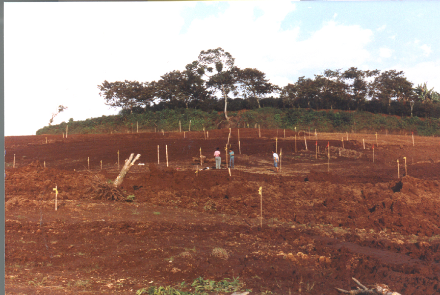

First making the community plan, on the site itself, with stakes, and then laying out corner stakes for each lot with the families themselves.

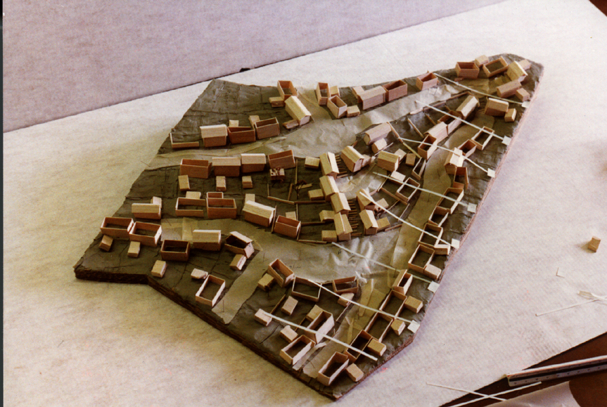

Then making a model of the whole on a map of the topography, to try and understand, in principle, how the neighborhood might be configured.

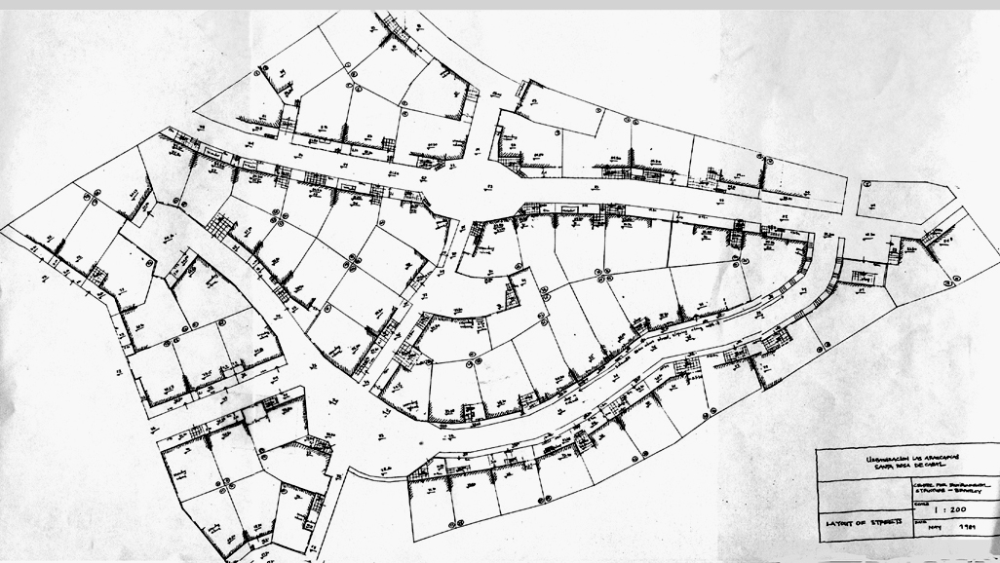

Then finally surveying the positions of each stake, making a formal drawing of the stake positions, and submitting the drawing to the building department of Santa Rosa.

## Starting to prepare the land

*Hillside, showing Santa Rose families working to lay out their streets and houses.*

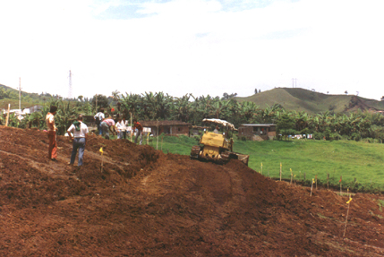

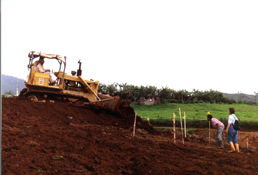

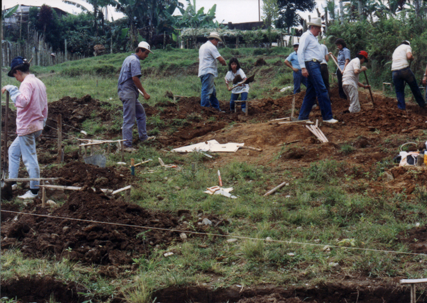

## Plans and designs made by the families

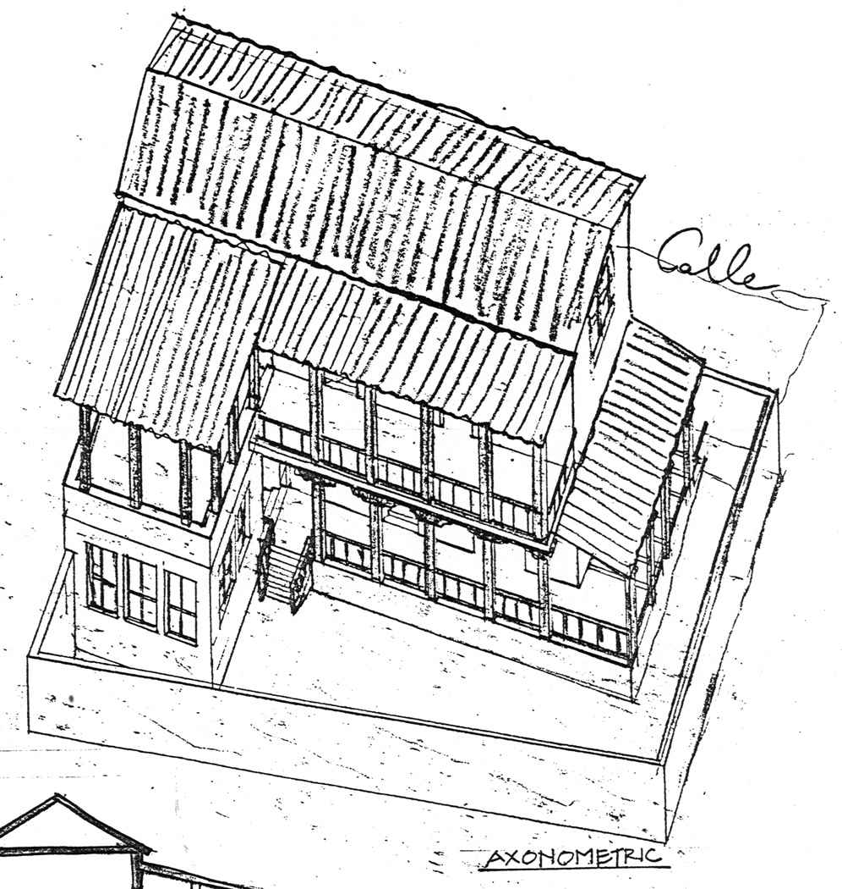

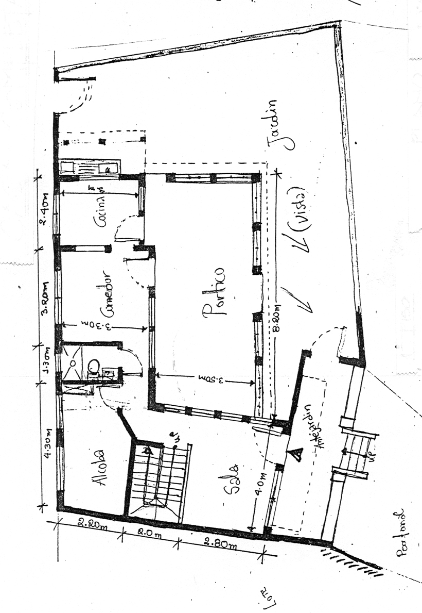

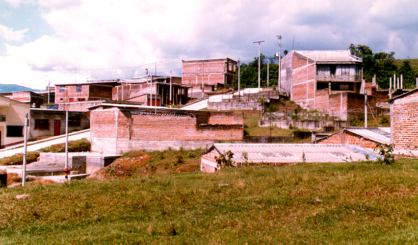

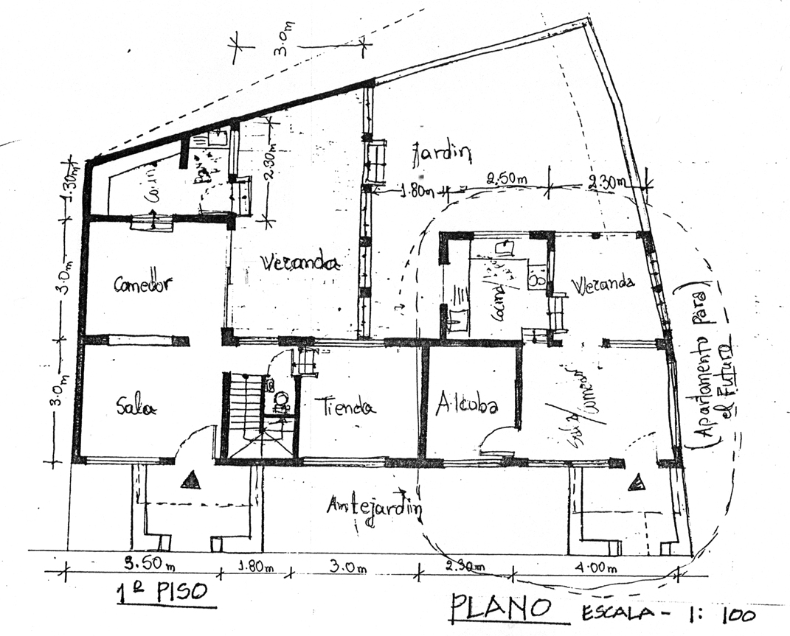

A typical house plan, drawn with assistance of a draftsperson, but still reflecting the informal quality which comes about when family people lay out and label houses for themselves. Such drawings were prepared for each of the seventy houses, and these drawings were accepted as sufficient documentation, by the Santa Rosa Building Department

## The neighborhood, still growing and evolving

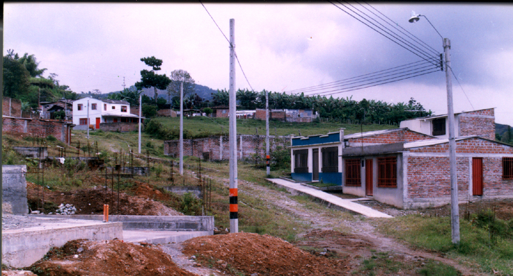

An area with small private houses, whitewashed, plain, painted blue, some with entrances on the street, others set back with land in front.

Looking up the hill towards the central space and the crest of the hill. There are workshops, houses, small houses for those who had not much money, larger houses, some houses quite idiosyncratic according to the special life of different families.

**It is rough and ready, but it is human, real life, unexpected in every pore, a real place..**

## Discussion of the Santa Rosa generative code

See [Excerpts from the Santa Rosa Generative Code](../assets/library/srgc.pdf)

and

*From* Building Living Neighborhoods *by Christopher Alexander, Maggie Moore Alexander, Randy Schmidt and Nick Littlestone, with Bev Behrman and Howard Davis. © Center for Environmental Structure. [Original page](https://www.livingneighborhoods.org/ht-0/santarosa.htm).*
