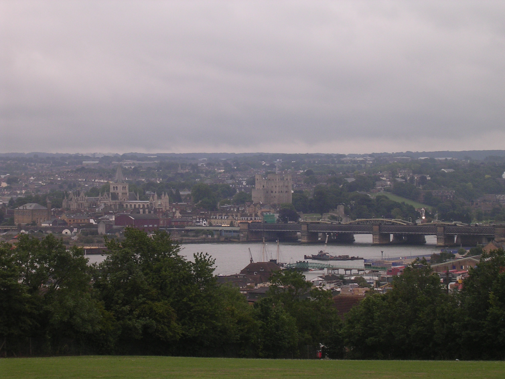
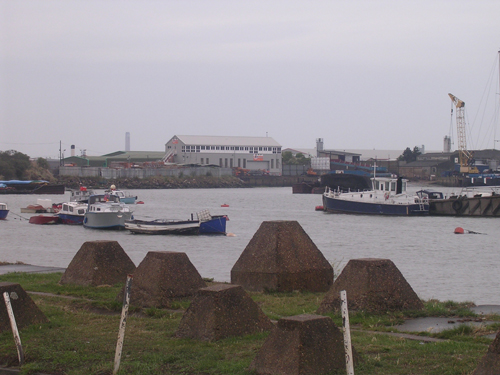
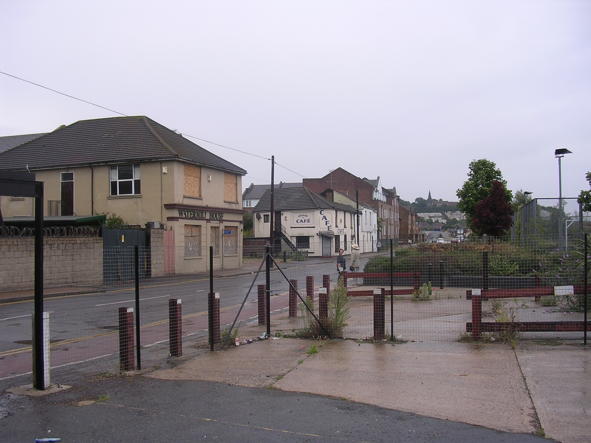
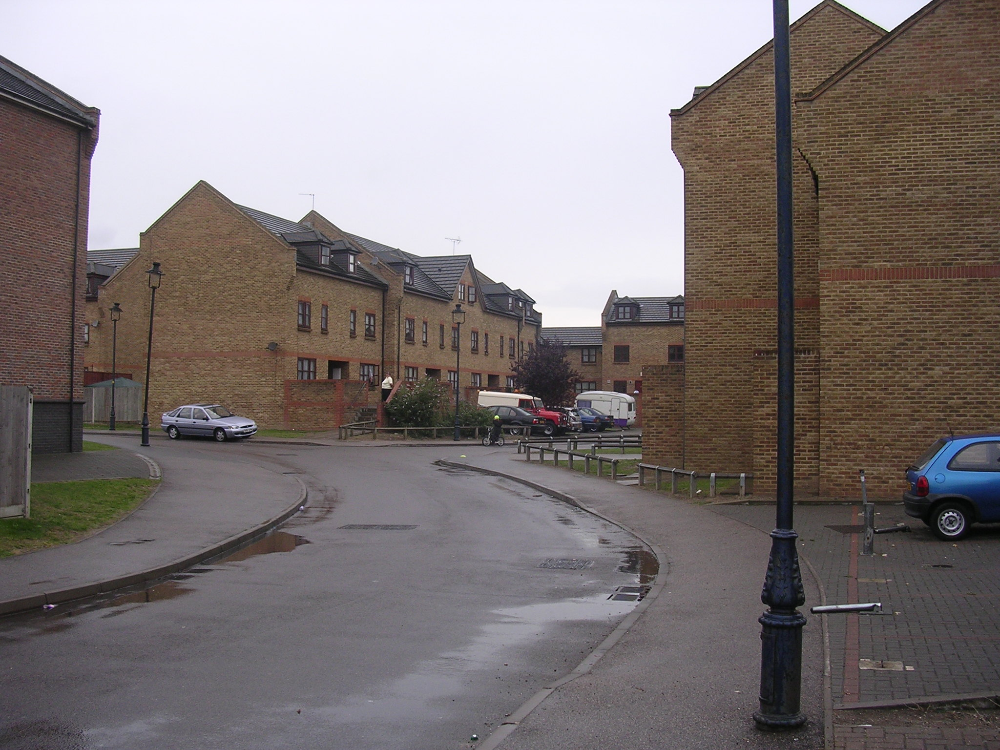
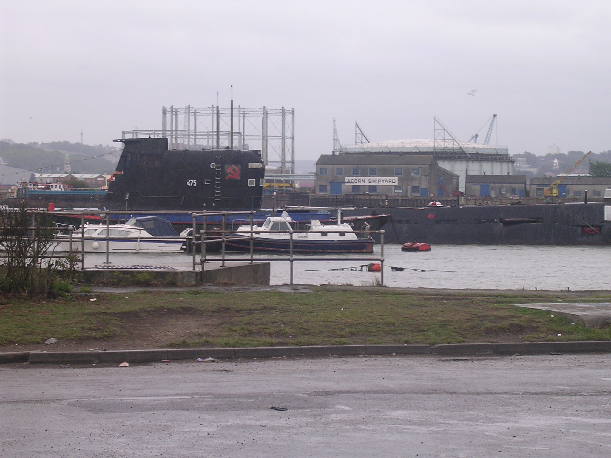
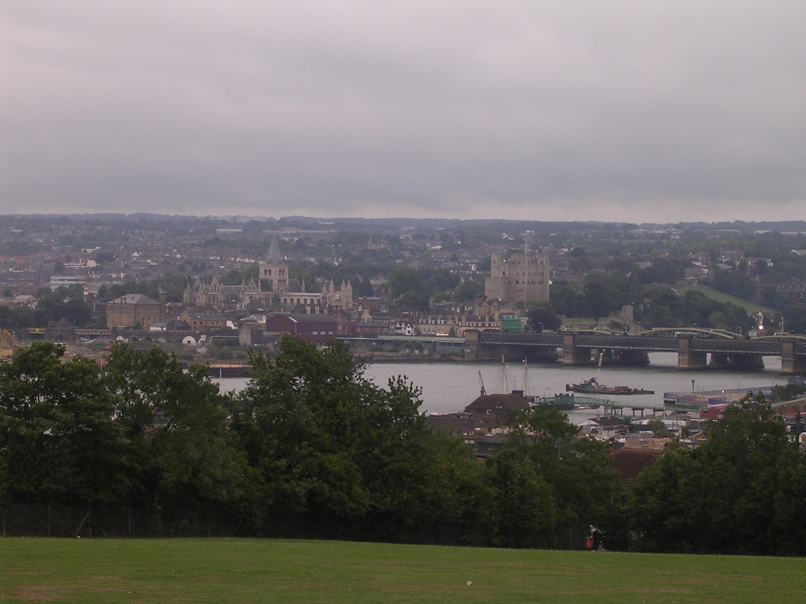
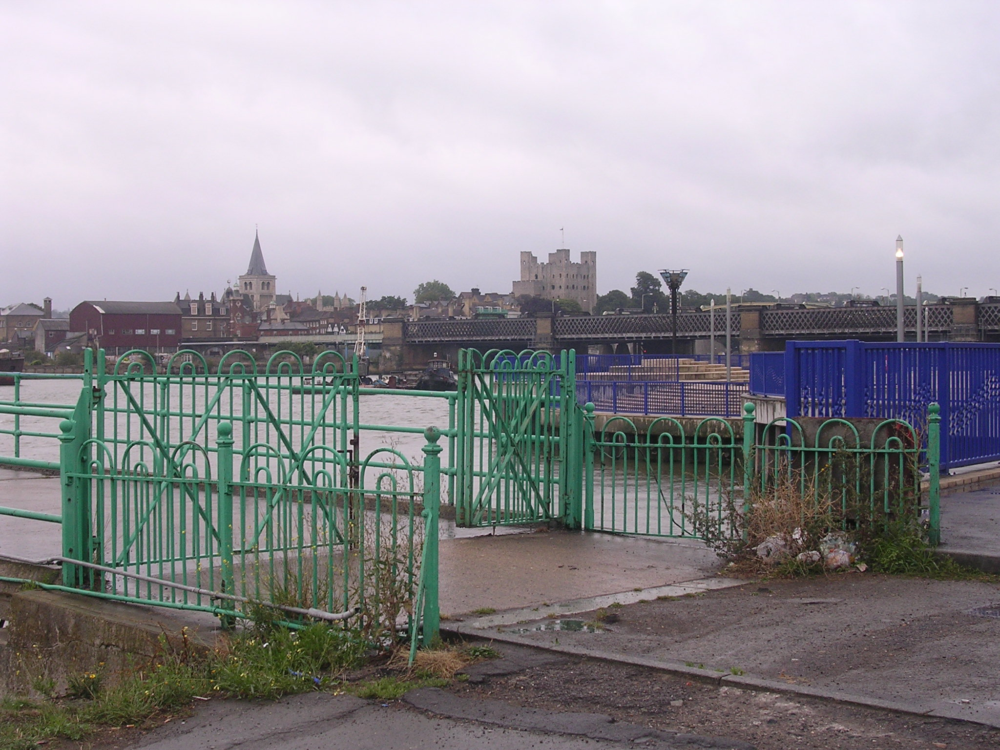
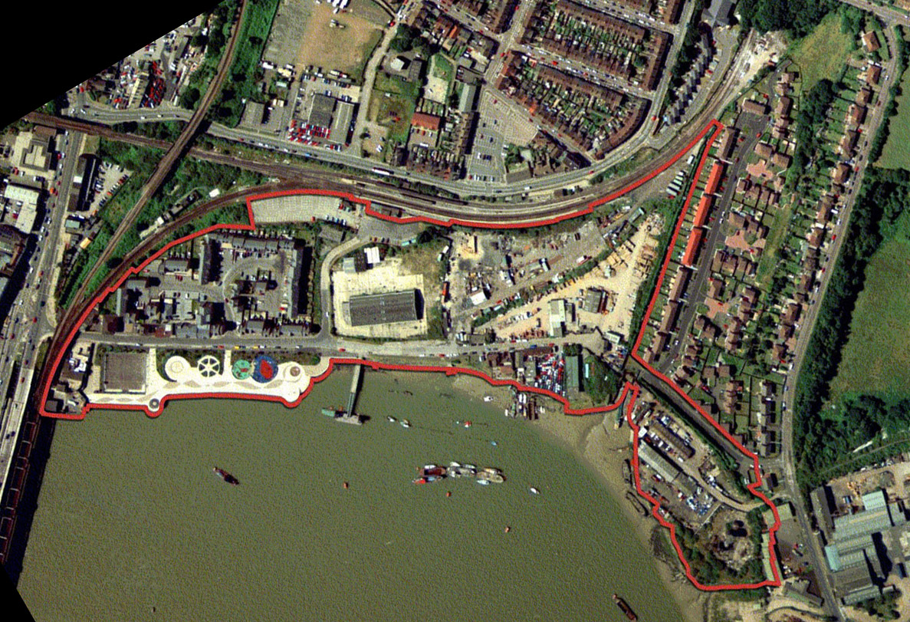
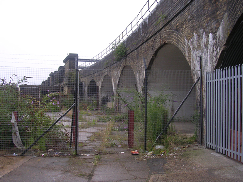
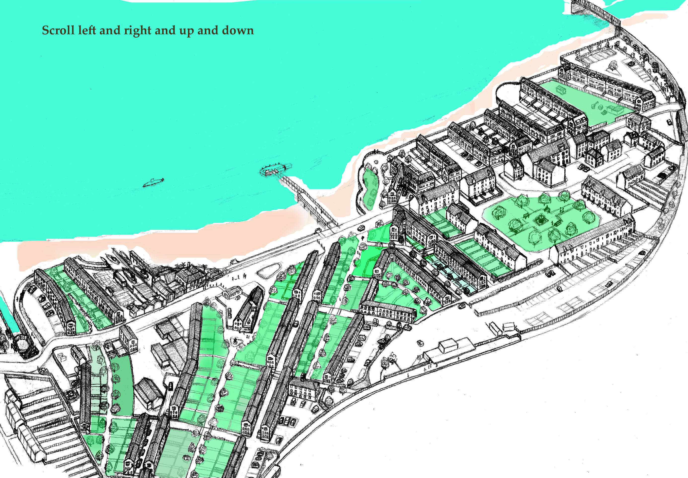

## ENGLAND, near LONDON,   STROOD RIVERSIDE

## Project history

Strood is a town in Kent, on the river Medway, just across from the ancient town of Rochester. A neighborhood on the north bank of the river, locally known as Strood Riverside, is about 7 hectares. It consists, at present, of broken down industry, a few houses, an old and very nice pub, Strood railway station, and a number of small businesses, and some poorly built social housing from the 1950s. The area has been earmarked for redevelopment by Medway council.

**The present area of Strood Riverside, and views across the Medway towards Rochester**

**POINTS OF SPECIAL INTEREST IN THIS PROJECT** One of the most startling aspects of the project, was the assumption made by Medway Council, that they would clear the site, and sweep all existing businesses away, so as to give an incoming developer a tabular rasa for profit making in a monoculture of housing only.

It was our considered opinion, after talking to various small business owners (including a boat builder, a crane driving business, a tire-shop, automobile repair, the Tavern, a small construction company), many of whom were threatened with the end of their business lives if swept away, were an essential and necessary part of the community which was to be built, and our views on the code, and on the plan as we developed it, was that these businesses had to be viewed as the nucleus of the new community, and had to be allowed to keep the space they had previously occupied.

The social difficulty of convincing both the council, and the financing companies of this approach was considerable. However, we believe it imperative to stop destroying communities all over the world, because the mix of uses is not convenient to rapacious developers.

Above: Aerial photograph of the strood riverside area.  Right: railway arches on the western boundary of the site. **Below: Bird's eye view of the whole Strood Riverside neighborhood, as proposed by us.**

## Further discussions of the generative code for Strood

[First generative code for the stepwise conception and layout of the new Strood Riverside neighborhood](../assets/library/stroodcode-v13.pdf) 3 pages

[Second version generative code for Strood, showing the sequential unfolding of the neighborhood plan from this code.](../assets/library/stroodunfolding-v19.pdf)

Below, the project we prepared for Medway council. The organization of the site favors pedestrian layout, includes very substantial green common areas between houses, abundant views directly to the river. Houses are arranged in long frontage cottage buildings, with excellent light and sunlight. The various businesses existing now are (with only one exception) included in the layout seemingly odd (and archaic) layout of this plan (shown right), comes from the direct application of the generative sequence. It has the effect that each important building is placed to be the focus of a well-shaped spatial center.

## Strood neighbourhood-making

## An example

This is a bird's eye view of a new plan for a brown field site in Strood, Kent, 30 miles southeast of London. In this view, we are looking south toward the river Medway. The plan shown, which includes about 400 houses (300 new and 100 refurbished), has been created with generative codes. More information about how this was done is given in [Generative Code for Strood Riverside](../assets/library/stroodcode-v13.pdf) and [Unfolding of Strood Riverside](../assets/library/stroodunfolding-v19.pdf), also found on the Work Plan page.

To build such a place, the development process requires a new form of planning, procurement, and project management that is capable of placing human values and people's feelings and affections ahead of money and mechanical efficiency. **It does not cost more**.

For a detailed explanation of this new process, see the [Guide to Process and Implementation](../running-a-project/main-steps-of-work.md)

## Bird's-eye view of Strood (filed as Sheffield)

A bird's eye view of a new part of Strood, in Kent, looking south towards the river Medway This plan, which includes about 400 houses (300 new and 100 refurbished), has been generated by the process described in the documents and articles listed in the archive under Neighborhood. The process requires an entirely new form of planning, procurement, and project management, which is capable of placing human values and people's feelings ahead of money and mechanical efficiency. It does not cost more. It costs less. Please work with us to help generate a sustainable England based on ordinary people's feelings and affections, and on forms of management and morphogenesis which can create beautiful buildings and greens, and paths and gardens. [Please CLICK HERE to send us an inquiry by email, if you would like to consider working with us or to receive information](mailto:neighborhoods@patternlanguage.com)

## The unfolding movie (applet no longer runs)

**THERE ARE 34 STEPS IN THE UNFOLDING. WATCH THESE STEPS AND STUDY THE UNFOLDING**

*To control the playback yourself,*

very slowly mouse-over the list of steps below to view the unfolding at your own pace.

-    **The code itself follows:**

If you prefer, you may also make the computer run the playback of the unfolding automatically, by

***clicking this link*. You can then see the rhythmic step-by-step unfolding dynamically. *While the automatic is running, keep the cursor on the right hand side of the screen, or it will not run at all.*.**

**CREATING THE LAYOUT OF THE STROOD RIVERSIDE NEIGHBORHOOD BY UNFOLDING** Set screen to full view (F11) for maximum enjoyment. In order to get the maximum benefit from this demonstration, you must manipulate the two scroll bars so you can see the instruction on the left, and the full wording of the caption on the right. **In addition it is important to keep going back and forth from one step to the previous step a few times until you understand exactly what happened in that step.**

*From* Building Living Neighborhoods *by Christopher Alexander, Maggie Moore Alexander, Randy Schmidt and Nick Littlestone, with Bev Behrman and Howard Davis. © Center for Environmental Structure. [Original page](https://www.livingneighborhoods.org/ht-0/strood-riverside.htm).*
