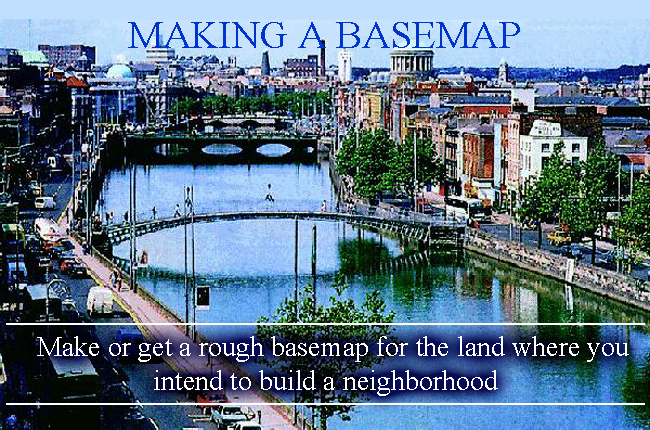
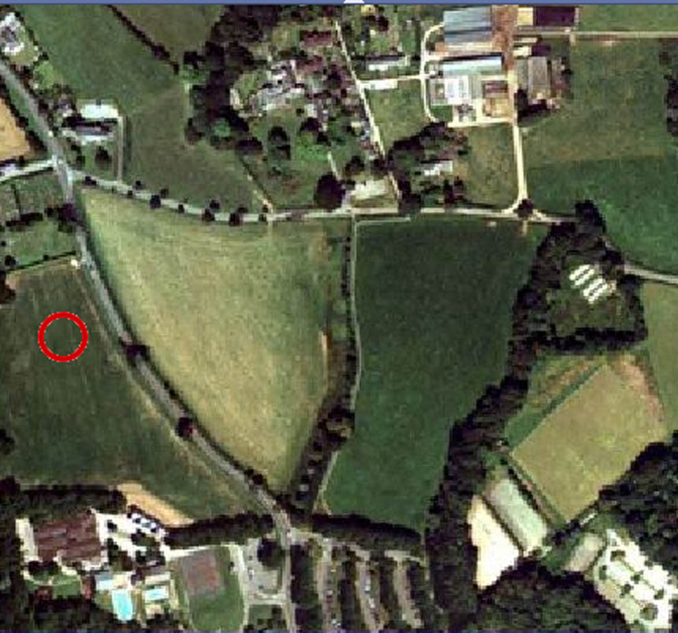
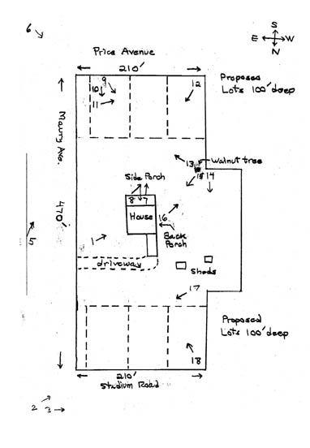
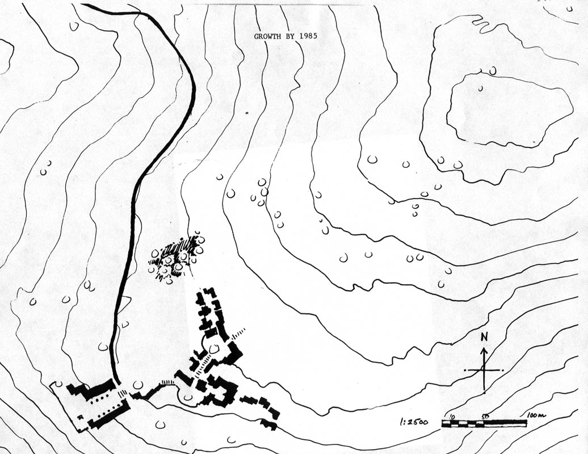
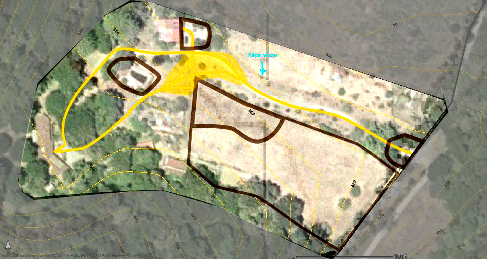
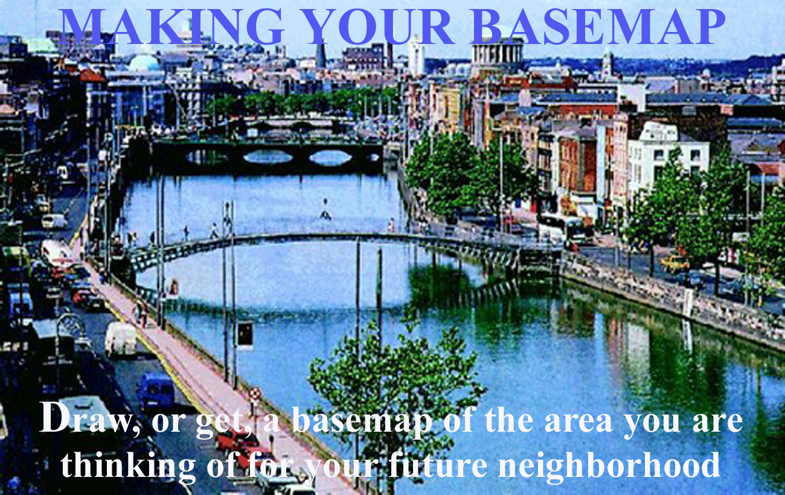

This unfolding needs you to DRAW. After reading and thinking about your best course of action, go to the DRAWPAD. Link is at bottom of page.

 Example 1: An aerial photo downloaded from the web

Example 2: A map sketched by a client

 Example 3: A base map made professionally by a surveyor

 Example 4: A more elaborate base map consisting of an aerial photo with portions of an ordinance survey superimposed upon it.

## Why you need a base map

Wherever you are - whether it is in a city, small town, or wide open spaces - it's essential to understand the physical attributes of the place. This is the base from which to unfold the whole. To achieve successful unfolding of your neighborhood design, you will need to make a sequence of drawings, each defining one aspect of the whole, as it unfolds. These drawings will need to be made on a semi-accurate Base Map that is roughly to scale. To create such a map, you can:

find and download or copy an aerial photograph or map from the internet;

sketch a rough freehand map yourself; or

have the land surveyed professionally.

You can use these approaches in combination as well. If you have no other way to do it, at the very least, make a rough pencil sketch of the land on an ordinary sheet of paper and take it to a place where it can be scanned. Have a .jpg file made of it. Then you can use the physical sketch as an underlay of your work.

If you have no other way to do it, at the very least make a rough pencil sketch of the land on an ordinary sheet of paper, take it to Kinkos or any other place with a scanner, and have them make a jpg of it. Then you can use the physical sketch as an underlay of your work, and use the jpg in your computer.

However you choose to obtain the Base Map, make a folder on your computer where you will keep all the files related to your project, and store the map there as a .jpg file. Also keep this Base Map in your workbook.

## Aerial photos make the best basemaps

Example 1. FIND AN AERIAL PHOTO OR MAP OF THE LAND WHERE YOUR NEIGHBORHOOD WILL BE

You can get aerial photos or maps from many suppliers. For instance, in the United Kingdom, Multimap covers the whole country, and it is free. You can simply blow up the area you are interested in, use printscreen on the computer, and then save the image (in Photoshop or other image processor) as a .jpg file to the folder you have chosen. You can get good aerial photos from many suppliers as well. In the United Kingdom, Promap also covers the whole of the UK, and one aerial photo costs £7 [promap](http://www.promap.co.uk/promap/products.jsp). Again, save your photo as a .jpg file to the folder you have chosen. Comparable services exist in most countries.

When the Drawing Pad on this website is operational, you will be able to select the maps and photos you have gathered in the folder on your computer, and use them in the Drawing Pad to create unfoldings.

In the meantime, these images can be used beneath tracing paper so that they guide the unfoldings you use to design your neighborhood.

**WHY DOES AN AERIAL PHOTO MAKE THE BEST BASEMAP?**

The essence of the lessons to be learned from the processes explained and defined on this website, is the fact that each neighborhood unfolds from the reality of the land and buildings which already exist. This unfolding, is a kind of adaptation - and the adaptation only works to the extent that you have direct and realistic access to the configurations and features that are on the land, or in the surrounding streets, the trees, the contours, the slopes, the views.

There is no map which does this as well as the place itself, with its sights, and sounds, and palpable physical reality. However, of the available choices, an aerial photo comes closest. From looking at an aerial map, you know the space between this building and that oak tree. You see existing tracks in the land, and walls, for instance, that are usually not shown on commercial survey maps.

All in all, with an aerial, you have the biggest chance of being able to feel , with your intuition and feeling, the actual spaces and distances and qualities that exist on the land. And you are then most able to draw things, or make things, that really and truly fit the land.

Even then, any map, because it is only 2-dimensional has huge shortcomings. If this project is a real one, we recommend that ultimately, you repeat the process using a three dimensional contour map with all trees, and buildings. That will give you an even better feel for what is appropriate, and what most truly unfolds from the existing configuration.

**IF YOU DECIDE TO USE A DRAWING INSTEAD OF A PHOTO, AS A BASEMAP, YOU HAVE SEVERAL OPTIONS**

Example 2. SKETCH A SITE MAP YOURSELF

As you see in Example 2 on the left, for a small piece of land it is not difficult to make a small drawing, freehand or hard-line, by pacing off distances, and measuring key features. This is not ideal, because it gives you less information about trees, views, and the character of other nearby buildings, but it is serviceable, and useful. **The important thing is that it can get you started very quickly.**

## What needs to be on the drawing

Here are the things you need on your drawing.

The drawing should be made at 1:200 scale, or 1/16th inch to a foot.

On an A4 sheet, at this scale you will have room for a piece of land about 200 feet long and 150 feet wide. If your land is bigger, draw it at a smaller scale.

You must put a scale on the drawing, so you always know how big the things are, that you are drawing.

Include buildings, and physically built features on the site.

Include major trees with trunk position, including the approximate size and position of the crown.

Include existing paths and driveways.

**Example 3. HAVE THE LAND SURVEYED PROFESSIONALLY**

It is not always easy to get this kind of map from a surveyor, since the items that should be on the map are very specific, and not typical. In addition to the items necessary that are listed above, ask for:

Contours should be shown at 2-foot intervals.

Steps and ramps should be shown.

The drawing is to be provided as a computer file.

One version should include the contours and

You will need another version without the contours.

You will need one print at full size, 1:200.

You will need another file that allows you to print the whole thing on an A4 or 8½" x 11" sheet, with a graphic scale. A small, accurately scaled sheet like this is invaluable for drawing the result of a diagnosis for a possible arrangement of house positions, or later more refined steps of unfolding.

Some of these items may be charged at what seems to you an unnecessary amount. So, before starting you should negotiate the total price of the survey and make it reasonable in price while giving you the essentials. An "essential" is any feature that is likely to play a physical role in the layout you make, and therefore must be known in regard to size and position. You can save money by simply leaving out the minor features that are unlikely to enter into your design.

**Example 4. IT IS ALSO POSSIBLE TO COMBINE AN AERIAL PHOTO WITH A PROFESSIONAL SURVEY AND CONTOUR MAP.**

A person who knows their way around computers, can easily make a more complex basemap, combining an aerial photo with semi transparent roads and others features from a survey map.

## Summary of tasks for this unfolding

- Get or make a Base Map in one way or another.

- Include all required information as listed above, as you will need this as your design unfolds.

- If the Base Map is not already a digital file, have it scanned at a high resolution. Store it on your computer and in your workbook.

- Keep the digital Base Map where you can store other files that relate to your project.

- When the Drawing Pad is operational, use it to import your Base Map. This will be the basis for all further drawings.

  [Go to DRAWING PAD to enter an aerial photo or other basemap into your computer file](../../tools/drawing-pad.md)

## Shorter earlier version, kept for its differences

 Example 1: A hand-drawn base map

 Example 2: A base map downloaded from the web

 Example 3: A base map made by a surveyor

 Example 4: A more elaborate base map made by one of our clients

## Why you need a base map

In order to achieve a successful unfolding of your neighborhood design, you will in due course need to make a sequence of drawings, each defining one aspect of the whole, as it unfolds. These drawings will need to be made on a semi-accurate base map that is roughly to scale. To get such a map, you can draw it yourself, or get it off the web, or have someone make it for you. You may get such a map (1) by sketching a rough freehand map by yourself, (2) downloading or copying an aerial photo or a map of the area from the internet, or (3) having the land surveyed professionally. You can also use these different approaches in combination.

If you have no other way to do it, at the very least make a rough pencil sketch of the land on an ordinary sheet of paper, take it to Kinkos or any other place with a scanner, and have them make a jpg of it. Then you can use the physical sketch as an underlay of your work, and use the jpg in your computer.

## What needs to be on the drawing

Here are the things you need on your drawing.

The drawing should be made at 1:200 scale, or 1/16th inch to a foot.

On an A4 sheet, at this scale you will have room for a piece of land about 200 feet long and 150 feet wide. If your land is bigger, draw it at a smaller scale.

You must put a scale on the drawing, so you always know how big the things are, that you are drawing.

It should include buildings, and physically built features on the site.

It should include major trees with trunk position, including the approximate size and position of the crown.

It should include existing paths and driveways.

## Example (1) sketching it yourself

If you look at the frist example Here are the things you need.

The drawing should be made at 1:200 scale, or 1/16th inch to a foot.

It should include buildings, and physically built features on the site.

It should include major trees with trunk position, including the approximate size and position of the crown.

It should include existing paths and driveways.

Example (2) downloading or copying an aerial photo or a map from the internet

Here are the things you need.

The drawing should be made at 1:200 scale, or 1/16th inch to a foot.

It should include buildings, and physically built features on the site.

It should include major trees with trunk position, including the approximate size and position of the crown.

It should include existing paths and driveways.

## Example (3) having a surveyor do it

It is not always easy to get this kind of map from a surveyor, since the items which should be present are very specific, and not typical. Here are the things you need to ask for.

The drawing should be made at 1:200 scale, or 1/16th inch to a foot.

It should include buildings, huts, and physical built features on the site.

It should include all trees with trunk position and tree type, including the approximate size and position of the crown.

It should include all existing paths and driveways.

Contours should be shown at 2 foot intervals, and steps and ramps should be shown.

Some of these items may be charged at what seems to you an unnecessary amount, so before starting you should negotiate the total price of the survey and make it reasonable in price while giving you the essentials. An "essential" is any feature which is likely to play a physical role in the layout you make, and must be known in regard to size and position. You can save money by simply missing out the minor features which are unlikely to enter in to your design.

## A few important details

Ask for the drawing to be provided as a computer file.

Ask for one version to include the contours and another without the contours.

Ask for one print at full size 1:200.

Ask for another file which allows you to print the whole thing out on an A4 or American 8.5 x 11 sheet, with a graphic scale. A small, accurately scaled sheet like this is invaluable for drawing the result of a diagnosis, of a possible arrangement of house positions, or later more refined steps of unfolding.

---

← [Vision](vision.md) · ↑ [Phase 1: Startup and vision](index.md) · → [A poetic pattern language](poetic-pattern-language.md)

*From* Building Living Neighborhoods *by Christopher Alexander, Maggie Moore Alexander, Randy Schmidt and Nick Littlestone, with Bev Behrman and Howard Davis. © Center for Environmental Structure. [Original page](https://www.livingneighborhoods.org/actions/basemap.htm).*
