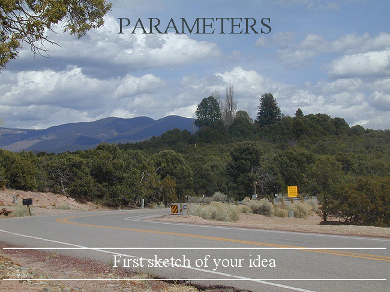
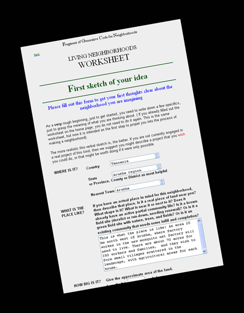
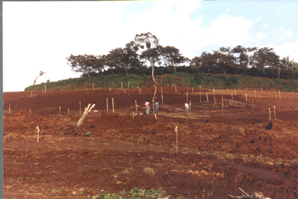
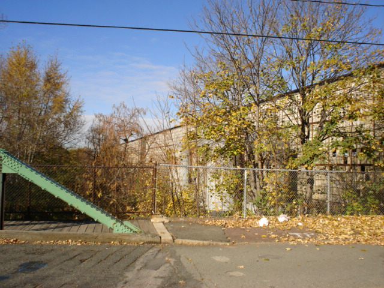
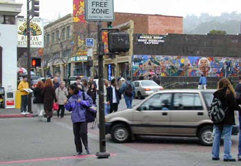
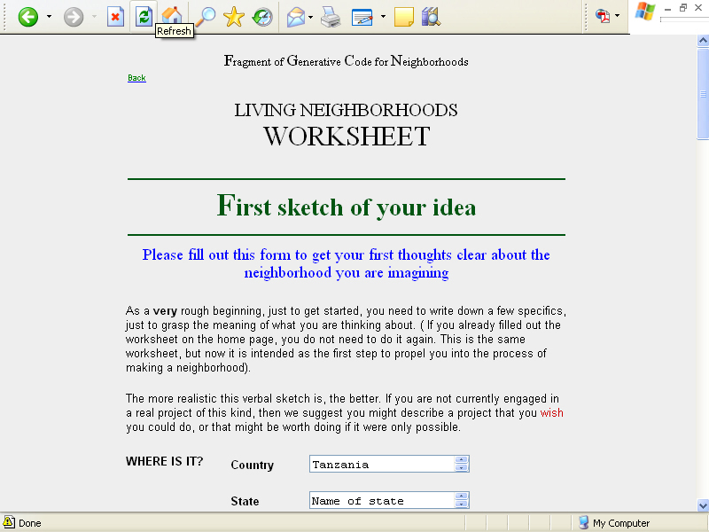

## Please fill out this form to get your first thoughts clear about the neighborhood you may be imagining

Below you will find pictures of some of the kinds of places where your neighborhood might be. It makes a difference, because according to these circumstances, you need a different approach to making the neighborhood

 Greenfield site

 Brownfield site

 Infill urban

As a **very** rough beginning, just to get started, write down a few specifics, to grasp the meaning of what you are thinking about.

The more realistic this verbal sketch is, the better. If you are not currently engaged in a real project, then we suggest you might describe a project that you **wish** you could do, or that might be worth doing if it were only possible.

## Where is it?

Country

State               or Province, County or District as most helpful

Nearest Town

## What is the place like?

If you have an actual place in mind for this neighborhood, then describe that place. Is it a real piece of land near you? What shape is it? What is near it or next to it? Does it already have an active partial community life? Is it a brown field site (derelict or run-down, needing renewal)? Or is it a green field site with nature, trees, and fields? Or is it an existing community that needs some infill and completion?

## How big is it?

Give the approximate area of the land. Length: It is yards long Width:   It is yards wide. Area: The total area is roughly acres

If you prefer metric, use these boxes. Length: It is meters long Width:   It is meters wide. Area: The total area is roughly hectares

What will it be like in the new neighborhood?

Give a thumbnail sketch of the character of the place you hope to create. Imagine, in your mind's eye, a kind of neighborhood, or small community, where it would be fun to work, live, enjoy yourself. Choose it so that it really appeals to you and as far as possible, all the people you are speaking for. Don't worry about money; for now, just assume that the money will be forthcoming.

## How many people?

How many people (roughly) may be working and living there? If you don't know, make it up. This is to give you a realistic intuitive feel for the place, and what it might be like as a community. less than 10 less than 30 30-150 200-1000 more than 1000

## How many buildings?

Guess roughly how many buildings might be there when it is finished? Just make this up, intuitively. Don't try to calculate. less than 5 5-10 10-50 more than 50 more than 200 more than 1000

## How much public open land?

How much public open land, public gardens, and public streets will there be when it is finished? Write it as a percentage of the area of the whole neighborhood: 10% 20% 30% 50% or more more than 75%

## Real or imaginary?

Is your project a real project, an entirely fictitious project, or half and half? A real project Entirely made up Half and half

## Your name?

Please write your name, so we know who you are:

## Your e-mail?

Please give us your e-mail address, so that we can communicate with you to hear about your experience on the website. This will be of great help in our effort to make the website work better for you.

## When you have filled out this form, press the submit button. You will receive a copy of it via email for your file.

Then go on to the next step in the unfolding process.

By answering these questions, a very vague picture will have begun to develop in your mind. If you have submitted the form, a copy of your form will go back to you, so you will have a record of what you sent, and a copy will also be emailed to us. When we receive it, we will contact you by email to see if you would like to talk about your initial work. This will allow us to refine the website, and make it more useful. So please do fill it out!

## The worksheet itself

## Worksheet

Whatever it is you are thinking of working on, try to express the dream that lies behind it

**We suggest that you make a copy of this page (select *all*, then *copy*) then paste the page into a blank word file and save it somewhere convenient. In this file, you can use the questions to clarify your ideas about your project, write your own thoughts and comments against the various questions, as you wish, and correct the whole picture over time, as it becomes more clear.**

Getting Started

This worksheet is intended to help you clarify your vision for what you want to achieve in a particular place where you have a possibility, or an opportunity, to do something. It may be part of an existing neighborhood, or a small neighborhood. It should express the important physical characteristics of the place you are thinking of, where it is, the land, the buildings that are already there, and the building site itself if there is one that is well defined.

Your Vision

What is your vision of the place you hope to create. Just describe, in your own words (and as if it was already finished), what it will be like, if you succeed in getting, in the most perfect way you can imagine, what you most dearly hope for.

## Your team?

Who are the people you will involve in developing the vision, walking the land, framing a shared idea of what the neighborhood can become, and building the place? They are likely to be neighbors, city planers, builders, craftspeople, and other professionals who can help with conceiving, planning, financing, and building the place you hope to create.

Additional Practical Details

To the extent possible, please give us some additional practical details. Visualize the place as it is now, and as you hope it will be after you have finished.

1.  Roughly how big is the land where you would like to do your project?

&nbsp;

2.  Where is it?

&nbsp;

3.  What do you want to build there?

&nbsp;

4.  What elements are you considering? Listing the elements you want to place on the site (homes, gardens, parks, public buildings, etc.) begins to define the neighborhood and becomes a basis for generative codes.

&nbsp;

5.  Who is currently involved in the project?

&nbsp;

6.  Who needs to become involved?

&nbsp;

7.  What work has already been done (e.g. pattern language, group discussions, sketches, meetings with professionals, etc.)?

&nbsp;

8.  What is already built on the site? In your view, should these built structures be preserved and/or repaired?

&nbsp;

9.  Have you made any site maps that show 1) the precious places on the site that need to be preserved and enhanced; 2) beautiful views; 3) the ways in and out?

&nbsp;

10. What is (are) the funding source(s), and how much money is available?

&nbsp;

11. What are the funding triggers that bring money to the project? Are there specific events or achievements which act as milestones to unleash funds?

## Statistics worksheet (Library of Unfoldings version)

**Statistics: Set some numbers to provide a concrete framework**

As a **very** rough beginning, just to get started, you need to write down a few specifics, just to grasp the meaning of what you are thinking about. ( If you already filled out the worksheet on the home page, you do not need to do it again. This is the same worksheet, but now it is intended to propel you into the process of unfolding).

The more realistic this verbal sketch is, the better. If you are not currently engaged in a real project of this kind, then we suggest you describe a project that you wish you could do, or that might be worth doing if it were only possible.

## What is it like?

Imagine, in your mind's eye, a kind of neighborhood, or small community, where it would be fun to work, live, enjoy yourself. Choose it so that it really appeals to you. Don't worry about money; for now, just assume that the money will be forthcoming.

This is what I see in my mind's eye:

## Where is it?

If you have an actual place in mind for this neighborhood, then describe that place. Is it a real piece of land near you? What shape is it? Does it already have an active partial community life? Is it a brown field site (derelict or run-down, needing renewal)? Or is it a green field site with nature, trees, and fields?

If you can't quite think of such a place, then choose an actual place in the world somewhere near you where it might be conceivable (at least in principle) to build a small neighborhood: a tiny one, or a larger one.

It's a real place. This is what it is like:

## How big is it?

Give the approximate area of the land.

In acres:less than 1 acre 2-5 acres 5-10 acres more than 10 acres

In length and width: It is yards long, and yards wide.

## How many buildings?

Roughly how many buildings might be there when it is finished? Just make this up, intuitively. Don't try to calculate.

1-10 10-50 more than 50

## How many people?

How many people (roughly) may be working and living there? Again, make it up. This is to give you a realistic intuitive feel for the place, and what it might be like as a community.

less than 30 30-150 a few hundred

## How much public open land?

How much public open land and gardens will there be when it is finished? Write it as a percentage of the area of the whole neighborhood:

5% 10% 20%30%50%more than 50%

## Real or imaginary?

Is your project a real project, an entirely fictitious project, or half and half?

Entirely made up Half and half A real project

## Your name?

If you feel like writing your name, so we know who you are, please write it here.

## Unfolding actions

By answering these questions, a very vague picture has begun to unfold. When you fill out the form, your answers will be emailed to us, and a copy of your form will also go back to you, so you will have a record of what you sent. We will not answer these emails individually. But we shall keep all the answers as a group so that we can analyze and understand what kinds of things our visitors are thinking about. This will allow us to refine the website, and make it more useful. So please do fill it out!

Later, once you have read more material on the site, if you then choose to send us a more detailed picture of a real project you are thinking about, we will then study your material carefully, on an individual basis, and get back to you.

---

↑ [Phase 1: Startup and vision](index.md) · → [People and community discussion](people.md)

*From* Building Living Neighborhoods *by Christopher Alexander, Maggie Moore Alexander, Randy Schmidt and Nick Littlestone, with Bev Behrman and Howard Davis. © Center for Environmental Structure. [Original page](https://www.livingneighborhoods.org/actions/parameters.htm).*
