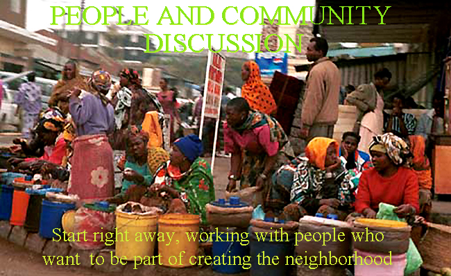
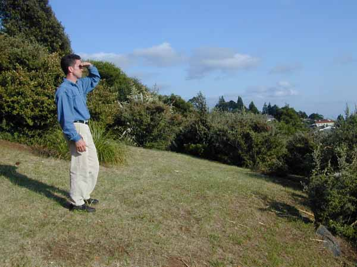
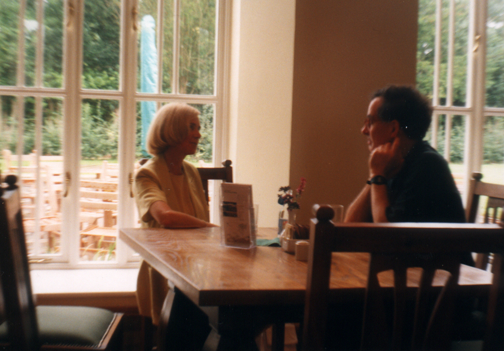
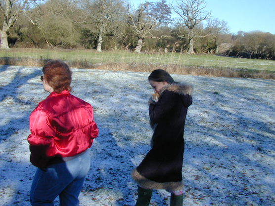
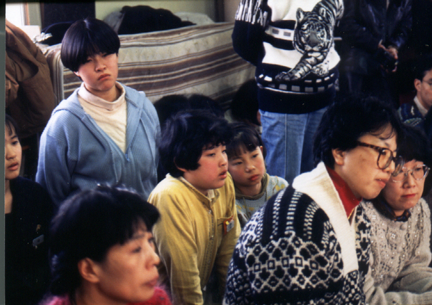
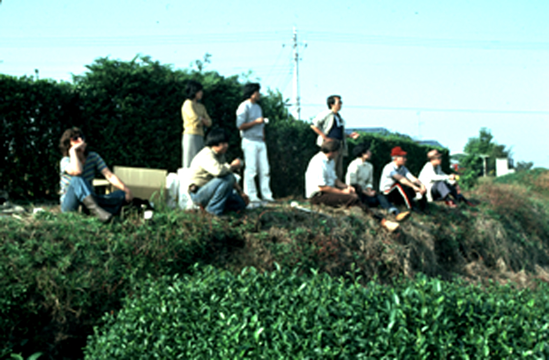
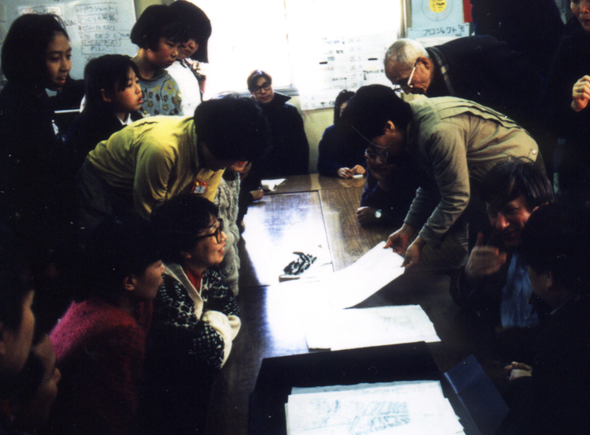

Example 1: Looking

 Example 2: Thinking together

 Example 3: Walking the land

 Example 4: Listening

 Example 5: Looking at the land together

 Example 6: Working together

## Go out and think about things by yourself

To start with, it's a good idea to go to the place where you think the neighborhood may be built, just stand there, look around, try to imagine what might happen there, try to draw in whatever inspiration you get from the land. Ask yourself how this idea may work with other people, your friends, your clients, families who may want to live there, small businesses that might like to bring their business to this place.

## Sit with a friend and talk it through

**You cannot do this alone, you can't even think successfully about it when you are alone.**

Innumerable cups of coffee, many meals together, are the ways to get it moving in your minds collectively. Encourage others who are involved to do this as often possible. They will get excited. So will you.

## Walk the land together

If you go on the land, just for a walk, taking in what is there, getting a feeling for the place, when gradually your group will have a feeling for the land, **together**. At this stage a communal quality will already be present, because sharing the land, and the feeling for the land, will tend to focus your thoughts in a common direction, without your even making an effort to try and get this to happen.

## As more people gather have more discussion

If the group of you has meetings around a table, gradually fruitful discussion will emerge, just from your common knowledge of the land, and a slow sense of common ideals that will emerge, in relation to the land. Look at the animated picture of a group of families working with us in Nagoya, Japan.

## Look carefully at the land together, again

As you can see, in this picture people are just resting together, taking it all in, developing their communal feeling for the place, getting to know it, perhaps getting to know the bushes, or the flowers, or the insects and birds.

It doesnt sound like much, but it makes a big difference.

Work together and write some things down in your workbook about your neighborhood, so they can be better shared

## Summary of tasks for this unfolding

- Think about things yourself.

- Talk through with a friend.

- Walk the land.

- Look carefully at the land again.

- Write it down!

---

← [Parameters: a first sketch of your idea](parameters.md) · ↑ [Phase 1: Startup and vision](index.md) · → [Vision](vision.md)

*From* Building Living Neighborhoods *by Christopher Alexander, Maggie Moore Alexander, Randy Schmidt and Nick Littlestone, with Bev Behrman and Howard Davis. © Center for Environmental Structure. [Original page](https://www.livingneighborhoods.org/actions/people.htm).*
