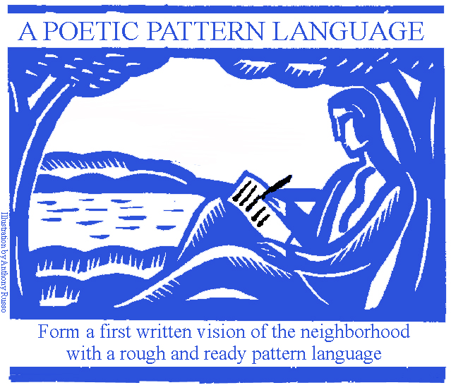

**WHAT DOES WRITING POETRY GET YOU?** Some people are reluctant to try writing poetry. If you feel that way, please be reassured that there is a good reason for such an attempt. We are looking for word "pictures" that have feelings in them - that describe reality in ways beyond analytical and technical ways of thinking. Writing poetry gives you permission to talk about things freely, in this feeling way, when otherwise it may not be so accessible.

**Use the following sequence as a model for making your own first rudimentary pattern language for the neighborhood -- just to get started. Although the following may seem "far out", it is intended to encourage you to allow free reign to your imagination at this earliest stage.**

This example originally written for Samarkand city center, Uzbekistan, 1994

1\. It is a sequence of public squares, gardens, and buildings, which will form the new center of the city of Samarkand, uniting historic and traditional buildings and quarters.

2\. There is a new dimension here, a center of spiri­tual life. It is not a commercial center, not a cultural center, not a religious center in the old idea. It is not a convention center. Somehow, this new center of the city of Samarkand, unites old and new, weaves to­gether the thread of the silk road, the tomb of Timur the Great, with the modern world, and a vision of the world in which comfortable human concern, and a spiritual awareness of the importance of life, is vis­ible, felt, and active.

3\. It is an inspiring place to go. A place of pilgrimage, which will receive visitors from the five continents, in increasing thousands.

4\. A network of beautiful paths, formed by columns, colonnades, brick walls, buildings, gardens. This network of paths, which passes across the whole area, is formed by the building masses which arise out of it, and by formal gardens.

5\. Do the paths open into courtyards, ponds, gardens, hidden places? Are they formed only by mysterious buildings, rising in color, tile, and marble? Are there figures, statues, animals, Gods, people, statues stand­ing at the places where the paths cross?

6\. Are the animals themselves covered with mysteri­ous animals?

7\. Is there any reference to voyages?

8\. The main thing one is aware of is a network of green and beautiful jewel-like streets. Each has lush trees, seats, platforms, streams.

9\. These green streets, made by their trees, benches, sitting platforms, and edges, form a lacework of places to walk. They are like parks, long and nar­row, you can explore for many hours, walking around these streets.

10\. Each one of the streets arrives on some new trea­sure. Each building is like a treasure, arrived at by the green streets.

11\. Samarkand, historically, and in the time of Ulugh Beg, was a crossroads of the world. In the Tang dynasty period, every conceivable exotic sub­stance, or idea, or artifact, or art on earth, came through Samarkand. No matter where it went, or where it came from, it went through Samarkand.

12\. Somehow, then, one may imagine these green heavenly paths, as a network—almost a mythical bazaar in which reference to these many exotic sub­stances exists.

13\. The blue tile work of the Timurids, the hand-painted blue tiles, with small black, yellow, and white detail, on mud brick—these tiles, and the yel­low bricks are in evidence on walls, domes, court­yards throughout the center. It is a thread which connects.

14\. The whole network of paths is almost like a forbidden city. A place which is walled, punctured at very occasional places which allow one to enter, a special area that contains its own magic.

## Summary of tasks for this unfolding

- **Write a poem** like the one for Samarkand, for your own new, imagined neighborhood. Allow yourself free reign, free imagination, and make it poetically whole. Capture the spirit of the very best, and most serious that this new neighborhood could be.

- If possible, **pin up the poem** you have written, on the wall where people can see it, and listen to what they say.

- Put a copy in your workbook!

---

← [Making a basemap](basemap.md) · ↑ [Phase 1: Startup and vision](index.md)

*From* Building Living Neighborhoods *by Christopher Alexander, Maggie Moore Alexander, Randy Schmidt and Nick Littlestone, with Bev Behrman and Howard Davis. © Center for Environmental Structure. [Original page](https://www.livingneighborhoods.org/actions/poeticpl.htm).*
