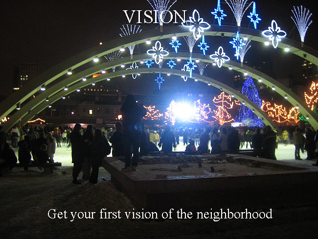
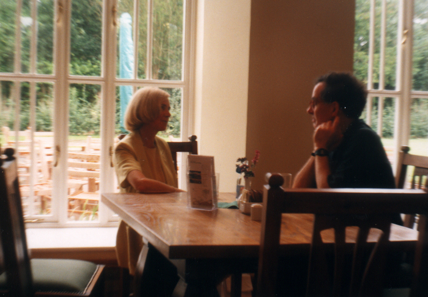
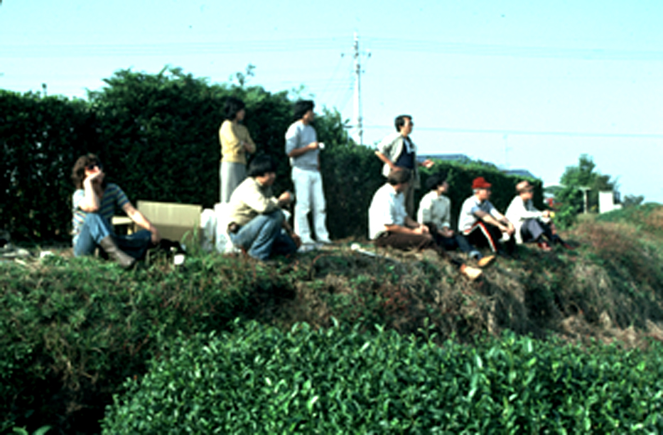
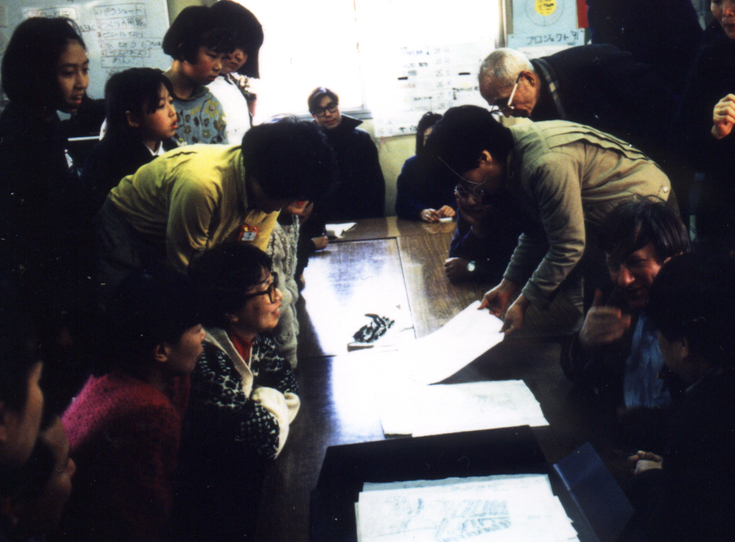

The neighborhood you imagine building: here's what you have to do to start imagining it

One of the best ways to see clearly, or to find out what your vision is, is to close your eyes, and imagine that you have just arrived in the place. What do you see? What is most wonderful about the place you see?

**WHAT DO YOU SEE WHEN YOU CLOSE YOUR EYES?**

It is also very possible to do the closed-eyes process with your friends. Just sit around, all close your eyes together, and talk about what you see.

Write down what you see, in your workbook. It is sometimes elusive, and if you don't write it down the memory can fade.

## Who are your partners?

What we mean by "partners" are any of the people who are likely to do this project together. They may be lay people, neighbors, professionals, city people, and anyone who has an important part to play, to get the project done. It will take a while to identify these people as a group. Allowing it to form gradually will help the process.

Sometimes you just do not know the people who are likely to live and work in a new neighborhood, because it is too early, or too hard, to identify them. Even in this case, it is helpful -- almost necessary -- to involve people who are living and working nearby, and treat them as a source of information, and inspiration, so that what you are doing becomes as real as possible, even in the temporary absence of some of your future occupants.

Do you already have your land, or is it not yet chosen?

Two different scenarios: (a) A piece of land is already identified. People have a piece of land and have an idea of what they want to do there. Walk the land together. Spend time on the land where you imagine this project can be done. Visit the place fairly often. Involve your partners in continuing conversation about the place and its value. Make sure that you gradually achieve cohesion as a group by being on the land together, and continuing to talk. (b) A piece of land is not yet identified. People have an idea of what they want to do but haven't yet found a piece of land where they feel it's appropriate to do what they have in mind. Even then you can begin thinking about the ingredients of the community, and what will be unique to this place.

## What mix of ingredients will define the neighborhood?

Given the piece of land, what are some of the ingredients you are thinking about putting there? Is it a conventional group of houses? Can it contain businesses and workplaces? How much park and green space would you like to see? How much in the way of gardens? Would you like something communal -- church, town hall, association? This last is very important -- but it needs an inventive attitude and time to think of a communal building that will really work.

The **overall mix** of things should be inventive, and particular to **you**. How they fit together may not be immediately obvious and may be hard to talk about, but it is important to do so. How will it work economically? How will it work socially? Given your choices of the above ingredients, you also need to answer the key question How **much** of each is going to be happening there?

Later these ingredients, may be refined to become patterns, and then steps of the generative code.

## A more visionary mix of ingredients

The list in the last paragraph may seem a bit bureaucratic or unexciting. That's because it isn't yet your list, it is ours. **Do you and your friends see a more vivid picture, one with very particular emotional colors, activities, buildings, and businesses?** If this vividness is real -- then give that reality voice. Your neighborhood will be a more lively place, in the long run people are likely to love it more. And there is probably more chance of it helping to make the world a better place.

If you have an idea for this that you would like to sketch, or if you want to make sketches of some of the elements of your vision, that's a very good idea. Keep your sketches in your workbook and share them with others.

## Summary of tasks for this unfolding

- Write down a description of the vision you have gained.

- Share it with your colleagues, and edit it until it is more or less shared among all of you.

- It should be written in as much detail as you feel you know, and kept in your workbook.

- It's to be hoped that this vision is largely shared, but if there are points of disagreement or opinion, not settled yet, then write those down as well.

---

← [People and community discussion](people.md) · ↑ [Phase 1: Startup and vision](index.md) · → [Making a basemap](basemap.md)

*From* Building Living Neighborhoods *by Christopher Alexander, Maggie Moore Alexander, Randy Schmidt and Nick Littlestone, with Bev Behrman and Howard Davis. © Center for Environmental Structure. [Original page](https://www.livingneighborhoods.org/actions/vision3.htm).*
