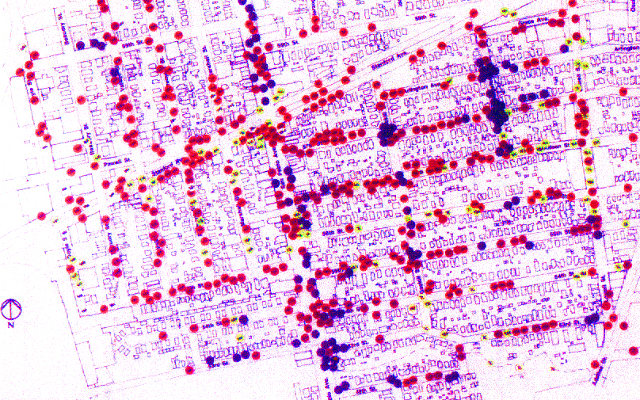

## Damage and repair

Identify the damaged places which need repair, so that they become a focus for constructive action.

## The principle

This is based on a principle first enunciated thirty years ago in *A Pattern Language*. The pattern *Site Repair* says that in any kind of building process, it is wisest to build on the places which are damaged, and to leave the undamaged places -- those that have more life as they are -- intact.

This achieves two goals.

It makes use of a fundamental principle of economy, since the life of the new place is allowed to benefit as far as possible, from healthy life that exists already, even if in small scattered doses!

It also uses the damaged places as sites for construction. This wholeness-extending transformation, cleans up bad areas, and makes positive use of them.

## Agreement in the community

In the drawing (shown above), made by Yodan Rofe, we see a part of Emeryville, lying between Oakland and Berkeley. The dark blue spots show spots of damage; the red spots show places that have potential to be fixed. Yellow spots show places that people really like.

What is fascinating about the map, is that each dot shows a place singled out by an individual as being good, bad, or indifferent. Yodan undertook this study, to show the very considerable level of agreement among people about places that have life, or do not. It is established, by this study, that the life or absence of life, is an objective phenomenon, with a deep base in communal sentiment.

This, in itself, is a profound discovery, which sets the stage for intellegent and effective action.

## Tasks to complete

## In order to achieve this unfolding

Using the base map that you created in the first phase (Startup & vision), carefully survey the entire site of your hoped-for neighborhood. Involve everyone who has a stake in the neighborhood, and see what you can determine,ogether, about the places that are in need of repair -- where they are, what kinds of actions might repair them, how the underlying wholeness of the place can be extended by dealing creatively with these repairs.

---

← [Magic configurations](magic-configurations.md) · ↑ [Phase 2: Diagnosis of the land](index.md) · → [Latent centers](latent-centers.md)

*From* Building Living Neighborhoods *by Christopher Alexander, Maggie Moore Alexander, Randy Schmidt and Nick Littlestone, with Bev Behrman and Howard Davis. © Center for Environmental Structure. [Original page](https://www.livingneighborhoods.org/actions/repair.htm).*
