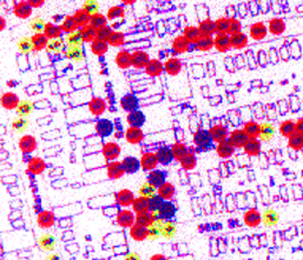
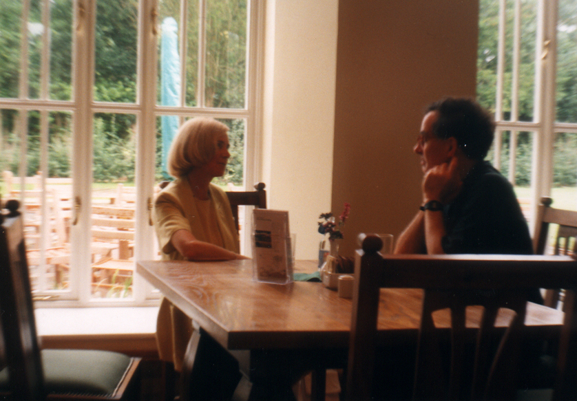
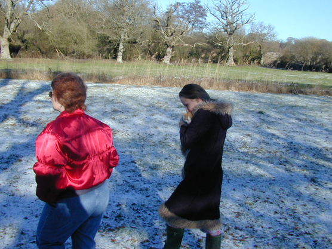
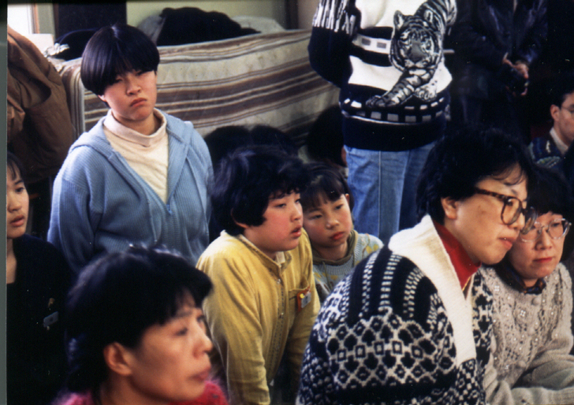
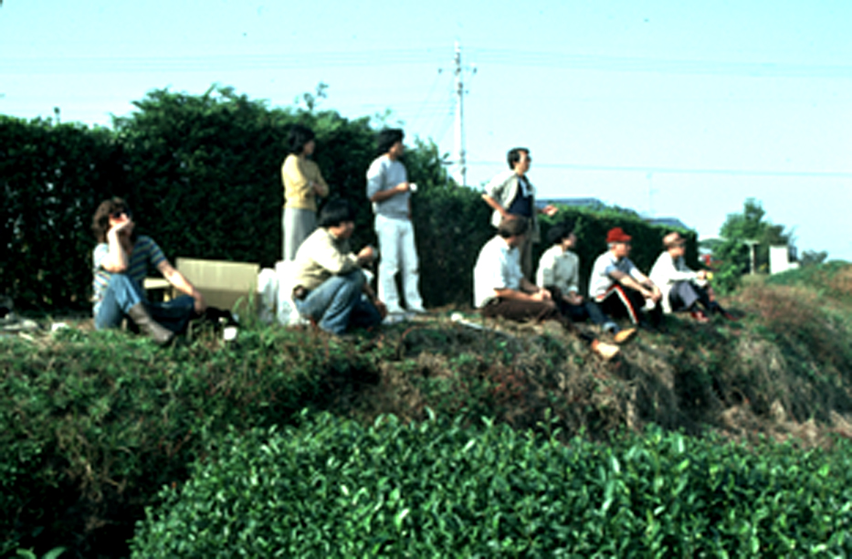
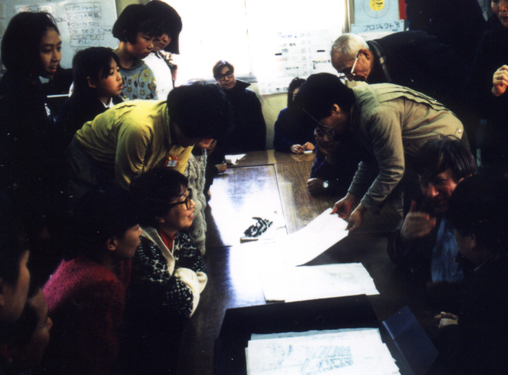
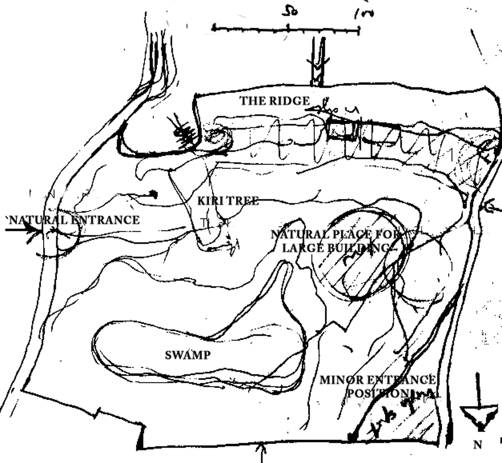

## Diagnosis

Observe, in the land, the vital structure of the whole, which must be extended, preserved, and repaired.

Work on your drawing

Detailed explanation of what to do

Example 1: Good and bad places in a neighborhood of San Francisco

 Example 2: Thinking together

 Example 3: Walking the land

 Example 4: Listening

 Example 5: Looking at the land together

 Example 6: Working together

## General introduction to diagnosis

The most fundamental way to treat the land-- whether it is an open field, or an existing village, or a street in a town -- is to respect what is there, protect it, continue it, make it better. Heal it, make it more whole.

The great towns and villages have always been built this way, and it is this process which gave them their beauty. It takes skill. It requires a loving attention to what is there.

What is the "it" that has to be preserved and extended?

What is the "it" that is being preserved and extended, during these kinds of actions? It is the configuration of the whole. In every place there are deep seeds of structure running in the place, in its geometry, its colors, its smells and sounds. It lies in the hills of the land, in the stands of trees and hedges; in the gullies; in the outcrops of rock.

In an existing town, too, the "it" that has to be preserved is the deep structure, the seeds of loveliness that are present there, and these seeds of loveliness are in the wholeness. It is this wholeness, the larger, deeper structure which matters most. Although it is in the wholeness, it may nevertheless be caused by small details. A corner store, with two tables on the sidewalk that forms a corner, and also in turn forms a larger center in the neighborhood. This is an example of what must be preserved, protected, and extended. You cannot extend it by making it larger - -but by honoring it and respecting it. It means making sure that the larger structure which ripples out from these two tables is extended and strengthened by whatever other things are built in the nearby areas. .

In order to do this, we need to walk around the place many times, with others, and alone, asking ourselves which place has the natural magnetism to pull us to go there, which makes us want to stay there, which has the power (potentially) to give us life merely from **being** there.

## On a green field site

On a green field site, where a neighborhood does not exist, this feeling will most likely be generated by a view, by the form of the land which has a natural protected area, a declivity, or by a high spot which looks out. Great trees, are also capable of giving us such a place, naturally occurring water, the edge of a forest, the bottom of a cliff. It is impossible to predict with any general principles, what feature of a particular piece of land will have this character. Each piece of land is different, and will tell you, in its own way, what unique feature, on that land, is best suited to become the spiritual center of a future neighborhood built there.

The way to achieve this is to spend time, gazing on the land, at the place where the building is to be, or at the space itself, as a place and as a beautiful entity in itself. Ask yourself -- standing there, and closing your eyes -- how high it is, what line will enhance the place, where you would most expect to find the front edge of the building, if it is a peaceful and gentle place.

It will not be out of place, either, to ask childish things, of your inner eye. What color is it? When you close your eyes, what color do you see? What kind of windows does it have? When you close your eyes, what shape are the windows, what figure gives them inspiration, and makes the place worth being in?

In an existing community where your work is fitting in a helping to heal it and extend its well-being

If the group of you has meetings around a table, gradually fruitful discussion will emerge, just from your common knowledge of the land, and a slow sense of common ideals that will emerge, in relation to the land. Look at the animated picture of a group of families working with us in Nagoya, Japan.

## On a brown field site

As you can see, in this picture people are just resting together, taking it all in, developing their communal feeling for the place, getting to know it, perhaps getting to know the bushes, or the flowers, or the insects and birds.

It doesnt sound like much, but it makes a big difference.

Work together and write some things down about your neighborhood, so they can be better shared

Your unfolding drawing is active just below, and has been carried forward from your previous unfoldings.

---

← [Latent centers](latent-centers.md) · ↑ [Phase 2: Diagnosis of the land](index.md) · → [Accurate positioning with GPS](gps.md)

*From* Building Living Neighborhoods *by Christopher Alexander, Maggie Moore Alexander, Randy Schmidt and Nick Littlestone, with Bev Behrman and Howard Davis. © Center for Environmental Structure. [Original page](https://www.livingneighborhoods.org/actions/diagnosis.htm).*
