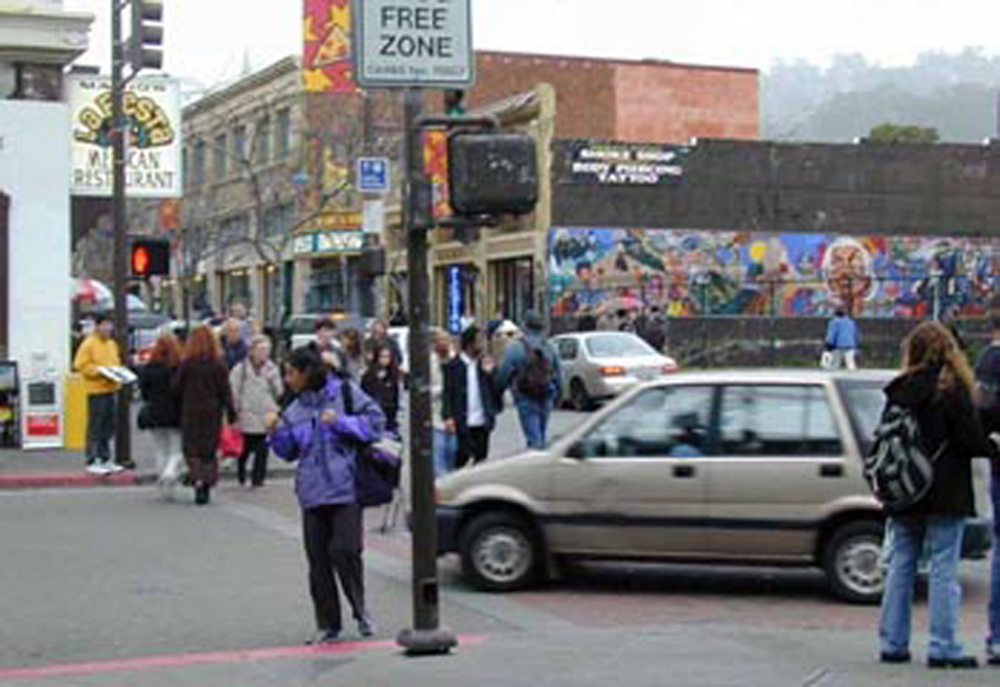

## Introduction to diagnosis

Extract all the vital parts and structures of the presently existing whole, which must be preserved, enhanced, extended, and repaired.

## Making a diagnosis

Now it is time to walk the land, slowly, and with care.

What is precious, and where is it? What is ugly? What is desperately in need of repair? What has the potential to become something wonderful, with a minimum of work? We find it most helpful to do this with a map in one hand and a pen in the other -- a surveyor's drawing of the site, with the boundary marked, with trees and existing buildings marked, and recognizable features so that you can locate yourself as you are walking around and know exactly where you are.

Each unfolding in this section asks you to attend to a different aspect of your neighborhood site. When they have been completed, you will have a comprehensive and sophisticated diagnosis that can serve as the basis of **generating** life.

Diagnosis is the basis on which all unfolding proceeds. It helps you:

Identify special spots in the land that must be enhanced and protected.

Do the same whether it is urban land, or natural land.

Determine needed density by considering what the land can hold comfortably -- not based on how to make the most money, but how to hold the land as sacred in perpetuity.

Prepare for making a generative code for your particular place

Record all beautiful and important spots.

Note all places in need of repair.

Capture all views and view corridors.

Note all those important trees and buildings, gullies, edges, which are **especially** vital to the heritage and spirit of the place.

All of this information is to be kept on a map. You were asked to make a basemap in Section 1, Startup & Vision. This will be your starting point for recording all the information you collect from your diagnosis. Once the drawing pad is operational, because it has the capacity for several layers which are in register, we suggest that you devote a different layer to each kind of diagnosis. In the meantime -- or if you prefer to do it on physical maps, make several copies of your basemap and record your findings there.

Remember, these are working documents storing vital information. Keep working on them over many visits, walks, and discussions with others who are thinking about the neighborhood. And keep copies in your workbook.

This diagnosis is the well-spring of the life that can arise in the new neighborhood. It is the source of inspiration that connects you to the land. If you don't make the effort to understand these details about your site, you seriously limit the degree to which you can create a living, thriving neighborhood.

## Evaluating on the basis of feeling

**Your diagnosis is your attempt to capture the wholeness of this piece of land as it exists today.**

The wholeness is, above all, dependent on **details**. And it is made of those details which you can be sure of, because they have come from your feeling. For example:

- You know that this tree is important to the feeling of the place.

- You know that a view visible between these buildings is important, and fills you with feeling when you are standing there.

- Even though it seems trivial, you know that the sunshine which falls in a certain circle, is what draws people, and needs to be kept (if possible) in any future neighborhood.

- You know that this old brick wall, with jasmine growing on it, even though it is leaning, and moss covered, is a valuable part of the past, and should, if at all possible, be kept.

All this ***together*** is an approximation to **the structure** of the land. These spots and views and lines of movement, and many others like them, are anchor points in your understanding of the land. If you get confused later, when you are trying to unfold the appropriate positions of new parts of the neighborhood -- you can always come back to this diagnosis for security, and calmness of mind, **because these are the things you are sure of**.

The diagnosis (which is a rough picture of the wholeness that is there now) is the point of origin for the next unfolding.

The structure of the land, with all its subtle detail, is the key to all subsequent unfolding. It is this structure which is then to be unfolded further, when you begin to tweak the generative code in Phase 4. Indeed, above all, the task will be to hold on to this precious structure, both in its detail, and in its overall character. What you do with the neighborhood, is to **preserve** this structure, **enhance** it, and **extend** it. It is this action which will make the neighborhood both natural and a living continuation of the land.

## Basic instructions

On your scale map of the whole neighborhood, you and your colleagues should write a record of your observations while walking the land.

Arrows to show important views which should be protected and made much of;

Circled areas to designate important precious places which should be protected and enhanced;

Marks for good places to come in to the site, and good places to leave by.

Marks to identify places which are urgently in need of repair

If possible, this map should be kept in a place where they can be shared by all the partners, so that it may be contemplated, in quiet.

Each of the unfoldings which follow in this section, will direct you to specifics.

---

↑ [Phase 2: Diagnosis of the land](index.md) · → [The large-structure wholeness diagram](wholeness-structure.md)

*From* Building Living Neighborhoods *by Christopher Alexander, Maggie Moore Alexander, Randy Schmidt and Nick Littlestone, with Bev Behrman and Howard Davis. © Center for Environmental Structure. [Original page](https://www.livingneighborhoods.org/actions/diagnosis-intro.htm).*
