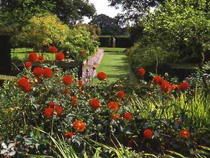

## Precious places, magic configurations

Find all the magic configurations among land and buildings, and ***keep*** them.

## Observation

Whenever you start a project, or whenever you begin to take action, you must always looks for those sparks of life, among the buildings, or in the open land -- places that, just very slightly, have a quality that make you feel fractionally a little more alive and a little more inclined to love life.

You need to be very discriminating when you do this. Such places may be only fragments, in the middle of other stuff that is not worth much.

These small fragments are too precious to be swept carelessly out of the way, or destroyed, or casually rebuilt. They are capable, like seeds, of starting the new life of the place, like fresh shoots.

Indeed, if you start with nothing but these fragments -- a bench here, the base of a tree that has primroses around it in spring, an archway from an ancient building, a piece of a brick wall with lovely scarlet bricks -- keep **all** of them. These are what we mean by "magic configurations." You can always find a way to build whatever new you are going to build, without destroying these magic configurations.

If you follow this rule, it will give the place you are making, an altogether deeper character where one feels the presence of the human heart.

Do not think that you can achieve the same end, by plucking the beautiful fragment, and replanting it, or inserting it into some other structure. That will always be damaging, as if one had hacked out a piece of life and pasted it into a new place. It can't be done, because the life that exists in a thing, always comes from the larger context -- it is both its existence in the land, as it is, and the thing itself, which are capable of giving continuity to life.

## Tasks to complete

## In order to achieve this unfolding

Follow the rules written down above, exactly as they are written.

---

← [Precious places](precious-places.md) · ↑ [Phase 2: Diagnosis of the land](index.md) · → [Damage and repair](damage-and-repair.md)

*From* Building Living Neighborhoods *by Christopher Alexander, Maggie Moore Alexander, Randy Schmidt and Nick Littlestone, with Bev Behrman and Howard Davis. © Center for Environmental Structure. [Original page](https://www.livingneighborhoods.org/actions/magic.htm).*
