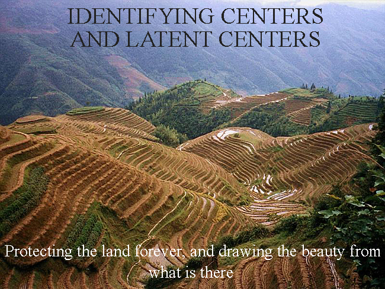
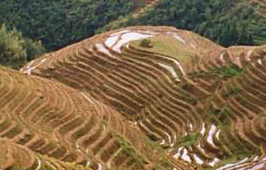
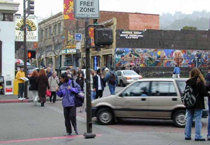
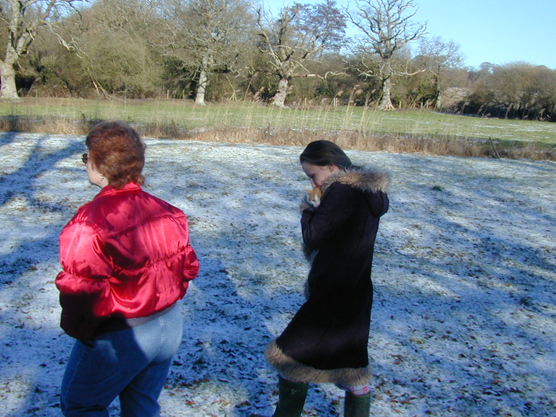
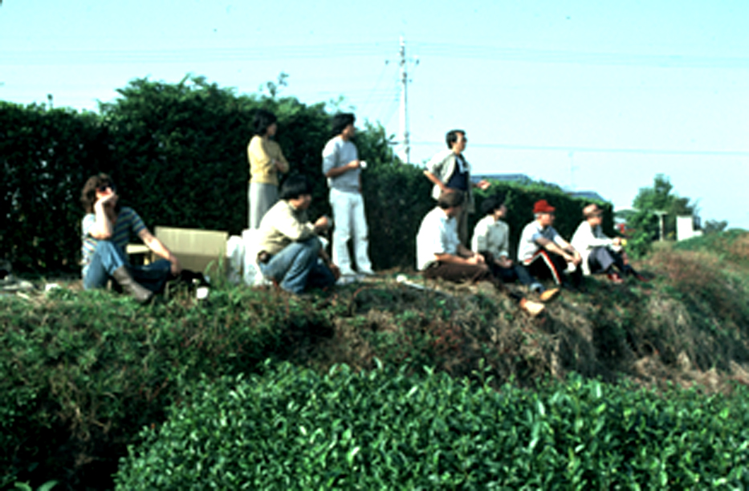
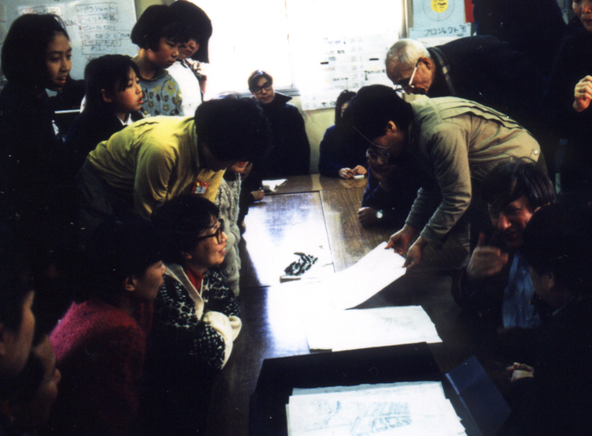

This unfolding needs you to DRAW. After reading and thinking (on the land), go to the DRAWPAD. Link is at bottom of page.

A center to be preserved

 How can this site be developed and keep the painting on the wall?

 Walking the land

 Looking for precious places, and comparing lists

 Looking at the land together

 Working together

## Protecting the land for ever

Walking around the land, one will encounter different spots with natural beauty or special characteristics. It is not enough to simply identify these beautiful spots. What happens in a typical development is that people see these beautiful places, then rush to exploit them, or overlook them, and perhaps even bulldoze them. Generative code seeks to protect them and enhance them by providing steps that will enshrine each of these lovely, precious spots so that they are part of the living fabric of the neighborhood that is to come.

**Generative code statement:** In order to protect the natural beauty of the land, a continual effort must be made to identify those naturally occurring "centers" in the land which most inspire love and attachment, to keep them and strengthen them so that, as the town is urbanized by construction, still the centers which were inherent in the land will inspire and dominate the structure of the newly built place.

WHAT IS A CENTER, AND HOW SHALL CENTERS BE PROTECTED AND ENHANCED? A center is a spot of living beauty in the land. When you walk around the land, as it is today, these places strike you with their life, the life radiates out beyond them, and they beg to be preserved. Centers can be any size: very small, middle sized, or very large. A trickling stream under a piece of stone may be a center. A large basin in the landscape may be a living center. The intent of generative codes is not only to encourage the preservation of living centers in the land, but then to enhance them and strengthen them: that means to build buildings and other built structures which preserve and draw their inspiration from the naturally occurring centers, so that their beauty and intensity is kept alive. This can be done by building - in stone, in wood, concrete, tile, steel, and glass - constructed enhancements that support the naturally occurring centers in the land. This is intended to preserve a continuity from the land as it was, to the neighborhood and buildings as they will be, and, through its unfolding, to maintain the deep feeling of the place at all times.

**Generative Code statement:** The neighborhood, as it evolves, shall always be made so that, as far as possible, the existing centers visible in the land shall be maintained, sustained, and improved, by the actions taken in development. This means specifically that: a. The public pedestrian paths and roads and public open spaces - the rights of way which form the life of the neighborhood - shall be chosen to preserve and strengthen the centers that inhere in the land itself. b. The buildings and enclosures created by construction adjacent to these public rights of way shall be placed and shaped to enhance and enliven the deep feeling which lies in the centers as they exist in the neighborhood and land before construction.

## Diagnosis on a green field site?

Diagnosis is the process through which the land is observed, and scrutinized, at regular intervals, to identify the living centers, as a guide and source of future construction, and as precious places of value to be kept and hallowed by the construction of the neighborhood.

**Generative code statement:** In an area being diagnosed, the living centers shall be identified by the following empirical test: a place within the area is identified as "living" when two or three people agree that to them it seems a spot with exceptional life. Places meeting this test shall be recorded on a diagnostic site map.

DIAGNOSIS IN THE PRESENCE OF BUILDINGS OR AN EXISTING NEIGHBORHOOD In an area where buildings, roads, public works, or exterior structures have been built, the process of diagnosis is more complex, and requires a somewhat more complex procedure. As in the case of nature, the process starts by looking for valuable and precious places which have life, as they are, using the same empirical procedure set forth in 1.3. **Generative Code Statement:** The valuable and precious built places that have life shall be recorded on the diagnosis site map, and protected in any subsequent construction that takes place.

The second way the diagnostic process works, in cases where there is existing built structure (buildings, roads, paths, retaining walls, and so on), looks for ''latent'' centers. A latent center is a center which has the promise of life, even though it may not be very strongly living as matters now stand. The criterion for a latent center, is that two or three people can see, and agree, not only that it has potential as a living center, but that structure-preserving (defined in 1.6) actions can be imagined which will bring that place to life.

**Generative code statement:** Latent centers that have the promise of life shall be recorded on the diagnosis site map, and protected in any subsequent construction that takes place. Rough ideas about possible structure-preserving transformations for a given place shall be recorded at the time of the initial diagnosis. Members of the neighborhood shall be encouraged to think about diagnosis as a routine matter of daily life, and to communicate their feelings about possible structure-preserving transformations. Some version of the imagined improvements shall be carried out.

## Summary

Diagnosis is the process through which the land is observed, and scrutinized, at regular intervals, to identify the living centers, as a guide and source of future construction, and as precious places of value to be kept and hallowed by the construction of the town or neighborhood.

An initial diagnosis is first made for a small portion of the site, which indicates certain natural centers. These are places of natural beauty, which have specific form or potential. This initial diagnosis has been created to make the most of the land as it exists, and will lead to development that preserves and extends the natural beauties of the site.

A few of our initial assessments are recorded in the site map on page 23 of this section. Further standards for diagnosis, and the practical nature of the process of diagnosis are given, by example, in two sections of this plan. One is given in section 3.8(?check). The other is given in section 10.3.(?check)

In an area being subjected to diagnosis, the living centers shall be identified by the following empirical test: a place within the area is identified as ''living'' when two or three people agree that to them it seems a spot with exceptional life, which deserves protection. Places meeting this test shall be recorded on a diagnostic map, by the HPA and masterplan consultant. \[Note: Validity of this empirical test, and correlations and statistical methods demonstrating degree of objectivity and range of reliability are given in Yodan Rofe, xxx.\]

## Summary of tasks for this unfolding

- **Walk around** for awhile on the land, with all stakeholders, and look for particularly important places

- Sit down outside, and **discuss-- everyone compare their lists.** Walk around til everyone agrees on where these precious places are

- make a quick **handsketch,** and take photos

- **write a quick sentence** or two about each precious place, describing why its special

- Then go to the **DrawPad** and record this information, before you forget..

  [Go to DRAWING PAD to complete this unfolding](../../tools/drawing-pad.md)

---

← [The large-structure wholeness diagram](wholeness-structure.md) · ↑ [Phase 2: Diagnosis of the land](index.md) · → [Magic configurations](magic-configurations.md)

*From* Building Living Neighborhoods *by Christopher Alexander, Maggie Moore Alexander, Randy Schmidt and Nick Littlestone, with Bev Behrman and Howard Davis. © Center for Environmental Structure. [Original page](https://www.livingneighborhoods.org/actions/preciousplaces.htm).*
