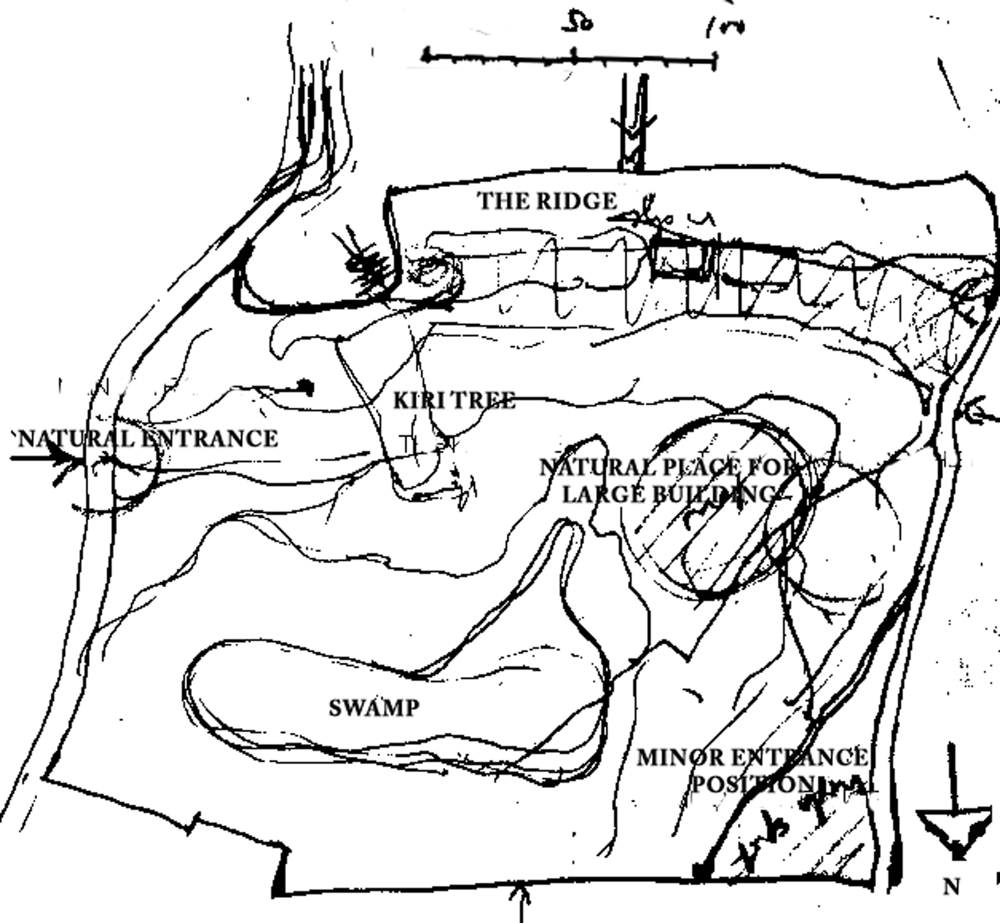
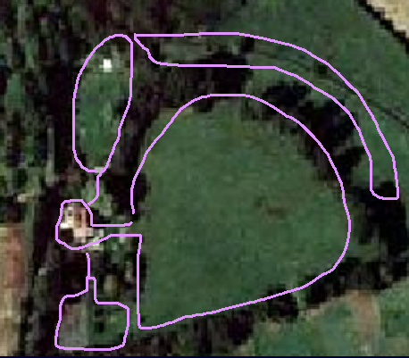
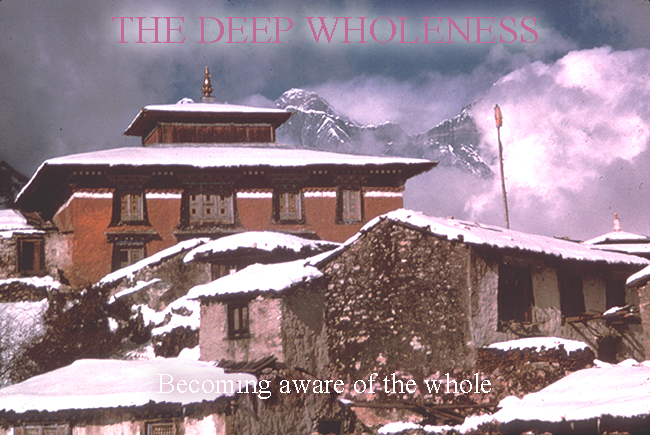

## The "large structure"

## Wholeness diagram

Make a diagram which captures the essence of the large scale structure which pervades the land and the area around it. This diagram should capture your intuition of the largest wholeness structure that governs that place.

## First example of a large-structure diagram

The diagram at the top of the page was the first diagnosis diagram for the Eishin Campus (outside Tokyo). It refers to a piece of land about 300 meters by 300 meters. South is at the top of the drawing. The drawing includes all the larger land features which determine the character and essence of this place.

There is a ridge at the top of the drawing -- this ridge looks towards the south, and it contains the site, physically.

The swamp is shown, a major feature of a low-lying area, which was always wet.

A beautiful kiri tree with purple flowers, is the focus of the largest area of flat land.

The two places which seem and feel like natural entrances to the site, are marked.

A possible place for a large, important building is marked.

Other features are drawn, without notation. At the top left one sees the quarry, a deep incision into the land, cut in to the south-facing slope, to a height of some 30 feet.

All in all, the drawing provides a sketch of the whole, showing the overall configuration.It gives a sense of that overall configuration as one experienced the land then, in 1982. Today, some 25 years later, the land is experinced in much the same way, though more than 30 new buildings fill the site. Building the school and college has only subtly transformed its shape, and it has a deep structure which has grown out, directly, from the structure it has when it was still agricultural land.

## Second example of a large-structure diagram

Here is a more pure example, for a ten-acre farmland site with a single farmhouse on it. It marks pastures, trees, hedges, and topography. The drawing attempts to catch the overall structure as it exists, underneath the details.

**GENERAL PRINCIPLES TO FOLLOW WHEN MAKING A LARGE-STRUCTURE DIAGRAM**

To make a drawing like this, it is best to have considerable experience of the land, best if you have walked it, and know it, and can remember the experiences you have had in different places.

Then, sit down and make a quick sketch which captures the structure of the whole thing, as you remember it, and which captures the different experiences you have had there, and the places which gave rise to them.

## Tasks to complete

## In order to achieve this unfolding

- Walk the site alone, and with your colleagues.

- Notice all the places and features which are giving it its character, and its uniqueness.

- Make a crude and simple drawing which somehow captures the structure of the whole.

- Discussion with your colleagues will help to cement the wholeness in your minds, since no one drawing of structure ever captures the wholeness fully.

- Be prepared later, when you come to details of diagnosis, to record these features of the whole, so that you can then act to protect this wholeness, reinforce it and extend it.

Above all, work to make sure that whatever you do there next leaves the beauty of what is there now, intact.

## Becoming aware of wholeness

## Becoming aware of wholeness

At any given moment, in any part of the world, there is a deep wholeness which exists there. This is the **structure** of the whole: the largest and deepest physical configuration that is present there. It can be felt and seen.

The most fundamental rule, to be followed always, is that we must do our best to leave this structure intact. This does not mean we must do nothing there. It means that we should honor and respect the structure that exists, and try to preserve this deep physical configuration in whatever new things we do. **The new should always grow out of respect for what is there now, and what was there before**. We must act out of the knowledge that if we violate the deep structure, we will not only violate the place. We will, at a profound level, also damage our own feelings and our own sensibilities.

It is this wholeness - **the basic structure of the place** - that matters most. In the monastery of Thyangboche, on the lower slopes of Everest, (shown above) the angles are chosen to reflect the angles of the mountains; the overhanging roofs enter into the wholeness which is there; the blood red walls, for some reason that is not entirely clear, support the wholeness; the walls are made of rocks which come from that place. The white stripe on the building wall reflects the snow; the snow lying on the shallow roofs stays there, and makes a blanket just as the snow does on the mountain's hanging slopes. That monastery became part of Everest, and it continues the wholeness and the structure of the mountains which surround it.

Equally, in a village, a corner store with two tables on the sidewalk, the whole of which forms the corner, also, in turn, forms a larger center in the neighborhood. Both small and large details about the place make it so. This is an example of something to be preserved, protected, and extended. You cannot extend it simply by making it larger - only by honoring it and respecting the existence of a center there. This means making sure that the larger structure that ripples out from the two tables on the sidewalk is extended and strengthened by whatever other things are built in the nearby areas.

The unfoldings on this website guide you in the process of envisioning, diagnosing, planning and building on your physical site, always with the purpose of extending wholeness -- the basis of every living neighborhood.

## Tasks to complete

## In order to achieve this unfolding

- Make a mental effort **to become aware, emotionally, of the deep structure** which is there.

- **It may help to close your eyes and bring it to your mind.**

- **Do not play with words.** When it comes to judging this deep structure, do not be intellectually over-critical. Remain true to the feelings you carry inside of you about the place. Draw the structure that you see in your mind's eye.

- When you draw the structure, make a bold drawing, perhaps even with a piece of charcoal or blunt crayon, on a rough piece of paper -- so that the entire action encourages you to represent the physical structure you **feel** to be there, rather than an intellectual construct.

---

← [Introduction to diagnosis](introduction.md) · ↑ [Phase 2: Diagnosis of the land](index.md) · → [Precious places](precious-places.md)

*From* Building Living Neighborhoods *by Christopher Alexander, Maggie Moore Alexander, Randy Schmidt and Nick Littlestone, with Bev Behrman and Howard Davis. © Center for Environmental Structure. [Original page](https://www.livingneighborhoods.org/actions/largestructure.htm).*
