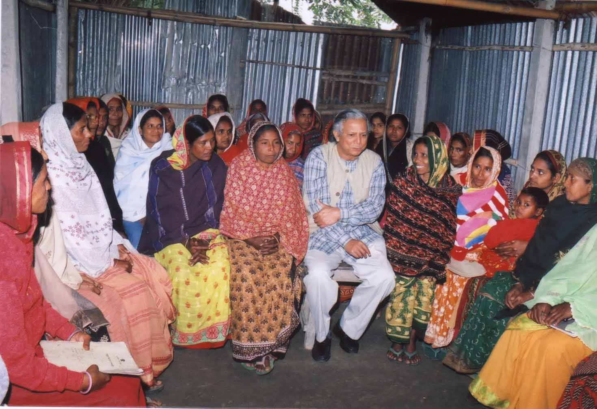

***Section Four***

## Fourth phase of unfolding

## Individual unfoldings

Section 4 Modifying Your Code **Modify the code to fit\
your local culture, your needs and your\
project**

4.1 

## Introduction: genetics

The code for your project, starts with generic code already present on this website, and then gets modified by you.

4.2 

## Our baseline code

The code for your project, starts with generic code already present on this website, and then gets modified by you.

4.3 

## Local culture

Respect your local culture, and decipher that local and cultural particulars: then graft this local culture into the generic baseline code.

4.4 

## New entities

Describe, in words, the entities which must be created to create the new culture that is in process of arising in your neighborhood.

4.5 

## Inserting and amalgamating code

Marrying your special code with our baseline code, to make a functional and workable code to generate your own particular neighborhood.

This phase has five steps to help you, your friends, and partners get your local culture and special ideas into the neighborhood

*A meeting of a local community whose members are in the process of modifying a generative code. A group of Bangladeshi villagers meeting with Muhammad Yunus during the work of clarifying the operation of the local village-owned bank. Yunus is an inspiration to us!*

*From* Building Living Neighborhoods *by Christopher Alexander, Maggie Moore Alexander, Randy Schmidt and Nick Littlestone, with Bev Behrman and Howard Davis. © Center for Environmental Structure. [Original page](https://www.livingneighborhoods.org/packets/code-phase.htm).*
