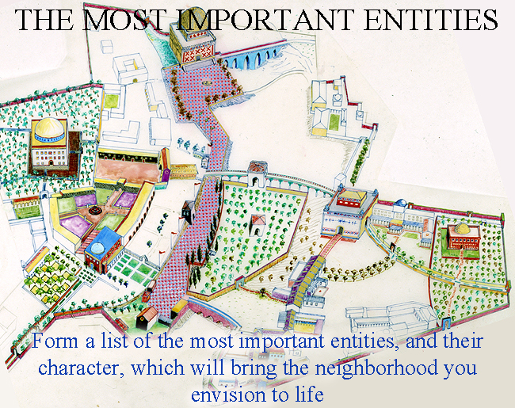

An example to help you understand the idea of this phase

**Use the following list of "entities" as a model for making your own first rudimentary list for the neighborhood -- just to get started. Once again, the exotic nature of this list is intended to encourage you to allow free reign to your imagination at this early stage.**

A vivid example, originally written for Samarkand city center, Uzbekistan, 1994 This was the second list I wrote for the project. After trying to understand the system of patterns as a whole, and as we worked on it, the list was then transformed as a whole to modify the global feeling and content of what this place was going to be — as it matured in our under­standing. We kept on thinking of the *whole* way of life which would be created by these patterns, and then changed the patterns, intensified them, improved them, made the centers more explicit, as our understanding of this whole increased. We kept on working at it until the living whole revealed itself, as fully as we could manage, in the list of centers. After much more work, the list — or pattern language — for the project ended up with the following centers: Note, the earlier statements are written in the active form, in italics, which sketches the content of each possible center. The second, longer list which follows is given in small capital letters, to indicate that by this stage the ideas had materialized and solidified as *centers*— as potentially solid objects which were reliable and recognizable as entities.

the main bridge

the forbidden city

massive surrounding wall

the festival promenade

view to registan

the observatory

the orchard of peach trees

main terrace

 outdoor theater

craft school and bazaar

 the inner city

small hotels

walled path

music school

inner city gate

five small walled gardens

chaikhanas

main street from the registan

fountains and streams

exhibition hall

covered bazaar

the library

the manuscript museum

arched bridge

soccer and games

wall of arches

gates in the outer wall

the hospice or kulliye

inner part of the forbidden city

blue-tiled walks

the mosque

The lower photograph shows the model we made for the project, on the basis of this pattern language.

This example gives an idea of the vital role which generic centers can play in creating a whole. In this example these centers, *the list alone*, creates an almost magical atmosphere. As soon as we name them, *just from naming them*, we begin to feel the aura of the place. The patterns are evoca­tive. It doesn’t even matter in what order we take the centers. The mere list, itself, already conveys a profound atmosphere, and defines, in great de­gree the atmosphere of the place which will be made up of these centers. It creates the atmo­sphere right away. It is these centers which play the defining role. In Book 3, chapter 4, I show a drawing I made with my apprentices to show the physical character of this system of centers when they are realized.

## Summary of tasks for this unfolding

- Compose a list of key entities (like the above list for Samarkand) for your own new, imagined neighborhood. Allow yourself free reign, free imagination, and make it poetically whole. Choose the entities so that the group of entities, taken as a whole, successfully capture the spirit of the very best, and most serious that this new neighborhood can be.

- If possible, pin the list of entities you have written, on the wall where partners and colleagues can see it. Listen to what they say.

---

↑ [Phase 4: Modifying the code](index.md) · → [The baseline code](baseline-code.md)

*From* Building Living Neighborhoods *by Christopher Alexander, Maggie Moore Alexander, Randy Schmidt and Nick Littlestone, with Bev Behrman and Howard Davis. © Center for Environmental Structure. [Original page](https://www.livingneighborhoods.org/actions/entities.htm).*
