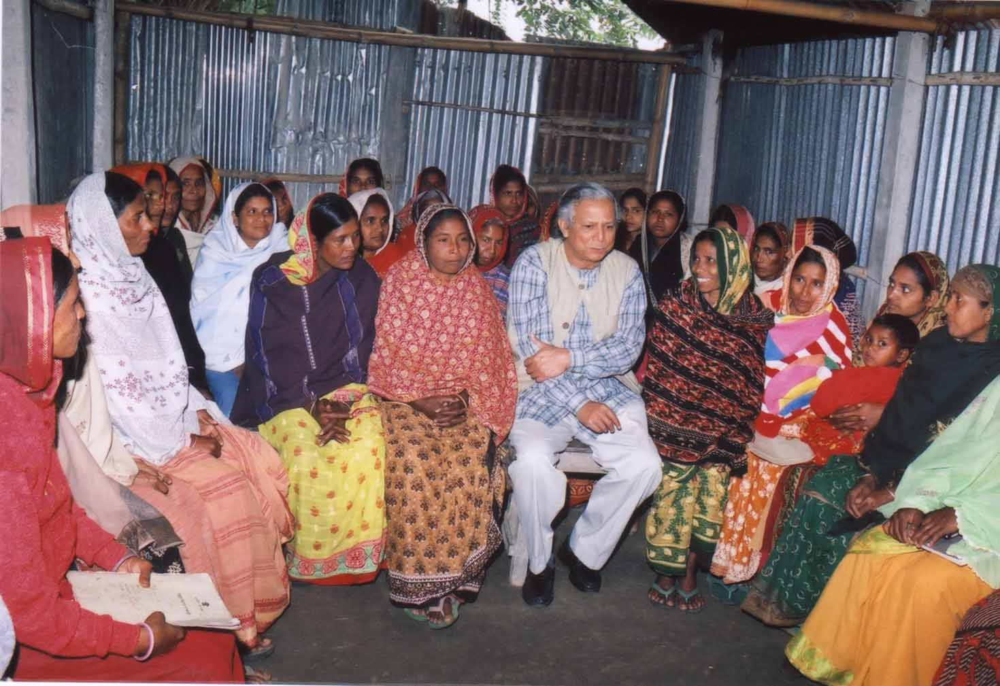

**Modify the code to fit your local culture, your needs and your project.** This phase has five steps to help you, your friends, and partners get your local culture and special ideas into the neighborhood.

*A meeting of a local community whose members are in the process of modifying a generative code. A group of Bangladeshi villagers meeting with Muhammad Yunus during the work of clarifying the operation of the local village-owned bank. Yunus is an inspiration to us!*

## The steps

1. **[Introduction: genetics](genetics.md).** The code for your project, starts with generic code already present on this website, and then gets modified by you.
2. **[Our baseline code](baseline-code.md).** The code for your project, starts with generic code already present on this website, and then gets modified by you.
3. **[Local culture](local-and-cultural-patterns.md).** Respect your local culture, and decipher that local and cultural particulars: then graft this local culture into the generic baseline code.
4. **[New entities](entities.md).** Describe, in words, the entities which must be created to create the new culture that is in process of arising in your neighborhood.
5. **Inserting and amalgamating code.** Marrying your special code with our baseline code, to make a functional and workable code to generate your own particular neighborhood. *(Never written up on the original site.)* See [Writing a generative code](writing-a-generative-code.md).

## Related unfoldings

- [Land tenure](../../unfoldings/land-tenure.md): the kind of land tenure that goes with the project.
- [Zoning](../../unfoldings/zoning.md): an unfolding originally written for a 3 acre site in Charlottesville, Virginia.

---

← [Phase 3: Setting density](../3-density/index.md) · [All phases](../index.md) · → [Phase 5: Public spaces](../5-public-spaces/index.md)

*From* Building Living Neighborhoods *by Christopher Alexander, Maggie Moore Alexander, Randy Schmidt and Nick Littlestone, with Bev Behrman and Howard Davis. © Center for Environmental Structure. [Original page](https://www.livingneighborhoods.org/packets/code-phase.htm).*
