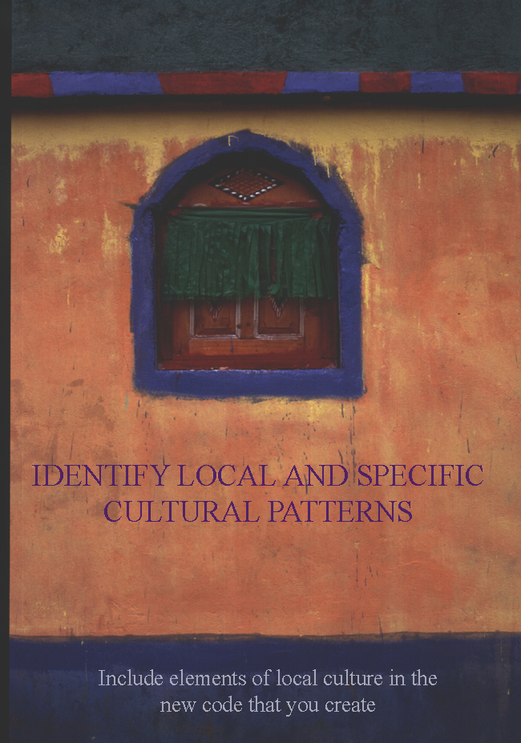
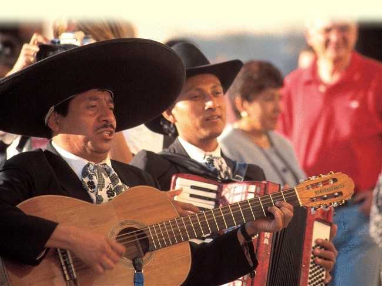

## Tradition and comfort

Each family, sometimes each street or city block, each neighborhood, each region, each culture, each nation, each island, each climatic zone, each ecological region, has its own specific traditions. Above a Guatemalan kind of house painting. Next page, a Mariachi band in Mexico.

Some of these traditions are of a practical nature; other are historical or sentimental; some are caused by local plants and materials; others by a particular pattern of rainfall; others are simply based on "the way" that things are done.

In order to make a generative code fit a particular place or culture, it is wide to introduce specific patterns in the following categories:

family types

acceptable density

size of rooms

Typical type of entrance

typical type of rooms for gathering

position of windows

roof shape

nearby materials and local materials

**NEW UNFOLDINGS FOR THE GENERATIVE CODE** Once you have identified the patterns which make people comfortable, in these aspects of their neighborhoods and buildings, it will not be too difficult to translate each pattern, into an unfolding: that is, into an action which occurs at a specific time in the overall sequence of layout processes, that will assure the introduction of the necessary pattern into that environment.

If you follow these rules, it will give the place you are making, an altogether different and more personal character.

## Summary of tasks for this unfolding

- Follow the rules written down above, exactly as they are written.

---

← [The genetics of a generative code](genetics.md) · ↑ [Phase 4: Modifying the code](index.md) · → [Writing a generative code](writing-a-generative-code.md)

*From* Building Living Neighborhoods *by Christopher Alexander, Maggie Moore Alexander, Randy Schmidt and Nick Littlestone, with Bev Behrman and Howard Davis. © Center for Environmental Structure. [Original page](https://www.livingneighborhoods.org/actions/culture.htm).*
