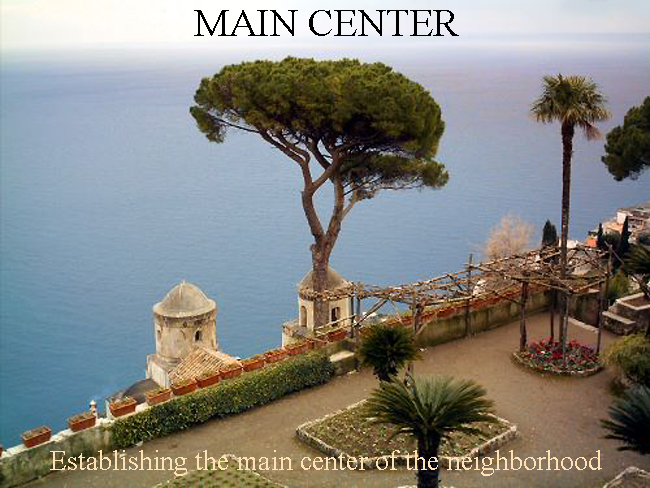

Assume now that a rough area for your neighborhood has been established, and its boundary is clear. The area may be part of an existing city, in need of new life or refurbishing. It might equally well be a green field site near a town, or on the edge of an existing town or village.

## Rule 1

**Let us ask ourselves which particular place in the area dedicated to the neighborhood most inspires us by its life or potential for life, and also has the greatest capacity for becoming the spiritual and emotional heart of the new neighborhood?**

In order to do this, we need to walk around many times, with others and alone, asking ourselves which place has the natural magnetism to pull us to go there, which makes us want to stay there, which has the power (potentially) to give us life merely from **being** there.

On a green field site, where a neighborhood does not yet exist, this feeling will most likely be generated by a view, by the form of the land which has a natural protected area, a declivity, or by a high spot which looks out. Great trees, are also capable of giving us such a place, naturally occurring water, the edge of a forest, the bottom of a cliff. It is impossible to predict with any general principles, what feature of a particular piece of land will have this character. Each piece of land is different, and will tell you, in its own way, what unique feature, on that land, is best suited to become the spiritual center of a future neighborhood built there.

On a site that is part of an existing neighborhood, or part of an existing town, the procedure is not very different, though it may turn out to be more complicated. ....

## Rule 2

**Let us now ask ourselves how the place we have chosen as the most natural center, may be enhanced and made profound.**

What we are asking here, is what kind of actions will support the essence of the place, make it convenient and natural for people to come to it, protect it from surrounding influences, so that it can have its own peacefulness and life.

## Rule 3

**Let us now ask ourselves how this place, which has been activated (in principle) by our response to Rule 2, may also be made beautiful and tranquil, as a work of architecture.**

The way to achieve this is to spend time, gazing on the land, at the place where the building is to be, or at the space itself, as a place and as a beautiful entity in itself. Ask yourself -- standing there, and closing your eyes -- how high it is, what line will enhance the place, where you would most expect to find the front edge of the building, if it is a peaceful and gentle place.

It will not be out of place, either, to ask childish things, of your inner eye. What color is it? When you close your eyes, what color do you see? What kind of windows does it have? When you close your eyes, what shape are the windows, what figure gives them inspiration, and makes the place worth being in?

## Conclusion

**As you see, these three rules are not rules in quite the usual sense. The rule does not tell us, magisterially, Do this! Do that!**

Instead it is a rule, but the rule says to you, Ask yourself this, and this and this -- and it works this way, because the rule knows that if you follow it, the vision of your own heart will answer the question correctly, and know what to do. And it knows, too, that when several of you do the same, together -- that is, do what this rule tells you, in the way of asking yourselves these questions -- then, for the most part, you will find yourselves in agreement with your fellows.

And that is where a lasting sense of unity and harmony within the neighborhood can come from: the results are not arbitrary, but found in the deepest place in your heart. It will last.

## Summary of tasks for this unfolding

- Define the area of this main neighborhood center on the ground and mark its corners with stakes.

- Transfer the positions of these corner stakes by direct GPS survey, via computer, to the topographic map you have.

- Try to decide what shaped space, how enclosed and how open, and what buildings around the space, will make it a beautiful spot.

---

← [Pedestrians come first](pedestrians-first.md) · ↑ [Phase 5: Public spaces](index.md) · → [Positive space](positive-space.md)

*From* Building Living Neighborhoods *by Christopher Alexander, Maggie Moore Alexander, Randy Schmidt and Nick Littlestone, with Bev Behrman and Howard Davis. © Center for Environmental Structure. [Original page](https://www.livingneighborhoods.org/actions/maincenter.htm).*
