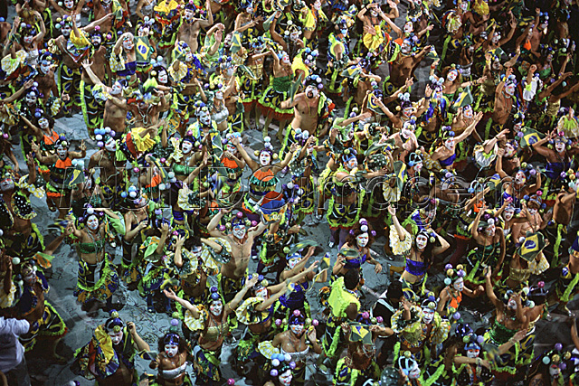
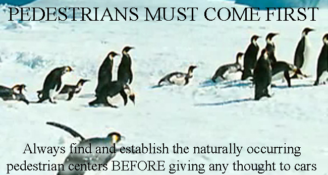

## Pedestrians must come first

Always find and establish the naturally occurring pedestrian centers BEFORE giving any thought to cars

This particular unfolding shows a case where the procedure of finding and establishing the network of pedestrian centers in a neighborhood, **by unfolding**, is entirely different from the normal process of planning streets as it has been done during the last two hundred years!

Let us ask ourselves which places in the area dedicated to the neighborhood most inspire us by their **present** life or potential for life, and also have the greatest capacity for becoming spiritual and emotional centers of the new neighborhood?

To do this, we need to walk around the place many times -- both with others, and alone -- asking ourselves which places have the natural magnetism to pull us to go there, which make us want to stay there, or simply BE there, which have the power (potentially) to give us life merely from our **being** there.

In other words, we look for the naturally existing places which are pleasant and comfortable, in their present state. We take a mental position, that these very plesant places, should become public places, and should be for the benefit of the neighborhood as a whole. In an urban site, if it turns out that a major vehicular thoroughfare is one of the most plessant and lively places in the neighborhood, we would then consider that it might, if at all possible, be transformed to pedestrian use, on the assumption that vehicle traffic, inherently more manipulable, and not as easily damaged functionally by lack of beauty, can be diverted or rerouted to a less important road.

On a green field site, where a neighborhood does not exist, similar feelings will most likely be generated by a view, by the form of the land which has a natural protected area, a declivity, or by a high spot which looks out. Great trees, are also capable of giving us such a place, naturally occurring water, the edge of a forest, the bottom of a cliff. It is impossible to predict with any general principles, what feature of a particular piece of land will have this character. Each piece of land is different, and will tell you, in its own way, what unique feature, on that land, is best suited to become the spiritual center of a future neighborhood built there.

On a site that is part of an existing neighborhood, or part of an existing town, the procedure is not very different, though it may turn out to be more complicated.

**The main point of this unfolding is that rather than *designing* a path network, according to our *ideas* of such a network, we start with those places in the neighborhood that have the deepest feeling -- and then choose to MAKE THESE DEEPER PLACES into streets and elements in a path network. The network comes into being as a result of what the beauty of the site and its places tell us, not vice versa.**

## Summary of tasks for this unfolding

- Without regard for existing traffic or lines of traffic, simply identify the most beautiful places in the neighborhood.

- Focus attention on these beautiful places, and use them as the backbone of what will become the pedestrian network.

- Take the shape of these places -- as they are now -- seriously, and leave them with the shape that now makes them beautiful, as it is.

- Transfer the positions of these shapes and spaces, with stakes in the ground.

- Measure their positions by direct GPS survey, via computer, to the topographic map you have.

- Complete the connections and connectivity, to take these most beautiful fragments, and connect them to each other to form a network.

---

↑ [Phase 5: Public spaces](index.md) · → [The main center of the neighborhood](main-center.md)

*From* Building Living Neighborhoods *by Christopher Alexander, Maggie Moore Alexander, Randy Schmidt and Nick Littlestone, with Bev Behrman and Howard Davis. © Center for Environmental Structure. [Original page](https://www.livingneighborhoods.org/actions/pedestriansfirst.htm).*
