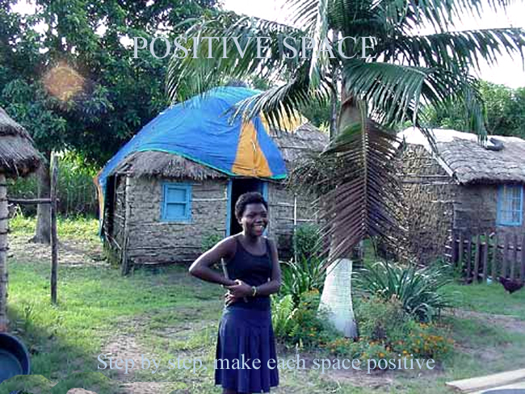
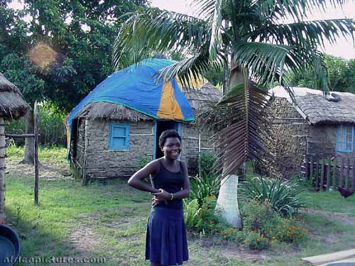
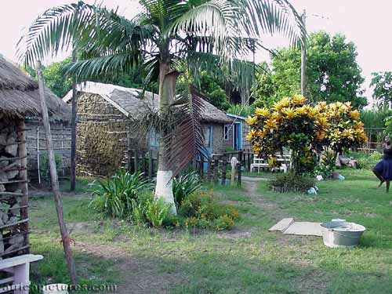
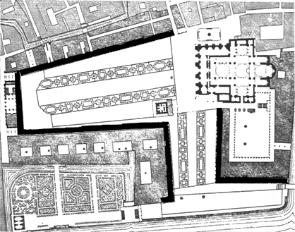
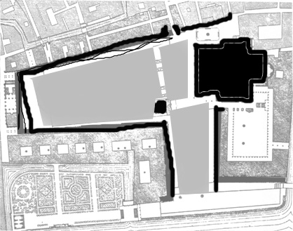
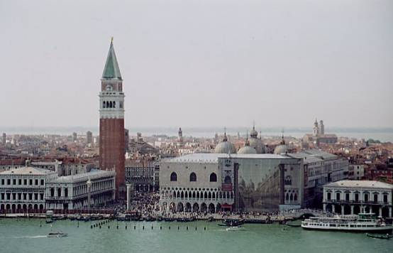

*The positive space at the core of a Zulu farm  Thembi Mhlongo*

**Space, especially outdoor space, is positive when you experience its embrace.** You feel its inside, and its outside, you experience its boundary, you can feel its center.

It has definite shape, it has a character that arises only from the land itself and what is there, it is a comfortable place to be, it is in some respects "convex".

What matters most, is the you feel the place has a heart, you want to be there, something is going on -- it makes you feel a world of some kind, with its life, is happening there.

You can make space positive, one step at a time, by making corrections. This works very well, you can feel your way into it, and you can watch the effects of what you are doing.

Step by step, you make every piece of every part of outdoor space turn into something well-shaped and positive.

## Take these unfolding actions

Walk the site alone.

Notice all the places and features which are give it its character, and its uniqueness, its center, and its boundary.

Are you clear in your mind where the boundary of this particular space ought to be?

If the boundary needs emphasizing, try putting an additional bit of "something" to increase the enclosure of the place.

A big piece of cardboard, a chair, a couple of chairs, a log, a couple of concrete blocks -- any of these can be used, to help you to "see" whether a slight increase in enclosure will make it feel better to be there.

In the same way, see if the space needs a center to embellish the feeling of being there. This center does not need to be in the middle. It could be a stone, a tree, a seat, a flowering bush, a place with a view, a place where the sunshine falls. If it needs it, you might try to embellish it, very subtly, by making something that makes the center feel more solid, something you can connect yourself to, when you are there.

Above all, work to make sure that whatever you do there leaves the beauty of what is there now, intact.

When you are done thinking about it, and testing it, take one small step which is a permanent or semi-permanent thing, which will affect the place in this way you have discovered, to make it more positive

Here is a second view of the Mhlongo farm. Now we see several positive spaces, not just the one we saw before. They are distinct, but overlapping. The positive spaces are made positive by a variety of elements, including fence, bushes, tree, woodpile -- all useful, and all accumulated over time.

The Mhlongo family is a traditional Zulu family that lives on a small farm located midway between the townships of Esikhawini and Port Dunford near Richard's Bay, South Africa. Their home is located about one kilometer off the paved road. Access is via a sandy pot holed road that winds out through a grove of eucalyptus trees across a pasture and then through a sugar cane field. Benard(pronounced ben-urd not "ben-ard"), the father, works as a gardener for a housing complex in Richards Bay where he earns 605 Rand (\$81) per month after transport costs. Since he doesn't have a car he takes a bus to work and back. He also grows a hectare(abt 2.5 acres) of sugarcane to supplement his income. They raise chickens, grow bananas, mangos, papayas, and tangerines, and have a small garden. Poor as they are in dollars, they are rich in beauty -- and they have time, the will, and the intelligence, to make every space positive.

**And the very same process can equally well be used for a great and magnificent place**. Just as it can be informal, the process of creating positive space can also be formal and grand. Let us consider St Mark’s Square in Venice. It was made in about ten steps, over a period of a thousand years, each one roughly occuring every hundred years. The Square has a kind of L shape or hammerhead shape, and is composed of three main “containers.” Yet we also experience it as one container. How then, does this manage to be positive? It is, I think, because of the Campanile, built before the main space was shaped, and shown as a small black square in the right-hand plan below.

The campanile forms a virtual center at the corner which has the effect of generating three independent spaces, each with good shape (shown gray in the right-hand plan below)), rather than being a single space with bad shape.

[**Click here, to watch a interactive movie showing the spaces and volumes of St. Mark's Square unfolding over the period from 560 AD to about 1600 AD.**](../../examples/st-marks-square.md)

*St Mark’s Square seen from the water*

You may find additional functional discussion of *Positive Outdoor Space* in *A Pattern Language* useful.  Click anywhere on the yellow page to come back here

## Library of Unfoldings version, longer

## Positive space

**Making a place positive, one step at a time**

Originally written for the Back of the Moon neighborhood, Texas, 1994

Space, especially outdoor space, is positive when you experience its embrace. You feel its inside, and its outside, you experience its boundary, you can feel its center.

It has definite shape, it has a character that arises only from the land itself and what is there, it is a comfortable place to be, it is in some respects "convex".

What matters most, is the you feel the place has a heart, you want to be there, something is going on -- it makes you feel a world of some kind, with its life, is happening there.

*The positive space at the core of a Zulu farm  Thembi Mhlongo*

You can make space positive, one step at a time, by making corrections. This works very well, you can feel your way into it, and you can watch the effects of what you are doing.

Step by step, you make every piece of every part of outdoor space turn into something well-shaped and positive.

## Take these unfolding actions

Walk the site alone.

Notice all the places and features which are give it its character, and its uniqueness, its center, and its boundary.

Are you clear in your mind where the boundary of this particular space ought to be?

If the boundary needs emphasizing, try putting an additional bit of "something" to increase the enclosure of the place.

A big piece of cardboard, a chair, a couple of chairs, a log, a couple of concrete blocks -- any of these can be used, to help you to "see" whether a slight increase in enclosure will make it feel better to be there.

In the same way, see if the space needs a center to embellish the feeling of being there. This center does not need to be in the middle. It could be a stone, a tree, a seat, a flowering bush, a place with a view, a place where the sunshine falls. If it needs it, you might try to embellish it, very subtly, by making something that makes the center feel more solid, something you can connect yourself to, when you are there.

Above all, work to make sure that whatever you do there leaves the beauty of what is there now, intact.

When you are done thinking about it, and testing it, take one small step which is a permanent or semi-permanent thing, which will affect the place in this way you have discovered, to make it more positive

Here is a second view of the Mhlongo farm. Now we see several positive spaces, not just the one we saw before. They are distinct, but overlapping. The positive spaces are made positive by a variety of elements, including fence, bushes, tree, woodpile -- all useful, and all accumulated over time.

The Mhlongo family is a traditional Zulu family that lives on a small farm located midway between the townships of Esikhawini and Port Dunford near Richard's Bay, South Africa. Their home is located about one kilometer off the paved road. Access is via a sandy pot holed road that winds out through a grove of eucalyptus trees across a pasture and then through a sugar cane field. Benard(pronounced ben-urd not "ben-ard"), the father, works as a gardener for a housing complex in Richards Bay where he earns 605 Rand (\$81) per month after transport costs. Since he doesn't have a car he takes a bus to work and back. He also grows a hectare(abt 2.5 acres) of sugarcane to supplement his income. They raise chickens, grow bananas, mangos, papayas, and tangerines, and have a small garden. Poor as they are in dollars, they are rich in beauty -- and they have time, the will, and the intelligence, to make every space positive.

**And the very same process can equally well be used for a great and magnificent place**. Just as it can be informal, the process of creating positive space can also be formal and grand. Let us consider St Mark’s Square in Venice. It was made in about ten steps, over a period of a thousand years, each one roughly occuring every hundred years. The Square has a kind of L shape or hammerhead shape, and is composed of three main “containers.” Yet we also experience it as one container. How then, does this manage to be positive? It is, I think, because of the Campanile, built before the main space was shaped, and shown as a small black square in the right-hand plan below.

The campanile forms a virtual center at the corner which has the effect of generating three independent spaces, each with good shape (shown gray in the right-hand plan below)), rather than being a single space with bad shape.

By clicking here, you may watch [a movie showing St. Mark's Square unfolding over the period from 560 AD to about 1600 AD.](../../examples/st-marks-square.md)

St Mark’s Square seen from the water

---

← [The main center of the neighborhood](main-center.md) · ↑ [Phase 5: Public spaces](index.md) · → [Recursive positive space](recursive-positive-space.md)

*From* Building Living Neighborhoods *by Christopher Alexander, Maggie Moore Alexander, Randy Schmidt and Nick Littlestone, with Bev Behrman and Howard Davis. © Center for Environmental Structure. [Original page](https://www.livingneighborhoods.org/actions/positivespace.htm).*
