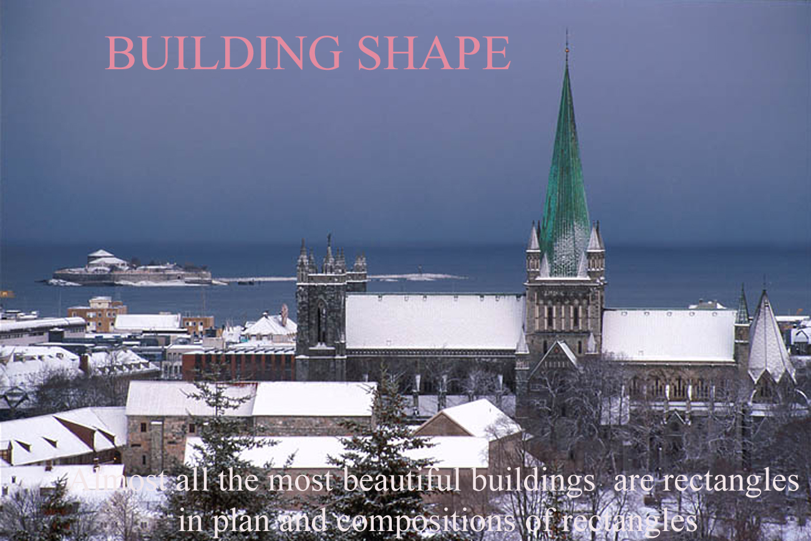

*Almost every building mass visible in this picture, from the town of Trondheim, is a rectangle in plan.*

## The basic shape of buildings

It is true that there are round igloos in the arctic, round wigwams among the plains , rounded mud huts in the Camerouns. Nevertheless, the vast majority of all good buildings, all over the world, for millenia, have been either

rectangular, or

near rectangular, or

compositions in which rectangles form coherent groups so that one rectangle leans off the next.

shaped by the shape of the boundary or nearby public way, even when it is curved or acute-angled.

The recent fashion for oddly shaped buildings has come about, for three main reasons:

First, because people have wanted to separate themselves from the sterile architecture of the 20th century, and somehow, by using more complex shapes, they think they will "do better".

Second, it happens simply because of lack of mental discipline. When someone who does not understand the nature of buildings or the nature of built space, or if they do not understand the principles of structural stability, there is a tendency to draw a rounded or odd-shaped polygonal diagram, and then try to make an actual building on the basis of that plan.

Third, it comes about because people do not understand the nature of the positive space next to the building. A rounded building or an angular building can only very rarely form positive space next to it.

## Summary of tasks for this unfolding

When the rudimentary placing of buildings first occurs, before the individual buildings are designed in detail, create credible and useful rough compositions in which each building is made of any one of the following:

- **Make the building mass a simple rectangle in plan -- in later elaborations the plan may take on many small helpful details which differentiate its shape and envelope.**

- **Make the building mass a rough rectangle which may have slight deviations from the perfect right angles in one or two corners, to accomodate the building to an existing context which requires such deviations.**

- **Make the building a hierarchical arrangement of several rectangles, in which the smaller rectangles "lean up against" the larger ones.**

- **In cases where the building is close to a road or boundary, shape it to maintain positive space in the public realm, and thus let it be shaped by the shape of the boundary or nearby public way, even when they are curved or acute-angled.**

---

← [Building fronts](building-fronts.md) · ↑ [Phase 6: Building volumes](index.md)

*From* Building Living Neighborhoods *by Christopher Alexander, Maggie Moore Alexander, Randy Schmidt and Nick Littlestone, with Bev Behrman and Howard Davis. © Center for Environmental Structure. [Original page](https://www.livingneighborhoods.org/actions/buildingshape.htm).*
