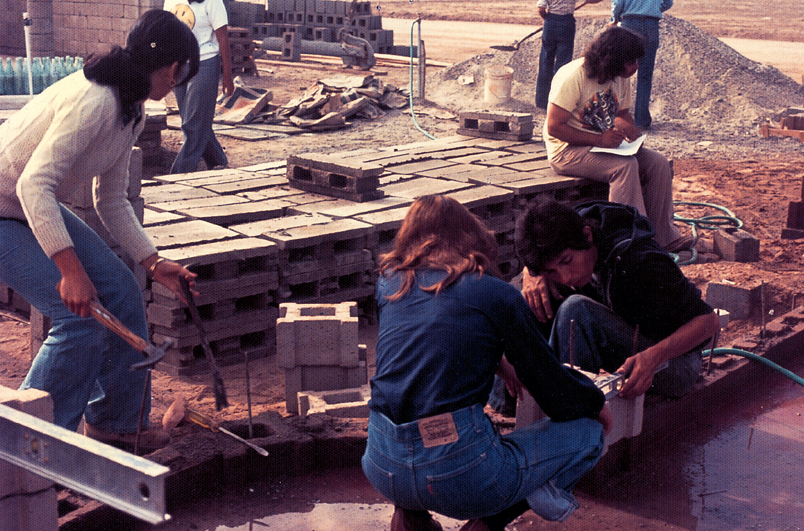
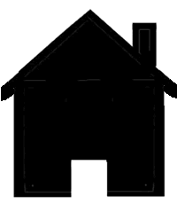

## Generative codes have

Evolved from pattern languages, but are much more sophisticated generating systems.

A generative code is a system of unfolding steps that enable people in a community to create a wholesome and healthy neighborhood. The steps are governed by rules of unfolding that are not rigid, but depend on context, and on what came before. The rules work in a way that is similar to the rules that nature follows to unfold an organism or a natural landscape, much as genetic codes unfold embryos. But these rules unfold a neighborhood and its buildings from the whole, and lead to a unique result for each particular place.The rules tell you how to take specific steps, in a certain way that allows unfolding to proceed.

- Like patterns (identified in *A Pattern Language*, 1975), the rules cover a great range of scales -- all of the major features of the neighborhood, down to the finer details, including open spaces, buildings, connecting paths, rooms, window sills, etc.

- The rules are ordered - sequenced - to unfold each part of the environment being created, smoothly and coherently.

- Also, in the generative code, each rule is specifically tied to a certain group of individuals, whose job it is to undertake that part of the unfolding together.

- Finally, in order to make the process succeed, the overall operation of the unfolding, which goes forward step by step, is accompanied by a general set of practical specifications for the conditions governing land tenure, cash flow, and human organization, and the community in which the process is being carried out.

When a generative code is used, the order in which things are done plays a **decisive** role in proper execution of the unfolding process. For example:

- Diagnosis of the site is an essential early step.

- Roads and driveways must be located and built after the pedestrian structure, not before.

- Roads must be located and built after the houses, not before.

- Sewers must be located and laid after public space is created, not before.

- When houses are designed, the garden must be placed (located) before the house volume is located, not after.

- Construction work must begin long before final drawings are ready, and the drawings develop, in parallel with the construction process.

- Windows must be placed, designed, and measured and built, after the walls or wall framing has begun, so that they reflect the real situations in the room, its light, and view.

- According to contract, changes of design which have no effect on quantity of units built, must not be viewed as change orders, but as part of the builders obligation, provided they stay within parameters of quantity and price.

In an unfolding sequence, these things occur in this unusual order, not in the order we might expect from conventional contemporary building methods. This is because each activity is unfolding from the wholeness of the place. The changes of sequence are not whimsical, but necessary, to make sure that each thing can be adapted to the whole, in a successful fashion. They are necessary, in order to allow a coherent unfolding, of the neighborhood, where the right things come first, and the lesser ones take their place in the context provided by the major things. The "right" things, are the ones which have the biggest impact on the environment from a human and emotional point of view, which is capable of making people healthy because their deepest feelings are respected.

## Footnote

In order to see the contrast, here is the order in which these things were usually done in conventional 20th-century development work, many of them specified in existing city codes. In current practice, there are many conventions of sequence, which have become part of the accepted wisdom, in planning, architecture, and development.

**The following examples are all harmful:**

Conventionally: Roads are built before the buildings they serve.

Conventionally: In a tract development, street sewers are laid long before the houses are built.

Conventionally: Houses are placed, and the garden is whatever is left on the lot, comes second.

Conventionally: Windows are designed and positioned at the time the building's plans are submitted for plan check.

Conventionally: Drawings are completed before any construction work is done.

Conventionally: Neighborhood plans are completed, before any construction work is done.

Conventionally: Public spaces are designed after individual buildings.

Conventionally: Changes are done by change orders, and therefore become very expensive.

**These practices do not support the creation of living neighborhoods.**

## The six phases

***Building Living Neighborhoods***

## Action & practice

A Generative Code for Modern Neighborhoods

In the generative code, each major part of the design and making process is called a "Phase."

\* \* \*

Each Phase is made up of several "Unfoldings" , which are the small steps one needs to undertake, in sequence, to achieve the goal of that Phase.

\* \* \*

Begin with Phase 1, Startup & Vision, to take the first practical steps towards imagining, designing, and building your neighborhood project.

## Phases

[**1. STARTUP & VISION\
[2. DIAGNOSIS OF LAND](2-diagnosis/index.md)\
[3. SETTING DENSITY](4-density/index.md)\
[4. MODIFYING THE CODE](3-modifying-the-code/index.md)\
[5. PUBLIC SPACES](5-public-spaces/index.md)\
[6. BUILDING VOLUMES](6-building-volumes/index.md)\
7. BUILDING LAYOUT\
7. BUILDING DESIGN\
8. PROJECT MANAGEMENT\
9. CRAFT AND CONSTRUCTION**](1-startup-and-vision/index.md)

Partial list of currently available phases and unfoldings

When you have had a look at the unfoldings, and are familiar with the way they work, the first task is to select the unfoldings that are relevant to your project, and place them in your WORKBOOK (see menu to the left). As you go forward collect pages, your own notes, sketches and ideas about the neighborhood, together with printed pages of the unfoldings you feel to be appropriate.

The DRAWING PAD (see menu to the left) provides a greater level of support to understand the land, and the unfoldings, as they occur.

## Step list with the three kinds of unfolding

## Step list

The following list of steps presents the unfoldings roughly in the order in which they will, typically, be used.

There are three different kinds of unfoldings.

1.  Those which are marked with the rainbow symbol . These inspire the design to move in a certain direction. They are unfoldings of a kind, but the unfolding occurs as a dream or image, which does not directly impact the concrete geometry of the plan. You may think of these as nascent unfoldings, which are carried forward in the process, remembered, and made concrete later.

2.  Those which are marked with the house symbol , are the ones which play the active part in the unfolding process. That is to say, in the geometrical creation of the emerging design Each of these steps, contributes a definite transformation to the emerging design, or drawing, or computer drawing on the drawpad. It is these steps which unfold the plan and design, and cause it to be successful, or not.They are the backbone of the list.

3.  Those which are unmarked and on a gray background, are also important, but less so. They do not have an immediate transformative effect on the emerging design. The provide an overall feeling, which should contribute to your understanding, and to discussion in your group. But they do not have the same unmistakable, concrete, practical effect on the design as the other two.

## Startup & vision

Worksheet: Fill out a worksheet describing your idea

People: Slowly and deliberately, bring in people you know, who want to be involved

Vision: Together, close your eyes, and imagine the neighborhood as in a true vision. You wait for it, and let it come of its own accord into your eyes-shut mind.

[Basemap: Make a detailed basemap of the area where your new neighborhood will be](1-startup-and-vision/basemap.md)

[Poetry: In words, write down your vision of the place, in the most emotional language](1-startup-and-vision/poetic-pattern-language.md)

## Diagnosis of the land

[Introduction: Introduction to diagnosis](2-diagnosis/introduction.md)

[The whole: Observe and sketch the deep configuration of the whole](2-diagnosis/drawing-the-diagnosis.md)

[Precious places: Identify the most beautiful and precious places](2-diagnosis/precious-places.md)

[Repair: Identify spots and areas that most need repair](2-diagnosis/damage-and-repair.md)

Draw: Draw diagnosis on your map

[GPS: Use GPS for exact positioning, and transfer to the map](2-diagnosis/gps.md)

## Customize our generative code to fit

## Your project

[Entities: Identify the most important entities and centers that will give the neighborhood its visionary character. These are not yet located, but identified and described, as to type.](3-modifying-the-code/entities.md)

Items of code: Write them up, as items of generative code, generic in nature, not specific to any one location, and having the emotional power of the visions established in \#1.5 above.

Locations: Now -- separately -- consider possible locations in the neighborhood, where these special entities might be built

Workbook entries: Insert the descriptions of these special entities, into this generative code you have downloaded to your workbook. These will need to be given special sheets, that you must make for yourselves inside your workbook.

Publish: If you feel that these entities your neighborhood has discovered, or pioneered, may be helpful to other neighborhoods, then add them to this website, for others to use as well.

## Place, size, and shape major public spaces

[Pedestrians first: A general proposition - Pedestrians first, cars later](5-public-spaces/pedestrians-first.md)

[Main center: Find and locate the main neighborhood center](5-public-spaces/main-center.md)

[Pedestrian centers: A general proposition - Pedestrians first, cars later](5-public-spaces/pedestrian-centers.md)

[Paths: Locate the most paths along beautiful spots and lines](2-diagnosis/magic-configurations.md)

Minor centers: Locate minor public centers as far as makes sense

[Shaping centers: Go back over all the public spaces you have located so far, and give each one a size and shape appropriate to its position. In doing this you are, step by step, to begining to shape the shared space of the community](5-public-spaces/positive-space.md)

## Begin decisions about building positions

[Building fronts: Building fronts must be positioned to generate valuable, positive space between them](6-building-volumes/building-fronts.md)

[Main center: Find and locate the main neighborhood center](5-public-spaces/main-center.md)

[Paths: Locate the most paths along beautiful spots and lines](2-diagnosis/magic-configurations.md)

Minor centers: Locate minor public centers as far as makes sense

[Shaping centers: Go back over all the public spaces you have located so far, and give each one a size and shape appropriate to its position. In doing this you are, step by step, to begining to shape the shared space of the community](5-public-spaces/positive-space.md)

*From* Building Living Neighborhoods *by Christopher Alexander, Maggie Moore Alexander, Randy Schmidt and Nick Littlestone, with Bev Behrman and Howard Davis. © Center for Environmental Structure. [Original page](https://www.livingneighborhoods.org/ht-0/gcwelcome.htm).*
