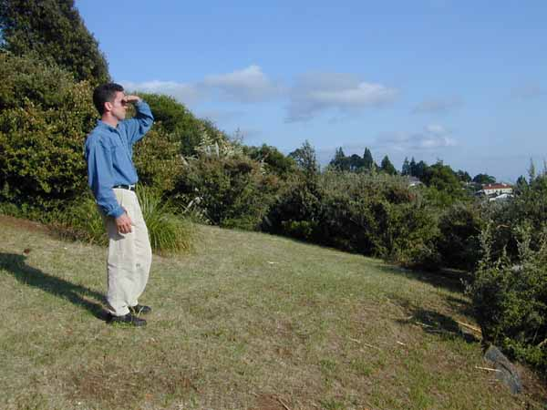

## How then to produce the key features in a neighborhood:

## The need for generative code

How to make key features of a neighborhood specific to a unique site

let us consider a site for a neighborhood, brownfield or greenfield. And let us say, that one of the elements high on our list of key features, is a neighborhood center (See [key features](key-features-of-a-living-neighborhood.md)). According to typical 20th-century practice, In a contemporary development, a planned neighborhood center (if there is one at all) is very likely to be an artificial thing, that started life as a mark on a piece of tracing paper, or as an area on a CAD file. Not surprisingly this does not have much life, when it is finally built. Let us, instead, consider a generative rule, or rules, which will **generate** the center, tell us where to put it, and tell us how to shape it! For example:

- Find a place which is an inspiring place, that looks out over the natural terrain, and that is marked as a place with a life of its own.

- Discuss this place with others, and dont choose it, *finally*, until you have at least near consensus, about which place is best and most inspiring.

- Then, using your arms, waving your hands, and using sticks, stones and strings as markers, mark out the shape of a place which seems natural and profound as an actual defined place that will form the center as you hope it will be.

This process is generative. By doing these three actions, you and your colleagues will find yourselves interacting with the landscape, and you will make decisions that come from the place, not only from you -- indeed not primarily from you at all.

## How the neighborhood center has been generated

Let us now consider a very straightforward example, of architecture: a type of form which is being created continuously, by people for themselves individually and collectively, in many parts of the world...

Looking for a likely spot

**The results are beautiful, organic, sustainable, and infinitely various. And nothing further is needed.**

*From* Building Living Neighborhoods *by Christopher Alexander, Maggie Moore Alexander, Randy Schmidt and Nick Littlestone, with Bev Behrman and Howard Davis. © Center for Environmental Structure. [Original page](https://www.livingneighborhoods.org/ht-1/from-key-features-to-generative-code.htm).*
