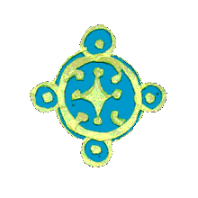
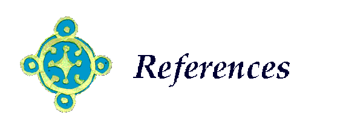
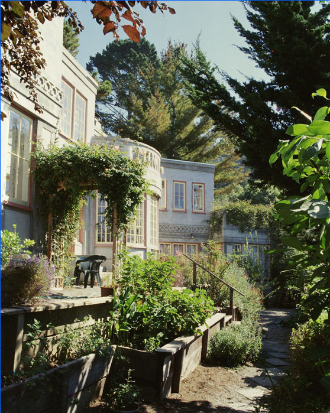

[jump](#anchor)

## Generative codes

Generative codes have evolved from pattern languages, but are much more sophisticated generating systems.

A generative code is a system of unfolding steps that enable people in a community to create a wholesome and healthy neighborhood. The steps are governed by rules of unfolding that are not rigid, but depend on context, and on what came before. The rules work in a way that is similar to the rules that nature follows to unfold an organism or a natural landscape, but these particular rules unfold a neighborhood and its buildings.

- The rules tell you how to take specific steps, in a certain way that allows unfolding to proceed.

- Like patterns, the rules cover a great range of scales -- all of the major features of the neighborhood, down to the finer details, including open spaces, buildings, connecting paths, rooms, window sills, etc.

- The rules are ordered – sequenced – to unfold each part of the environment being created, smoothly and coherently.

- Also, in the generative code, each rule is specifically tied to a certain group of individuals, whose job it is to undertake that part of the unfolding together; the roles needed for each one are specified.

- Finally, in order to make the process succeed, the overall operation of the unfolding, which goes forward step by step, is accompanied by a general set of practical specifications for the conditions governing land tenure, cash flow, and human organization, and the community in which the process is being carried out. These conditions are stated [at this bottom of this page](#conditions).

## Topic

**Details of Document**

## The birth of form

(morpho=form genesis=birth)

## Morphogenesis

The essence of a harmonious neighborhood is that it flows from the land, is harmonious with the land, and enhances the global structure of the land. This is true in rural areas, and it is true in urban areas. To understand how this process works, we ask you to study a short memo called [The Birth of Form](morphogenesis.md). It explains how a very simple process can generate large scale patterns in such a way as to be harmonious with a piece of land.

## Rules that make morphogenesis work

Please look back at the [five rules for terraces](morphogenesis.md) in the Birth of Form memo. They allow people to generate agricultural terraces for hundreds of square miles, Each of these rules makes you DO something, it is extremely simple, and it is expressed in a way that makes what you do depend on the configuration of the land and place, so that you are -- almost without effort -- in harmony with it.

This system of rules is a **generative system**.

## Start applying generative thinking to a typical neighborhood

To start thinking about a neighborhood in generative terms, please look at the [three rules for starting a neighborhood](../generative-code/5-public-spaces/main-center.md) by clicking this link.

Again, these simple rules are **generative** rules. You will find they generate something that is more in keeping with the land, or with existing buildings around the area: and you will find, too, that if you do it well, it will be more in keeping with the feeling in your heart.

If you continue the generative way of thinking when you go through detailed design, procurement, and construction, the neighborhood will still have that quality years later, when it is built and used!

## Watch a neighborhood plan unfolding

**It is exciting to watch.** Please look at [**THE UNFOLDING OF STROOD IN KENT**](../examples/strood-riverside.md) by clicking this link. You will see the geometric structure of the new neighborhood arising step by step, under the impact of some thirty generative rules. You may visit other parts of the site to get more information about the way this process works, in practice.

## Writing generative code

A paper describing the first steps of a typical generative code, which shows you how to get started, and also gives you a feel, immediately, for the huge difference between this generative kind of code, and the urban codes being used today, which are little more than rigid rule-books.[Writing Generative Codes](../generative-code/3-modifying-the-code/writing-a-generative-code.md)     5 pages

## A completed generative code as an example

Here is a complete generative code for a new community of 1200 houses on a square mile of land, on the Oregon coast.[The Generative Master Plan for Harbor Hills, Oregon](../assets/library/brook-2.pdf)    137 pages    40 pictures. Published January 2005.

A fledgling generative code while it is still being thought out

An example of an early stage in the process of writing a generative code. It is a complete code for a new neighborhood, very rough, which was written in two or three days. It contains many errors and omissions but is typical of the kind of work which can get you started, and which then begins to give a feel for the whole neighborhood that will be generated by this code. [Creating a new Generative Code for a neighborhood of houses and businesses in Strood](../assets/library/stroodcode-v13.pdf)    32 pages    10 pictures.

Below, *a house in California created with a generative code: the house fits the land, it seems loose, and more complex than a typically "designed" house. Yet it is made of highly ordered, locally symmetrical parts, so that one sees and experiences a rich hierarchy of enjoyable parts, each of which enriches the larger whole around it, and connects to it.*

## Further reading

## Definition of generative codes

[What is a Generative Code?](../assets/library/generativecodesv10.pdf) A paper discussing the nature of generative codes and the reasons why they work:   25 pages   

## Morphogenesis and sustainability

A longer paper discussing the unfolding of neigborhoods in the environment, in a way that parallels the unfolding of organisms and organic structures. This is shown to be the origin of true sustainability.Sustainability and Morphogenesis    69 pages    70 color pictures.

## Pattern languages: relation to generative codes

Pattern languages are very useful, but do not place sufficient emphasis on the dynamic component of **unfolding**, which does the hard work of creating and generating living form. This short memo ([The evolution of generative codes from pattern languages and sequences.](pattern-languages.md) ) explains the relation of pattern languages, the sequences presented in *The Nature of Order*, and the new Generative Codes.

## Necessary practical conditions

[Here you can see a List of the necessary practical features which allow unfolding to occur](../running-a-project/main-steps-of-work.md)

Please note: in order to allow us to make new results available as quickly as possible, many of the available papers are in draft form; others are in final form or in published form. If you need further information, please contact us by e-mail at [CES](mailto:livingneighborhoods@patternlanguage.com)

*From* Building Living Neighborhoods *by Christopher Alexander, Maggie Moore Alexander, Randy Schmidt and Nick Littlestone, with Bev Behrman and Howard Davis. © Center for Environmental Structure. [Original page](https://www.livingneighborhoods.org/ht-0/generative.htm).*
