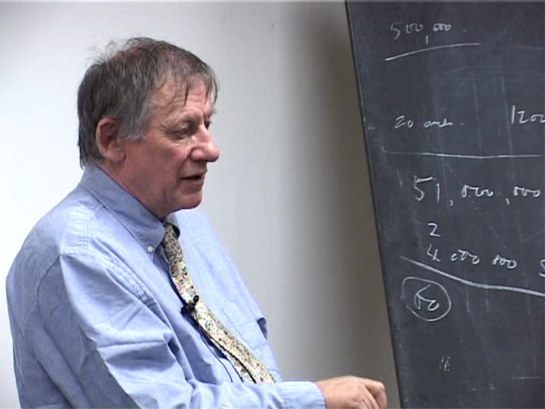

## Theory

and BACKGROUND

Why building communities and neighborhoods should be done this way...

[**BASICS\
[WHAT IS A GENERATIVE CODE](generative-codes.md)\
[CREATING COMMUNITY](../running-a-project/creating-community.md)\
[MAIN STEPS OF WORK](../running-a-project/main-steps-of-work.md)\
[UNFOLDINGS the elements of generative code](../unfoldings/index.md)\
[NEIGHBORHOODS built using this theory](../examples/index.md)\
[ARCHIVE of papers and essays](../library/index.md)**](what-makes-a-neighborhood-live.md)

## Overview of theory

## Summary contents of this part of the website

## Basics

Features of a [successful neighborhood](what-makes-a-neighborhood-live.md): size, cultural and human attributes, geometric attributes, and wholeness.

## Generative codes

When the concepts of life from *The Nature of Order* are applied to neighborhoods, a new class of sophisticated generating systems results. These systems try to ensure that life will be enhanced in a neighborhood, and deepen over time. They are called [generative codes](generative-codes.md). Almost everything built in the later twentieth century was planned out ahead of time in great detail. A generative process works differently. Like a biological process, the structure is built up gradually, so that a coherent whole is able to emerge,

On the Main Steps page, the subtle human interactions, and the practical technical arrangements that are at the heart of a generative process, are set out in a straightforward manner to ensure that each is covered --\> and genuine life can be achieved.

## Creating community

[Creating human community](../running-a-project/creating-community.md) as a necessary and fundamental basis for neighborhood building.

## The main steps of work

**HOW TO BUILD WITH GENERATIVE CODES.**  To enable you to carry out the generative approach to city planning and to the construction of designing buildings and neighborhoods, this page gives you an extended overview of the process, with detailed instructions at each stage, on how to proceed. Both the practical technical processes and the subtle human processes are set out in a straightforward manner to ensure that each is covered and hopes of genuine life in the neighborhood may gradually be achieved. They include: [phases of thought, community discussion, generative code, design, planning, building, money, craft, and overall implementation](../running-a-project/main-steps-of-work.md) .

## Library of unfoldings

**THESE ARE THE ELEMENTS OF GENERATIVE CODE THAT DO ALL THE WORK.**  The **elements** of a generative code are "unfoldings". They resemble patterns, but their emphasis is on dynamic action-oriented steps by which structure is introduced into the neighborhood, thus giving it shape. From the list of unfoldings in the [Library of Unfoldings](../unfoldings/index.md), choose the ones that are most useful to you. Each can define, for you, one step or action in your generative sequence of unfolding.

## Examples of neighborhoods

Examples of living neighborhoods and the generative codes which created them show how "life" takes many, extraordinarily different forms in different places of the world. Plans, discussion, and photographs of [places and neighborhoods](../examples/index.md) we have built and helped to build, or are working on, to illustrate what is involved.

## Archives

[Recent writings](../library/index.md) focusing on key theoretical, scientific, and practical aspects of the neighborhood-building process. These materials provide evidence supporting the assertions on this website. We hope that this evidence will encourage more and more people, world-wide, to take part, by improving and rebuilding neighborhoods in their own regions.

*From* Building Living Neighborhoods *by Christopher Alexander, Maggie Moore Alexander, Randy Schmidt and Nick Littlestone, with Bev Behrman and Howard Davis. © Center for Environmental Structure. [Original page](https://www.livingneighborhoods.org/ht-0/theory.htm).*
