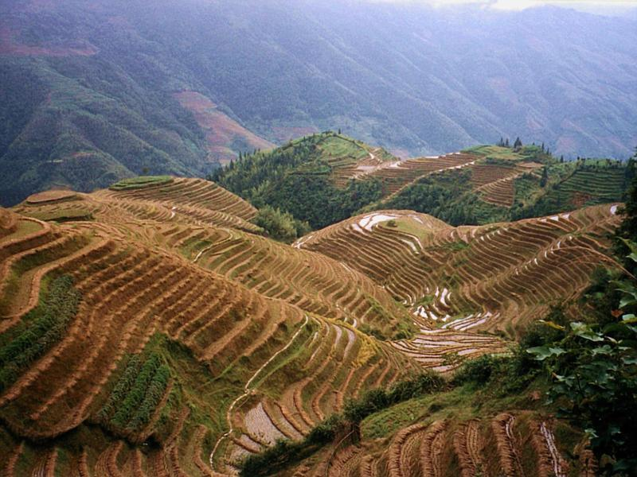
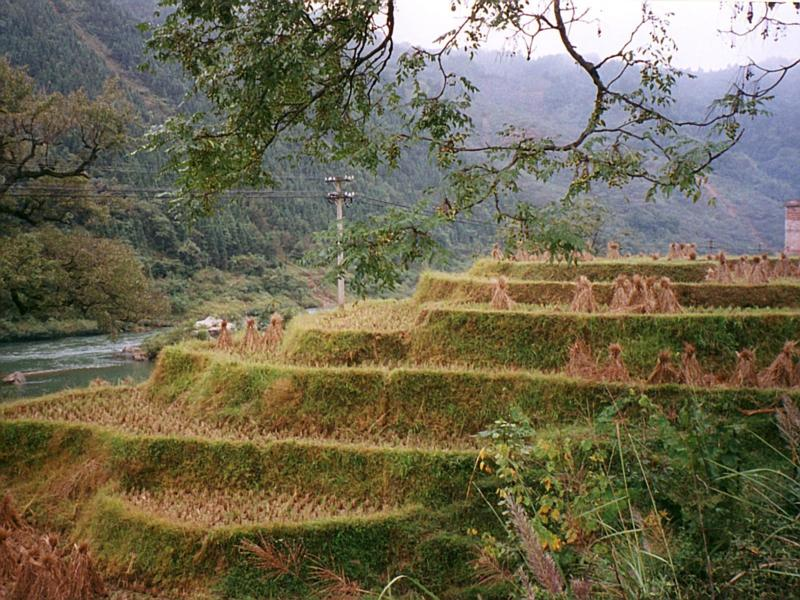
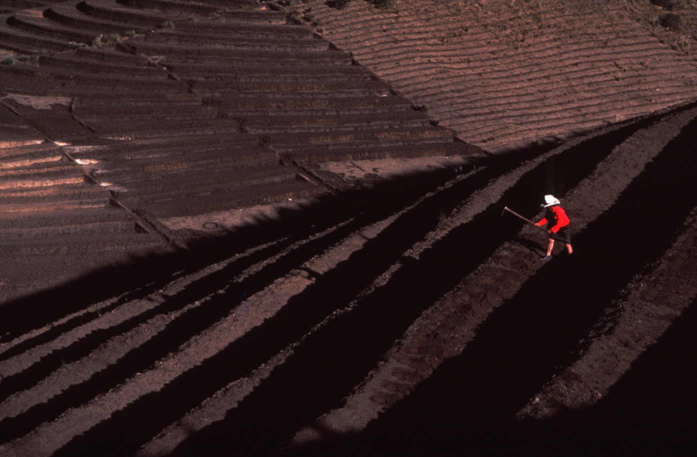
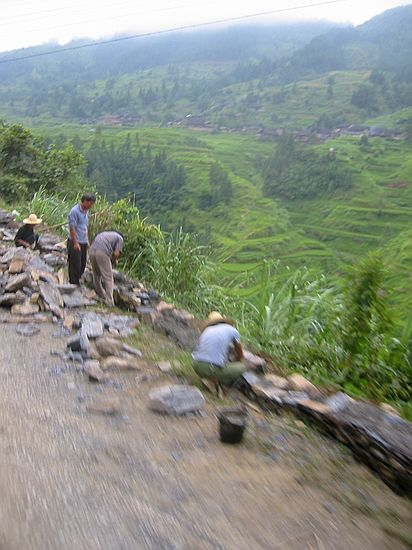
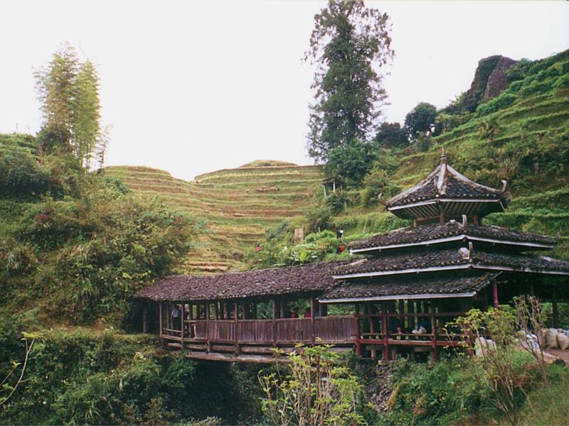

## The birth of form:

## Making the land harmonious

## Terraces in china

Let us now consider a very straightforward example, of architecture: a type of form which is being created continuously, by people for themselves individually and collectively, in many parts of the world...

Terraces in China's Guizhou province

A close-up picture of these terraces showing more detail of the way they are made.

A farmer engaged in virtually the same activity, in Guatemala

People engaged in a very similar activity to build a road in the same terrain.

Guizhou again: completed terraces, with a building nestled among them.

THE GENERATIVE CODE FOR THESE TERRACES These kinds of terraces have been built for millennia -- in Africa, Italy, Austria, China, Guatemala, and in almost every place on earth where there is hilly terrain.

Very roughly, the generative code consists of only half a dozen steps.

1.  Smooth the terrain to some degree

2.  Follow level lines along the contours on the slope

3.  Build a small wall, in stone or mud, or earth reinforced with sticks.

4.  Build the next wall a couple of feet down in level, and again let the lower wall follow the most level path, allowing the terrace to widen and narrow accordingly.

5.  Level the soil in the terrace.

Beyond these steps, there are a few variants. The walls can be stone, but they can equally be made of grass running over the earth wall, and holding it together. Trees may be planted in places along the wall.

In essence this very simple generative code, has enabled people to tame, and cultivate, thousands of square miles, all over the planet.

**The results are beautiful, organic, sustainable, and infinitely various. And nothing further is needed.**

This is the key to ALL unfolding, that produces harmonious results. And it is the method that nature itself uses. Throughout biology, a simple set of rules or processes are set in motion, and then generate beautiful structures of infinite variety, which fit the places where they belong.

## Caution

## An important note

Be careful in your thinking. Of course it is not true that ANY set of five rules will be able to to generate large and beautiful larger wholes that are well-fitted to the land. The rules we choose as generative rules, must have profound properties -- and a special kind of coherence -- so that they do work together, simply, to generate successful, well-adapted large scale configurations.

To study these profound properties is a very complicated business, and we must be respectful of it. It is at least as complicated, in its way, as the science of morphogenesis and the process which allows living form to appear when an embryo is formed. We do not need to start thinking about this problem just yet. For the time being, let us stay with our simple, and down-to-earth picture. But if we want to go deeper, and reflect on the depth of this great problem, we cannot do better than read a few words by the great biologist Lewis Wolpert, where we shall begin to understand the deeper aspects of what generative codes are, and what they need to do.

## A lesson

## From biology

quoted from Lewis Wolpert, Professor of Biology, University of London.

**Here is an eminent Professor of Biology on the same subject:**

"The embryo contains a generative rather than a descriptive program. All the information for embryonic development is contained within a fertilized egg. So how is this information interpreted to give rise to an embryo? One possibility is that the structure of the organism is somehow encoded as a descriptive program in the genome. Does the DNA contain a full description of the organism to which it will give rise? The answer is no. The genome contains instead a program of instructions for making the organism—a generative program—in which the cytoplasmic constituents of eggs and cells are essential players along with the genes like the DNA coding for the sequence of amino acids in a protein.

"A descriptive program, like a blueprint or a plan, describes an object in some detail, whereas a generative program describes how to make an object. For the same object the programs are very different. Consider origami, the art of paper folding. By folding a piece of paper in various directions, it is quite easy to make a paper hat or a bird from a single sheet. To describe in any detail the final form of the paper with the complex relationships between its parts is really very difficult, and not of much help in explaining how to achieve it. Much more useful and easier to formulate are instructions on how to fold the paper. The reason for this is that simple instructions about folding have complex spatial consequences. In development, gene action similarly sets in motion a sequence of events that can bring about profound changes in the embryo. One can thus think of the genetic information in the fertilized egg as equivalent to the folding instructions in origami: both contain a generative program for making a particular structure."

*From* Building Living Neighborhoods *by Christopher Alexander, Maggie Moore Alexander, Randy Schmidt and Nick Littlestone, with Bev Behrman and Howard Davis. © Center for Environmental Structure. [Original page](https://www.livingneighborhoods.org/ht-0/morphogenesis-two.htm).*
