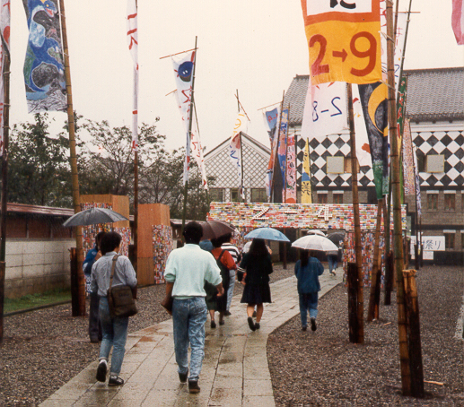

[jump](#anchor)

## Basics of neighborhood structure

How much is known about the key features of a successfulneighborhood?

What are the features that make it a pleasant place to live, allow you to live life in a way that is really enjoyable, and allow gardens, work places, children, families, sports, amusements, shopping, manufacturing, growing things and making things to co-exist?

What is the range of sizes for a neighborhood?

How big, or how small, can a neighborhood be? When we think of neighborhoods, we often imagine a couple of streets, with an area perhaps 100 yards across. Other places we also call neighborhoods are much larger -- areas like Greenwich village in New York, or Boston's Beacon Hill -- with many thousands of inhabitants. But a few buildings can form a neighborhood, too. On occasion, even a single house or single building may be a neighborhood. It depends on whether there is a sense that the place reaches out to include people, become a focus of social life, or emotional life. So even a handful of buildings will be better off if they ARE viewed as a neighborhood.

If you have an embracing view of some corner of the world, and want to make it better, want it to contribute in a valuable way to the world around it -- then that, by definition, will be a neighborhood. And your city, or town, or village, will be better off, if it is made of many, many such neighborhoods, small ones inside larger ones, all nested together. If that is your intent, the information on this website applies to your project.

## Neighborhoods have many different qualities, cultures, and functions

A neighborhood can be a school, a group of families, or a place with businesses and families living together. A church precinct can be a neighborhood. A pair of houses can form a neighborhood. A park with a few buildings in it can be seen as a neighborhood. A playground and roller-skating rink can form a neighborhood. A waterfront promenade with houses and shops all along can be a neighborhood. A group of 1000 houses can be a neighborhood. Even a small town of 5,000-10,000 may be regarded as a neighborhood, and built accordingly.

*The entrance street of a college and high school community outside Tokyo*

## Qualities of a living neighborhood

The core structure of a living neighborhood is crucial to the individuality and varieties of neighborhoods. These features are well-defined, and beginning to be fairly well-known. Please look most carefully at the [key features](key-features-of-a-living-neighborhood.md) which we believe all neighborhoods must have, in order to be good to live in, vibrant, creative, and fun to be in.

## One example: a high density neighborhood

We show a bird's eye view of a possible rebuilt neighborhood in the town of Strood, southeast of London. Please look at [this example](../examples/strood-riverside.md) to get an overall impression of the kind of structure which is likely to emerge from the use of generative codes at high density. It is a riverside neighborhood which could have about 350 families and businesses, and be vastly superior to the ugly and devastating highrise apartments which Medway council is currently contemplating. It meets the maximum density required by the Office of the Deputy Prime Minister (50-60 dwellings per hectare). That density is apparently not high enough to satisfy the council, who seek to build high rise apartment buildings all along the river, ruin the land, and make more money. **High-rise apartment buildings will not help the families live happier or more satifying lives!**

## Other examples

Many other examples in different countries, climates, and at different densities, are shown on the [example neighborhoods](../examples/index.md) page.

## The wholeness of a place

Every place on Earth, large or small, has its wholeness. It has wholeness if it is a green field site, a brown field site, a patch of dirt in the desert, a river bank, or a complicated little corner of a great city. This wholeness is a deep structure which simply exists there. You can sense it, you can grasp it or feel it by intuition, and you can analyse it by paying attention to the system of centers, large and small, which exist there.

The core of all successful human building, and of all successful neighborhood building, is that we respect and pay homage to that structure which exists, by intensifying it or enhancing it, and making it more beautiful.

## Wholeness-extending transformations

To create this natural beauty in a neighborhood, we need a way of both grasping the wholeness which exists there, and then creating from the natural structure of the place, an intensified deeper structure, consistent with its wholeness. Both can be done by learning to make transformations -- called wholeness-extending transformations -- to generate the steps of unfolding that give us the new, enhanced structure.

[*References*](nature-of-order-references.md)

Fifteen properties that are the building blocks of wholeness

To have life, the core physical structure of a living neighborhood must be congruent with the underlying structure of all wholeness. Wholeness-extending transformations are created by using fifteen properties. The properties work by injecting fundamental structure, over and over again, at many different scales. This is where the beauty of a neighborhood comes from.

Please look most carefully at the [fifteen properties](fifteen-properties.md) from which wholeness is built, and which neighborhoods must have, in order to be good to live in, vibrant, creative, health-giving, fun, and tranquil.

[*References*](nature-of-order-references.md)

## Where unfolding really comes from

The intellectual understanding of how morphogenesis and unfolding come about is not really sufficient, for it to be done well. Please read this [Note on the personal nature of the world](building-on-relationship.md). It has bearing on every step of the unfolding process, and shows how deeply unfolding and community are connected.

Please note: in order to allow us to make new results available as quickly as possible, many of the available documents are in draft form; others are in final form or in published form. If you need further information, please contact us by e-mail at [CES](mailto:info@livingneighborhoods.org)

*From* Building Living Neighborhoods *by Christopher Alexander, Maggie Moore Alexander, Randy Schmidt and Nick Littlestone, with Bev Behrman and Howard Davis. © Center for Environmental Structure. [Original page](https://www.livingneighborhoods.org/ht-0/basics.htm).*
