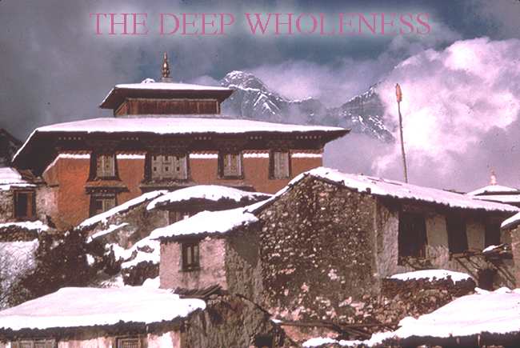

***Building Living Neighborhoods***

## Wholeness

## The foundation of

## A living neighborhood

Every act is taken in the context of some wholeness

The wholeness exists to begin with as a structure in the land and in the surrounding built environment.

The act which is taken must try to extend and enhance that wholeness.

There is then a new wholeness in that place.

The next act must then do its best to extend that second wholeness

This is true for a neighborhood.

It is true for an extension to an existing neighborhood.

And it is true for every individual building, window, door, and garden, *within* that neighborhood.

For life to occur, EVERYTHING is governed by the wholeness from which it came.

-o0o-

At any given moment, in any part of the world, there is a deep wholeness that exists there. This is the **structure** of the whole: the largest and deepest physical configuration that is present there. It can be felt and seen.

The most fundamental way to treat the land - whether it is an open field, an existing village, or a street in town - is to respect what is there, protect it, continue it, and make it better. Heal it. Make it more whole. The great towns and villages have always been built this way, and it is this process which gave them beauty. The deep seeds of structure run through the place in its geometry, its colors, its smells and its sounds. It takes skill to preserve and extend these. It requires loving attention to what is there.

It means that the new should always grow out of respect for what is there now, and what was there before.

The most fundamental rule, to be followed always, is that we must do our best to leave this structure intact. This does not mean we must do nothing there. It means that we should honor and respect the structure that exists, and try to preserve this deep physical configuration in whatever new things we do. **The new should always grow out of respect for what is there now, and what was there before**. We must act out of the knowledge that if we violate the deep structure, we will not only violate the place. We will, at a profound level, also damage our own feelings and our own sensibilities.

It is this wholeness - **the basic structure of the place** - that matters most. In the monastery of Thyangboche, on the lower slopes of Everest, (shown above) the angles are chosen to reflect the angles of the mountains; the overhanging roofs enter into the wholeness which is there; the blood red walls, for some reason that is not entirely clear, support the wholeness; the walls are made of rocks which come from that place. The white stripe on the building wall reflects the snow; the snow lying on the shallow roofs stays there, and makes a blanket just as the snow does on the mountain's hanging slopes. That monastery became part of Everest, and it continues the wholeness and the structure of the mountains which surround it.

Equally, in a village, a corner store with two tables on the sidewalk, the whole of which forms the corner, also, in turn, forms a larger center in the neighborhood. Both small and large details about the place make it so. This is an example of what must be preserved, protected, and extended. You cannot extend it simply by making it larger - only by honoring it and respecting what is there. This means making sure that the larger structure that ripples out from the two tables on the sidewalk is extended and strengthened by whatever other things are built in the nearby areas.

The unfoldings on this website guide you in the process of envisioning, diagnosing, planning and building on your physical site, always with the purpose of extending wholeness -- the basis of a living neighborhood.

**These practices are essential to creating a living neighborhood:**

As far as possible, try to become aware, intuitively, of the deep structure on your site.

Act in sympathy for your own instinct about the deep structure that you can sense is there.

Do not play with words when it comes to judging this. Be true to the feelings you carry inside of you, and do your best to protect the earth.

Try your best to make a new thing which, as far as possible, reflects, respects, and honors what is there already.

*From* Building Living Neighborhoods *by Christopher Alexander, Maggie Moore Alexander, Randy Schmidt and Nick Littlestone, with Bev Behrman and Howard Davis. © Center for Environmental Structure. [Original page](https://www.livingneighborhoods.org/ht-0/wholeness.htm).*
