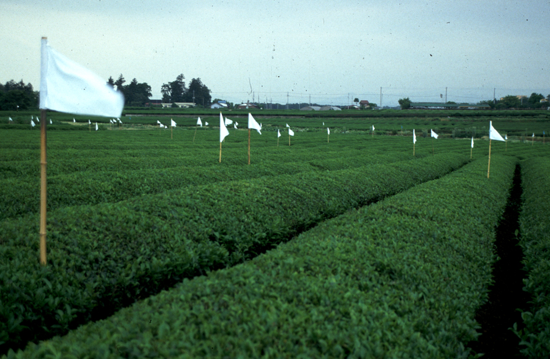

*Building Living Neighborhoods* is a practical method for laying out and building a neighborhood, or a hamlet, a campus or a group of houses, together with the people who will live there. It was written by Christopher Alexander, Maggie Moore Alexander, Randy Schmidt and Nick Littlestone, with Bev Behrman and Howard Davis, at the Center for Environmental Structure, and published on livingneighborhoods.org in the mid-2000s.

Its core is a *generative code*: a sequence of steps, or *unfoldings*, that a group works through on the land itself. You walk the site, find what is already alive there, place the main center and the paths before the roads, shape the public spaces, and only then position buildings. Each step is decided on the ground, in order, so the plan grows from the place rather than being imposed on it.

## Ways in

- **New to it?** [Start here](start-here.md): who it is for and how the process works.
- **Want to do it?** [The generative code](generative-code/index.md): six phases, from startup and vision through diagnosis of the land, density, modifying the code, public spaces and building volumes. Then the [library of unfoldings](unfoldings/index.md) for further steps such as surveying, land tenure and where the cars go.
- **Running a project?** [Running a project](running-a-project/main-steps-of-work.md): the main steps of work, community, developers, contracts and construction organisation.
- **Want to see it?** [Examples](examples/index.md): Eishin in Japan, Mexicali, West Dean, Fresno, Strood, Samarkand and more.
- **Want the ideas behind it?** [Ideas](ideas/index.md): generative codes, wholeness, the fifteen properties for neighborhoods, morphogenesis, and the links to *The Nature of Order*.
- **Going deeper?** [Library](library/index.md): papers, drafts, essays and interviews, including the *Generative Codes* book draft and the Strood code.

## About this edition

The original website was a valuable but hard-to-use collection: frames, a JavaScript menu, two overlapping versions of many pages, and navigation that followed the authors' working folders. This edition keeps the authors' text and images, at full size, and re-arranges them for readers. Each page links to its original, and the full site is preserved as an archive captured on 21 August 2026. See [about this edition](about/index.md) for what was merged, what was left out and why.

*Building Living Neighborhoods* © Center for Environmental Structure.
