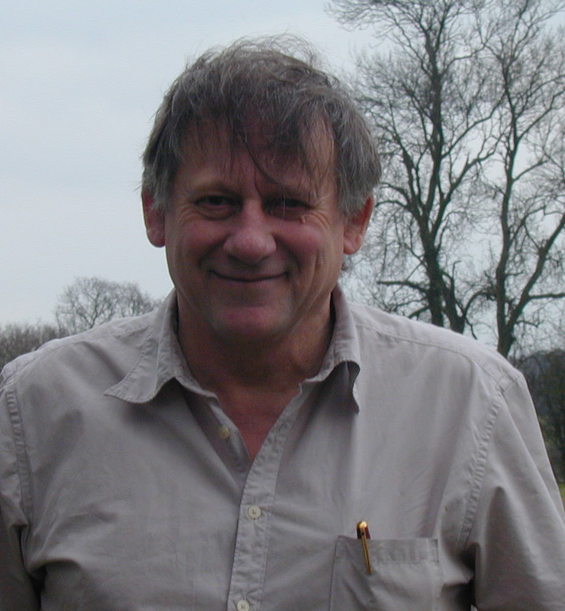

## A glimpse of God in matter

An interview with architect Christopher Alexander on his new work The Nature of Order, which seeks to discover, using the vocabulary of architecture, the divine elements that unify all beautiful created matter. By Britt Peterson (November 1, 2005)

Christopher Alexander ties together religion and architecture (Photo: Maggie Moore)

**Related STNews articles**

**Related external information**

**•** [Pattern Language](http://www.patternlanguage.com/)

*Architect Christopher Alexander may have just succeeded in doing what philosophers back to Thomas Aquinas and Aristotle have eternally sought to do: find God through science. In his four-volume work titled* The Nature of Order*, Alexander uses the vocabulary of architecture and the empirical tools of a scientist to discover the principles of what he calls “life.” Following his 30-year study of life and the universal human response to it, Alexander illustrates his idea that matter must hold within it something life-like — something God-like — which all humans understand as a pleasing beauty and order.*

*A professor emeritus of architecture at University of California, Berkeley, Alexander spoke recently with* Science and Theology News *editorial intern Britt Peterson about the importance of science and religion to architecture, and his empirical search for the face of God in the physical world.*

**What were some of your first lessons and how did you come up with the ideas you’re writing about today?**

I was astonished by the intellectual poverty of architecture as it was taught to me in the late 50s. It made me quite sick actually, and I have spent the rest of my life trying to work out what architecture actually is. I’m a practicing architect and I build a lot of stuff, so I wanted to know what it was all about. I began thinking about that when I was \[a graduate student\] at Harvard and really haven’t stopped to this day.

**What was the impetus to write your latest book, *The Nature of Order*?**

My first intention was simply to set down a coherent picture of what architecture is, so it wasn’t some sort of technical thesis but something that really dealt with the heart of the matter. Originally, I had the whole thing expressed in a one-volume version. As I gradually went on I found that I had to put in more and more material to cope with the really quite drastic changes in thinking that I had to make in order to make sense of the subject.

***The Nature of Order*** **took 30 years to write – how did your ideas change over that time?**

As I started to go into it, I began to discover that there were certain kinds of structures in space that were responsible for what really happens in art and in buildings. And these structures were very difficult indeed to describe. They required rethinking the nature of space in some form. And it was very difficult, hellishly difficult. I kept coming up against what appeared to be contradictions and found it very hard to construct a coherent picture that took things into account as they are.

I realized almost from the beginning that one couldn’t make a sensible picture of architecture without dealing with the feelings buildings create, and that that also — in the rather positivist atmosphere of the later 20th century — was quite difficult for people to accept. There was a view at the time that feeling was a wacky thing that had no place in a technical field.

**Much of your architectural work, both theoretical and practical, is very scientific, drawing on chaos theory, neuroscience and the natural sciences. Do you consider yourself a scientist as well as an architect?**

I’d say that I do very much consider myself a scientist. I used to work as a scientist when I was at Harvard, and I was trained in mathematics.  My wish always has been to try to write down something that is coherent and true.

Now architecture is a very difficult field. The subject of what makes buildings good or beautiful has been a no-no. It’s been something that people in the profession have really not wanted to deal with, both on the academic and the professional sides. And especially not from the scientific point of view, to do justice to the real issues that are involved when something is made – there’s never been a scientific model of what that’s all about. There’s never been a picture, other than a cartoonish one.

**How has your religious background influenced your architectural work?**

I have always felt that the religious picture of the world was probably more accurate than the scientific picture of the world that’s evolved over the past few hundred years. I was raised as a Catholic, and as a child I spent a great deal of time bicycling around England looking at country churches. But that wasn’t particularly what was forming my views about architecture. It was something different. As I got closer and closer to a picture of things that had common sense and seemed to work, I discovered that I felt more and more that the religious point of view — or a religious point of view — is inevitable as an accurate description of matter, if it is going to take into account the empirical facts about architecture.

I gradually have come to the conclusion that the presence of God in matter is inevitable. You can’t have a coherent picture that does justice to all the facts unless you have something like that in your mind. Exactly the form that does take, I won’t be the ultimate judge of. But I do think it’s unavoidable.

**How have your scientific and religious beliefs coalesced over the years?**

As the book evolved over the 30 years, I would say that religion gradually became the most important issue for me. But I say that as a scientist. I don’t particularly care for the firmly created divide between science and religion. I am most uncomfortable with it.

I do believe that the nature of God is factual. I think it is something that will be slowly understood better and better, that we will ultimately have a view of the universe in which it’s explicit. And as with other parts of science it will be wrong at first, and then gradually get more clear.

Science has demonstrated that the search for truth in an empirical way has enormous benefits for society. It gives us a view where millions of people can share the view they have of the world and learn about it together, and improve upon one another’s observations and so forth.

But I think the loony idea that God is in one compartment and electrons are in the other is of very little interest. It’s just an escape from confronting a very difficult set of questions.

[More Search options](http://www.stnews.org/search.php)

More in News

**A glimpse of God in matter**

• [Bigwigs of brainwaves celebrate 15 years at BU](http://www.stnews.org/articles.php?category=News&article_id=1879)

• [Baha’i conference attempts faith in action](http://www.stnews.org/articles.php?category=News&article_id=1804)

• [What is Baha’i?](http://www.stnews.org/articles.php?category=News&article_id=1805)

• [Spiritual capital empowers indigenous kids](http://www.stnews.org/articles.php?category=News&article_id=1788)

• [Prem Nirmal: Q&A](http://www.stnews.org/articles.php?category=News&article_id=1789)

• [Empowerment in action: Mandar Kadam](http://www.stnews.org/articles.php?category=News&article_id=1790)

• [Gifford Lectures forge ahead into the future](http://www.stnews.org/articles.php?category=News&article_id=1750)

• [Measure’ sizes up the Gifford Lectures](http://www.stnews.org/articles.php?category=News&article_id=1751)

• [Preaching Darwin](http://www.stnews.org/articles.php?category=News&article_id=1722)

[Home](http://www.stnews.org/index.php) \| [Commentary](http://www.stnews.org/articles.php?category=commentary) \| [Real Life Religion](http://www.stnews.org/articles.php?category=rlr) \| [News](http://www.stnews.org/articles.php?category=news) [Research Reports](http://www.stnews.org/articles.php?category=research) \| [Books](http://www.stnews.org/articles.php?category=books) \| [Altruism](http://www.stnews.org/articles.php?category=altruism) \| [Upcoming Events](http://www.stnews.org/articles.php?category=events) \| [Translated Stories](http://www.stnews.org/translated_stories.php) [Search](http://www.stnews.org/search.php) \| [Subscriptions](http://www.stnews.org/subscribe.php) \| [About Us](http://www.stnews.org/about.php) \| [Contact Us](http://www.stnews.org/contact.php) \| [Resources](http://www.stnews.org/resources.php) \| [Calendar](http://www.stnews.org/calendar.php) \| [Privacy Policy](http://www.stnews.org/privacy_policy.php) \| [Article lists](http://www.stnews.org/listing.php)

*From* Building Living Neighborhoods *by Christopher Alexander, Maggie Moore Alexander, Randy Schmidt and Nick Littlestone, with Bev Behrman and Howard Davis. © Center for Environmental Structure. [Original page](https://www.livingneighborhoods.org/library/glimpse.htm).*
