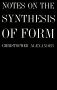

Christopher's Store

See All 32 Product Categories

  Your Account \| Cart \| Wish List \| Help \|

Christ..., 10 new deals await you in your Gold Box™

Improve Your Recommendations

Your Amazon Home

Your Profile

Learn More

Search 

Amazon.com People

## Gift guides

## More to explore

By Price Under \$25 Under \$50 Under \$75 Luxury By Recipient Mom Dad Sweetheart **\> **See all 19

For Kids and Teens Toddler (3-4) Boy (5-8) Preteen Girl (9-12) **\> **See all 8 Most Popular Most Wished For Most Gifted Top Sellers

See all Gift Guides Gift Organizer Gift Certificates Gift Central homepage Amazon Wedding Registry Wish Lists Find someone's Wish List:

Books

Music

## Dvd

## Vhs

Magazines & Newspapers

Computer & Video Games

Software

Amazon Shorts

Electronics

Audio & Video

Camera & Photo

Cell Phones & Service

Computers

Office Products

Musical Instruments

Home & Garden

Automotive

Bed & Bath

Furniture & Décor

Gourmet Food

Kitchen & Housewares

Outdoor Living

Pet Supplies

Tools & Hardware

Apparel & Accessories

Shoes

Jewelry & Watches

Beauty

Health & Personal Care

Sports & Outdoors

Toys & Games

Baby

Wish List

Gift Ideas

Wedding Registry

Baby Registry

Free e-Cards

In-Store Pickup

Your Amazon Home

Early Adopters

[Auctions](http://s1.amazon.com/exec/varzea/subst/home/home.html/ref=sd_allcatpop_au/002-6380071-1377620)

Outlet

[zShops](http://s1.amazon.com/exec/varzea/subst/home/fixed.html/ref=sd_allcatpop_zs/002-6380071-1377620)

Digital Locker

Photo Services

Movie Showtimes

Yellow Pages

Travel

Sell Your Stuff

Associates Program

Advantage Program

Paid Placements

Web Services

Corporate Accounts

J-P Delaporte \> **Reviews**

Search

People All Products

Browse

**Content by J-P Delaporte** • [Reviews written:](http://www.amazon.com/gp/cdp/member-reviews/A13CV160W4HR53/ref=cm_aya_bb_rev/002-6380071-1377620?%5Fencoding=UTF8) 1 • **(4 helpful votes)**

**Gift Helpers** • Free e-Cards • Gift Certificates • Your Reminders

**Community Features** • Purchase Circles • Discussion Boards • Top Reviewers • Share the Love

**Guidelines:** Learn more about the ins and outs of Your Amazon Home.

**Reviews Written by\
J-P Delaporte "J-P Delaporte"**

Reviewer Rank: 537513

**Page: 1**

**[Notes on the Synthesis of Form (Harvard Paperbacks)](http://www.amazon.com/exec/obidos/tg/detail/-/0674627512/ref=cm_aya_asin.title/002-6380071-1377620?%5Fencoding=UTF8&v=glance)** by Christopher W. Alexander **Edition:** Paperback

**Price: \$19.95**

**Availability:** Usually ships in 1 to 2 days

9 used & new from \$15.80

4 of 4 people found the following review helpful:

 **Art anticipates Science?**, August 30, 2005 Alexanders 'Notes' anticipates the paths that major sciences would take decades after its publication. This is no mean feat for a work of science but here youre dealing with a book on architecture- or better, on what architecture could and ought to be. readers with scientific interests will notice Alexander inventing- from purely architectural phenomena - such models as fitness landscapes, adaptation measures according to 'gene' frequency, evolutionarily stable strategies. The general system of analysis in the book serves as one of the best guides for understanding cellular automata and the startegy of isolating variables anticipates the justly famous work of Dawkins on selfish genes. Alexander had almost nothing to work with in the early sixties apart from some pioneering formulations in early AI and a very acute insight into the paradoxes of optimisation strategies. His foresight is best witnessed by reading the footnotes to the book which are in themselves an uncanny selection of what would come to dominate epistemology, evolution and modelling decades later. People teaching history and philosophy of science should prescribe this book as the pre-eminent case study 'consilience' On the strength of this one book, Alexander joins C S Pierce, Boole, Babbage and Minsky as one of the greatest pathfinders in the recent history of knowledge-- too bad that architecture as a discipline hardly rose to his challenge and is now drowning in couture (and more credit to the software makers who have kept this unmined treasure in print).

**Page: 1**

**Where's My Stuff?** • Track your recent orders. • View or change your orders in Your Account.

**Shipping & Returns** • See our shipping rates & policies. • Return an item (here's our Returns Policy).

**Need Help?** • Forgot your password? Click here. • Redeem or buy a gift certificate. • Visit our Help department.

**Search** Amazon.comBooksPopular MusicMusic DownloadsClassical MusicDVDVHSApparelYellow PagesMovie ShowtimesToysBabyComputersVideo GamesElectronicsCamera & PhotoSoftwareTools & HardwareOffice ProductsMagazinesSports & OutdoorsOutdoor LivingKitchenJewelry & WatchesBeautyGourmet FoodMusical InstrumentsHealth/Personal CarePet SuppliesTravelCell Phones & ServiceOutletAuctionszShopsEverything ElseAutomotive **  for  **   

Amazon.com Home   \|   Directory of All Stores

Our International Sites: Canada  \|  United Kingdom  \|  Germany  \|  Japan  \|  France  \|  China

Help   \|   Shopping Cart   \|   Your Account   \|   Sell Items   \|   1-Click Settings

Investor Relations   \|   [Press Room](http://www.amazon.com/gp/redirect.html/ref=gw_bt_pr/002-6380071-1377620?location=http://www.amazon.com/pr&token=BAEE9DA70CF09A98C919D458970CBF4BC4F8D95C)   \|   Careers

Conditions of Use \| Privacy Notice © 1996-2006, Amazon.com, Inc. or its affiliates

*From* Building Living Neighborhoods *by Christopher Alexander, Maggie Moore Alexander, Randy Schmidt and Nick Littlestone, with Bev Behrman and Howard Davis. © Center for Environmental Structure. [Original page](https://www.livingneighborhoods.org/library/delaportereview.htm).*
