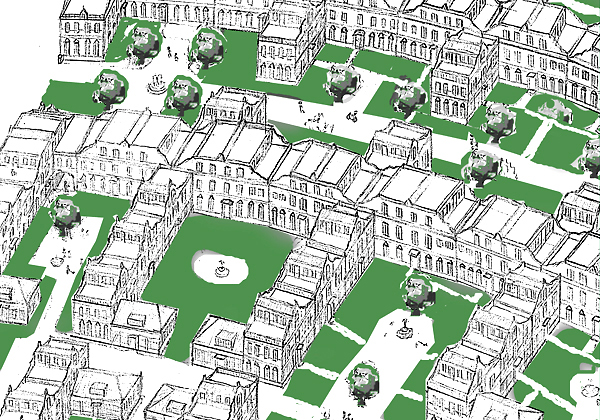
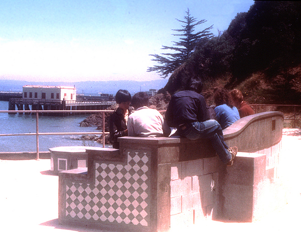
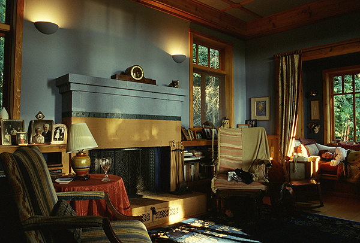
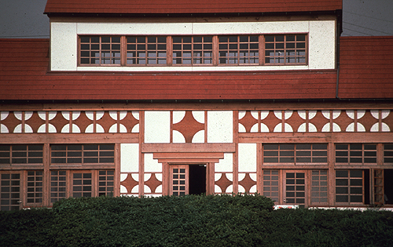
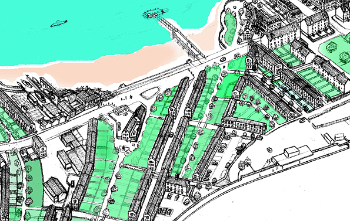
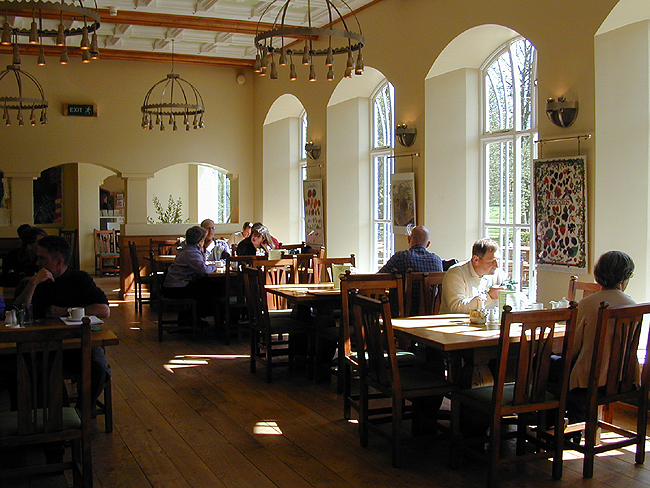
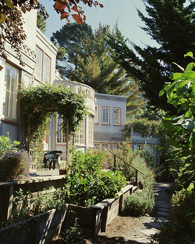

Most developers are idealistic people who wish to make a difference, who are proud to be spending their lives building communities for others.

Yet over the last fifty or sixty years, the development industry has changed, markedly. The philosophy, assumptions, practices, and techniques, have gradually created an industry which -- in the eyes of many, many people -- has been destroying the Earth.

We -- the creators of this website -- are conscious that developers play an **enormous** role in the creation of the modern environment, and in the creation of modern towns and cities. We hope that what we offer here can fundamentally improve the development process, so that developers become more concerned, among their many priorities, with the generation of living structure in the world.

Much of the material on this site is oriented towards communities, neighborhoods, and the people who have families or businesses in these neighborhoods. That is because we are convinced that it is only through the action and creative participation of these people, that neighborhoods can once again become genuine places that nurture life and joy and health. We hope that developers will think more about these issues, and do everything they can to put themselves in the background, and put the people they build for -- not themselves -- on center stage.

The proposals and instructions which exist on these web-pages, will seem radical, perhaps impractical, to many contemporary developers who may smile and turn away. We are well aware of this problem.

But in the last years a growing number of developers have decided that they are not doing enough, that they must try harder to approach the task of building a genuinely humane world in which people really matter, and that they must also contribute more to what is becoming known as a "sustainable" world.

We have collected a few statements together, in the hope that these visionary developers from our own time, will decide to try and use these techniques, and make a new start, or a more energetic start on ideals they have held for decades, but have not always known how to achieve these goals.

If you are one of these far-sighted developers, we suggest you might do three things:

1.  **Study a few pages on the website.** In particular we recommend you might look at [the management page](main-steps-of-work.md).

2.  **Write to us,** and ask us how you might overcome the conceptual problems, involved in running a successful business financially, and yet doing better to reach your own ideals.

3.  **Be aware that to achieve a new level of goals and ideals,** it is above all your business practices that make a difference -- new ways of controlling money, ways of dealing with people and communities, ways of rearranging your budget allocations to different line items. These are needed so that you may genuinely **achieve** a new kind of neighborhood, and rebuild your business with deep enough changes, so that you really **can** achieve it.

**Try, perhaps with us, to make the changes in your working life that are needed to build places like this:**

**or like this**

**or like this**

or like this

**or like this**

**or like this**

**or like this**

*From* Building Living Neighborhoods *by Christopher Alexander, Maggie Moore Alexander, Randy Schmidt and Nick Littlestone, with Bev Behrman and Howard Davis. © Center for Environmental Structure. [Original page](https://www.livingneighborhoods.org/ht-0/developers.htm).*
