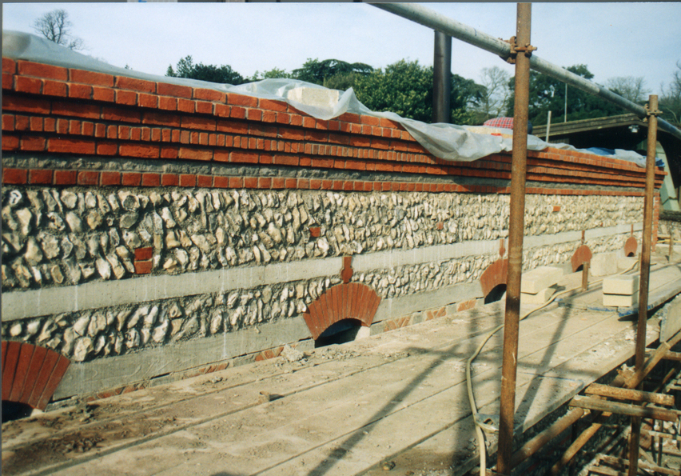
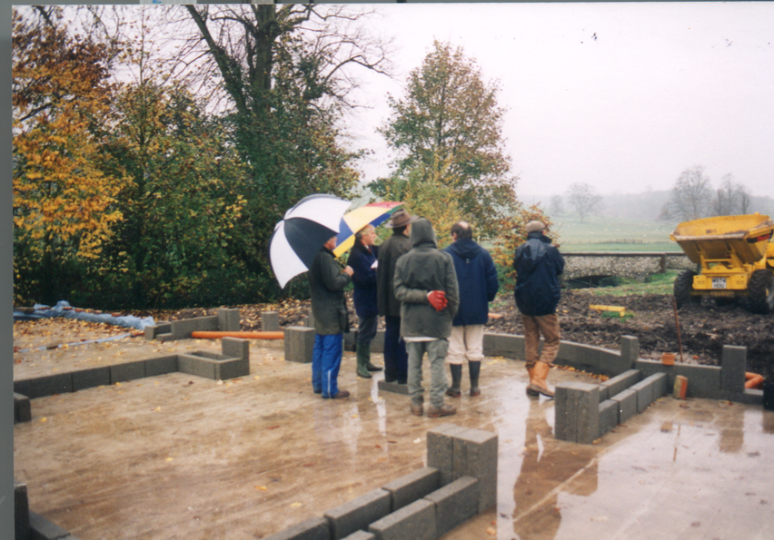
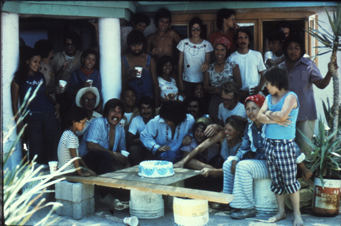
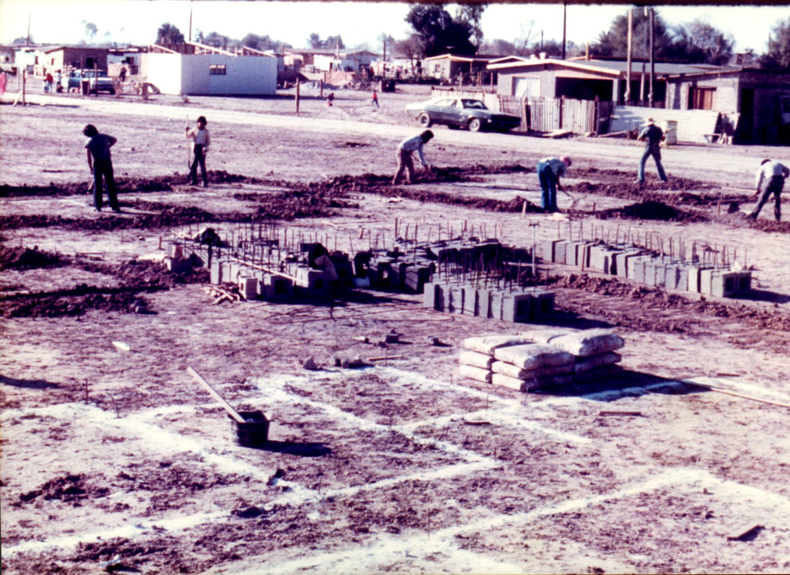

[jump](#seven)

## Main steps of work

## The broad flow of the building process

Those of you who are returning to the Main Steps page will see that the format is changing. We are in the process of simplifying and clarifying this material. This page now gives the Broad Flow of work as an overview, and directs you to the Library of Unfoldings for the means to accomplish each Phase. Unfoldings are bits of generative code that can be selected and adopted depending on the needs of your project. In the next several weeks, the whole of this page will gradually be reorganized to this new format.

Success in building living neighborhoods depends essentially on certain key sequential aspects of unfolding.

THESE EIGHT MAIN PHASES ENSURE THAT THE ESSENTIAL PROCEDURES RECEIVE CAREFUL ATTENTION. This will include both subtle human processes and practical technical processes. The steps provide a model through which local authorities, builders, architects and developers can work together with the people who live and work in the neighborhood, so that a human and ecologically wholesome community may gradually be created.

The overall flow of the process is complex because it involves a subtle human process -- creating bonds between people -- while at the same time involving many technical issues having to do with land, buildings, and city government. This guide will help you work through the complexity to actualize your vision.

We want, in advance, to draw your attention to the fact that there are a dozen key conditions, which will play a decisive role in the unfolding of a living neighborhood. If these "special" unfoldings (see [link to decisive conditions](#step0)) are not present in your process, or not in use while the neighborhood is taking shape, the likelihood that the neighborhood can genuinely come to life will be severely reduced.

The guidance here is distilled from Chris Alexander's 30 years of experience in designing and building many different neighborhoods. From that experience, we have created rules of thumb that call attention to essential considerations, and, at the same time, encourage working with the unique characteristics of any particular place. The rules of thumb continue to be refined, as we find ways to make them more precise and more helpful. The notation "more to come" appears when there are elements in the following sequence of phases that are still being developed.

*During the next weeks and months, we shall be making a gradual transition, in which this page deals more with the broad flow of the phases, and the new [Unfoldings page](../unfoldings/index.md), contains the specific unfoldings which belong to each phase.*

In order to understand what unfoldings are really like, and what the word really means, you may wish, before starting, to [study the following slide show of Strood Riverside](../examples/strood-riverside.md). This slide show describes the unfoldings that took place in 2005, as part of a workshop for creating a new neighborhood of about 300 families, southeast of London on the River Medway. When you open this link, please press F11 on your keyboard to get full screen view, and allow a minute or two for the pictures to download.

We should like to draw your attention, also, to the [neighborhoods page](../examples/index.md). Although some of the neighborhoods illustrated were built several years ago, they were all based on our technology of unfolding, going through all phases of conception, involvement of users, design, control of money, inventive construction techniques, and construction management, as described on this website, even though -- in those early days -- the unfolding technology did not yet exist in the formal manner now described on these pages. In short, neighborhoods illustrated now work because the "decisive" considerations were present from the beginning.

The nine main phases, each a distinct constellation of issues which come into play in approximate sequence, and at distinct phases of the project. You may jump to the phase you want by clicking the links on the left.

[Conditions](#step0)

Decisive practical conditions for life to occur throughout the process

[Phase 1](#step1)

## Getting a first vision of the living neighborhood

[Phase 2](#step2)

## The land: getting a feeling for its structure

[Phase 3](#step3)

## Writing your generative code

[Phase 4](#step4)

## Geometric unfolding of the neighborhood

[Phase 5](#step5)

## Time, money, program budgeting, and project management

[Phase 6](#step6)

Building design and construction : the interlocking teamwork of professionals, craftspeople, and families

[Phase 7](#step7)

Construction management in action: independent subcontractors and craftspeople working under fixed-cost, flexible contracts

[Phase 8](#step8)

## Maintenance, improvement and continued life of the neighborhood

## Conditions

**DECISIVE PRACTICAL CONDITIONS FOR LIFE TO BE ABLE TO OCCUR IN A MODERN NEIGHBORHOOD**    [next phase             [jump back to nine-phase menu](#seven)](#step1)

The following are the most important conditions for a living process, that **must** be present to implement a successful unfolding process in a modern neighborhood:

## Reduced emphasis on profit

One cannot both take care of the Earth, and also continue to maintain the principle of *maximizing* profit at all costs. The developer's expectation of profit must be kept within reasonable limits, and established as an earned reward for work done but not as an exclusive focus on the bottom line, so that the goal of achieving a living neighborhood is adequately funded.

## Curtail windfall income from land speculation

In addition, profit may not *merely* be gained automatically by increasing the number of dwellings or services in a given place, but only according to the level of land stewardship that has been provided and achieved.

## Less reliance on loans and interest payments

As far as possible, the construction must be independent of loans, and disconnected from payment of interest. Borrowed money has a corrosive effect on land and community, in that once money is borrowed, the payback schedule competes with these decisive practical conditions. Instead, the financial basis of a project must be based on a slower principle of lower income levels, income distributed over time, and on self-generated income from the project, helping to provide capital for further growth. This has the beneficial effects of reducing risk for the developer, and allowing these conditions.

## Different order of decisions

[See the details of the unfolding which deals with this condition](../unfoldings/the-order-of-things.md)

Unlike conventional projects, that work from a template of infrastructure (e.g. lot lines, roads, and sewers), an unfolding process establishes structure starting with existing trees, natural terrain, views, and existing buildings of all kinds. This changes the order in which major things are laid down. Gardens, building volumes, windows, paths, public gardens, roads, sewers, low walls, and street furniture, etc., follow as each necessary structure emerges in the process.

## Living centers must dominate the process

Creation of key centers is the first *geometric* unfolding of the neighborhood. Then gradual placement of the most important positive spaces and building volumes will occur.

## Project management as a professional service

Project management for site and civil works that directs timelines, money, program budgeting, and construction, must be done on a professional fee basis, so that the profit motive is removed from the entire procedure, and decisions are made in the context of what is best for the land and for the people who will inhabit the place, according to *their* view.

EXTENSIVE INVOLVEMENT OF INHABITANTS IN ALL PHASES OF WORK [See the details of the unfolding which deals with this condition](../generative-code/1-startup-and-vision/vision.md)

Extensive involvement of inhabitants and clients is necessary in developing a pattern language, generative code, layout, design of public space, design of private outdoors, even in the construction of dwellings. When people are involved, even a small amount in helping with construction, it fundamentally alters their feelings of belonging and strengthens their relationship to the neighborhood.

## Surveying from stakes

[See the details of the unfolding which deals with this condition](../unfoldings/surveying.md)

Surveying must be done directly from stakes that have been planned and put in the ground intuitively by clients and inhabitants. Drawings are made from the stakes, after the stakes have been placed intuitively. The drawing does not come before the placing of stakes, nor does it drive the placing of the stakes.

## Flexible construction process

Flexible design of buildings and construction methods require interlocking teamwork of professionals, craftspeople, and families.

## Modifying design during construction

See the details of the unfolding which deals with this condition

Modification of design of buildings and exterior space during construction, is based on continuous evaluation of design quality throughout the building process.

## Fixed price construction

[See the details of the unfolding which deals with this condition](main-contract.md)

Construction management in action: independent subcontractors and craftspeople working under fixed-cost, flexible contracts.

## Repair and maintenance

Maintenance, improvement and continued life of the neighborhood is guided over time by the generative code.

## Why these conditions are decisive

Generative Codes are flexible instruments whose unfoldings support the realization of a vision of a living neighborhood. Its elements -- the unfoldings themselves -- are dynamic statements that direct activity and comprise systems of instructions, each of which describes a decision step linked to those that come before and after, to further elaborate the unfolding neighborhood plan. (This is in contrast to rule-bound, prescriptive codes of contemporary planning theory, that are based on geometric constraints and are typical in current building practices.) Our performance-based codes are determined by the structure in the land, and the current built environment. By following unfoldings, one by one, and applying them to an idea, a piece of land, the design of a building, or a neighborhood, the thing you are building will be a natural evolution of what was there before, and will support and contribute to the wholeness of the place.

In nature, there is no impediment to unfoldings. But in our human society, as it has evolved in the last 150 years, there are now a great many institutional rules, procedures, habits, norms of conduct, and expectations that make it virtually impossible for unfolding to occur in response to the whole, as it needs to. Therefore, in order to get a generative code to work, a set of conditions or rules of conduct, that enables unfolding to work successfully needs to replace the currently prevailing rules of conduct that now obstruct unfolding. If these conditions are not part of the package, the generative code will not generate well-adapted, integrated results: life will not occur.

These few conditions are the absolutely necessary underpinnings for the unfolding process to succeed in modern society.

## Important footnote

These twelve conditions are very much like unfoldings, and do indeed, correspond to unfoldings in the library. They are very important, because without these particular conditions, there will be no effective antidote against the corrosive tendencies of speculative land development. This does not mean that they are altogether the twelve most important unfoldings. It simply means that they provide the necessary background for an unfolding process, because the other even more important unfoldings, will not survive or function, unless these antidotes to commercial development are in place.

## Result to be accomplished after accepting these conditions

As many of the people playing a role in the new neighborhood -- whether in the process of planning, design, construction, or administration, or working there, or living there -- have been exposed to a workshop, in which the critical nature of these "decisive" considerations has been fully discussed, worked through, and accepted.

**Players are all reminded of the fact that if these conditions were to be forgotten, or made weaker, the living nature of the neighborhood everyone is trying to build, will be severely impaired.**

## Phase 1 first vision of your living neighborhood

[next step            [jump back up to nine-phase menu](#seven)](#step2)

## How big is it?

Remember, a neighborhood can be quite tiny -- hardly more than a group of buildings -- or large, or very large. Even if you are dealing only with a small project, it is likely to benefit by being considered as a minute neighborhood.

Can you make a start on a vision of this place?

How far can you go, to take the first step in articulating your intention and your vision?

Is it appropriate to discuss it with your friends, colleagues, family, and partners? Does it seem that you will be able to reach a shared vision? It may help this task, if you read and fill out this [**worksheet**.](../generative-code/1-startup-and-vision/parameters.md)

## Links

The following packet of unfolding is relevant to this first phase:

- [UNFOLDING PACKET \#1: Allow a vision to unfold](../unfoldings/index.md)

## Accomplishment at the end of phase one

Using packet \#1, produce a written description of the vision you have, in as much detail as you feel you know. It's to be hoped that this vision is largely shared, but if there are points of disagreement or opinion, not settled yet, then write those down as well.

Keep these issues handy as you move into phase 2. As your vision gets grounded in the land itself, you'll have an opportunity to consider the issues deeply together, and resolve them.

**PHASE 2    THE LAND:\
GETTING A FEELING FOR ITS STRUCTURE**    [next step            [previous step            [jump back to eight-phase menu](#seven)](#step1)](#step3)

Starting to work with an actual piece of land

Let us assume, now, that you have found a piece of land, and that it is more or less suitable for the kind of neighborhood you hope to build. Now we need to marry the vision of the neighborhood as you have it in your mind so far, with the reality of the land as it really is. In this process the reality of the land will play an enormous role.

## Uniqueness arising from the people and the land

The most important question of all is this: Given the land, and the context it creates, **what truly *belongs* in this place?** This is the deepest question. It needs patience, insight, and emotional reality, for it to be discovered. Once you find out what it is, hold on to it, and make it happen!

Living neighborhoods usually have something unique -- something slightly surprising. A mix of things develops there and gives the place its character. What are the passions, skills, and dreams, of individuals involved, that could bring life to this community? The only place a successful mix will come from is people. It will depend on the genius of people and characters who have fun things to bring into the picture that will spice up the whole community for everyone.

But it depends, too, on the unique configuration of land, adjacent hills, trees, dips in the ground, on the presence of adjacent buildings, views, roads, monuments, existing building masses, paths, and on the materials of the adjacent buildings.

If the land is in a town, the task is more complicated

If the land is in an existing town, then on all sides there will be buildings, roads, views of distant buildings. Somehow the new neighborhood that is conceived must fit almost seamlessly into the existing fabric. But more than that, the new neighborhood must enrich the present town, build on its strengths, and complete it and extend it as it is.

In either case, we are brought back to the same question as before: **What truly *belongs* in this place?** Do you have an intuitive answer? Can you see, in your mind's eye, what would be most natural in this place, and what would at the same time pay deepest respect to what is there already?

## Links

The following packets of unfolding are relevant to this second phase:

- [UNFOLDING PACKET \#0: Overall Morphogenesis](../unfoldings/index.md)

- [UNFOLDING PACKET \#2: Diagnosis and Latent Centers](../unfoldings/index.md)

## Accomplishment at the end of phase two

Using packets \#0 and \#2, produce a scale map of the whole neighborhood, on which you and your colleagues have written a record of your observations while walking the land: arrows to show important views; circles to designate important precious places; good places to come in to the site, and good places to leave by.

If possible, this map should be in a place where they can be shared by all the partners, so that it may be contemplated, in quiet.

## Phase 3 writing your generative code

[next phase            [previous phase            [jump back to eight-phase menu](#seven)](#step2)](#step4)

## Intro to phase 3

Having moved through phases 1 and 2, you have developed some unfoldings -- rudimentary elements in a generative code. Now it is time to begin to write the generative code, using the unfoldings you have done so far, and being careful to identify the things which really matter most: the things that will bring the greatest deep feeling into the place. In order to help yourself write a generative code for your neighborhood, read a simple primer which will give you a hint on how to get going: [Writing Generative Codes](../generative-code/3-modifying-the-code/writing-a-generative-code.md).

## Start by thinking of unfoldings

One of the primary aims of this website, is to give you raw materials with which you can begin construction of a generative code for your neighborhood. Since the elements of a generative code are "unfoldings", you need to find a way of building a sequence of unfoldings, that suit your neighborhood, are compatible with the place where this neighborhood is and what is next to it, and that include the special conditions that will make this neighborhood unique.

## You can start with unfoldings from the library

As a beginning, you may go to the [library of unfoldings](../unfoldings/index.md), and mark all those unfoldings which strike you as helpful for your neighborhood.

In the future we hope to have a set of checkboxes next to each of the unfoldings. You will check the ones you want, and the computer will then send you an email with the list of those you have chosen, so that you can work on it and modify it to your own needs.

## A useful example: a first draft generative code

[A first draft Generative Code for Strood Riverside](../assets/library/stroodcode-v13.pdf) may serve as a useful example of what goes into a generative code.

## Form a committee to settle the generative code

If the number of people involved in the early planning of the neighborhood, is large, then day to day decisions about the code, and the process of refining it, will almost certainly have to be handled by a small committee, speaking for the others. The 6-8 members of this committee must be chosen with enormous care, to reflect as many interests and points of view as possible -- and with the idea that once this committee has agreed on a code, it will in all likelihood sail through passage at the whole neighborhood level. It is a lengthy process, because the items of the code, have to be scrutinized carefully, and agreed -- and this is where the real content of the resulting environment will come from. Under the guiding hand of one committee member who has some previous experience (professional, or not) all the pages in the code must be put in proper format. The committee will, in effect, have to visualise the unfolding of the the neighborhood, as they read, and study, and correct this code. And they must be guided in their round-table discussion, by the principle that important patterns, will be invented, and corrected according to the criterion of which version does the most to enhance the life and wholeness of the neighborhood.

**EXAMPLE OF A FINAL GENERATIVE CODE THAT YOU CAN USE AS A TEMPLATE**

For a situation where the code requires public and legal standing, use the example of a completed code that may be found in [The Generative Master Plan for Harbor Hills.](../assets/library/brook-2.pdf)

This particular code was written for a low-density new town on a green-field site. You may face entirely different density and scale conditions. However, you will see the approach taken, unlike the pattern language format, specifies what has to be **done**. It is a system of procedural instructions, which can be carried out, one at a time, interacting only with the context which has been created up to that moment in the sequence of unfolding.

For a more informal or more private situation, the format can be more relaxed.

## Accomplishment at the end of the third step

A jointly written notebook, in the format of the template, dealing specifically with your piece of land, and reflecting the consensus of the colleagues, partners and community. There should be one A4 or 8x11 page for each step of the code. On that page there will be a clear definition of what is required to be done, which partners or actors or professionals are to have main responsibility for doing it, and a clear definition of the effect to be achieved by each step as it is being done. The code contains the steps necessary to carry your community through completion and moving in.

**PHASE 4    FIRST GEOMETRIC UNFOLDING OF THE NEIGHBORHOOD:\
CREATION OF KEY CENTERS, GRADUAL PLACEMENT OF MOST IMPORTANT POSITIVE SPACES AND BUILDING VOLUMES**     [next phase            [previous phase            [jump back to eight-phase menu](#seven)](#step3)](#step5)

## Understanding unfolding

In order to understand what unfolding really means, take a look at an example. [**You may watch the unfolding of a community**](../examples/strood-riverside.md) happening dynamically on screen.Or, if you prefer, you may read the same sequence of unfolding events in an illustrated booklet: [**The Unfolding of Strood Riverside**](../assets/library/stroodunfolding-v19.pdf). In both cases, you see, step by step, how the unfolding of a neighborhood plan can occur in such a way that the geometry appears incrementally, but always as a whole, and step by step, so that everything has a harmonious relation to everything else. In particular, it shows how the gradual process of unfolding one feature of the plan at a time, works to create a coherent and harmonious whole.

## Teaching session

## A couple of trial runs

You may need to practise the concept of unfolding.

As a very simple exercise start with [three rules for a neighborhood](../generative-code/5-public-spaces/main-center.md). Apply these three rules to your own neighborhood, to see what happens. It will mean combining the diagnosis you have made with these three rules, and see what comes out.

For a second trial run, take a map of your land (a copy of your diagnostic map), and have in front of you the current rough generative code which gives you the steps you and your colleagues have agreed to. Then, take one step at a time, through the code, each time making a mark on the map, which expresses the consequence of the step you are working on. You can work through all the steps you have in the code, in a short time. The purpose is not to do the best design, but to understand what happens as a design unfolds. At the end, after going through all the steps, you should have a complete, worked out plan. This is not very easy, but it is important that you learn what is involved and how it works. Do it a few times, until you reach a point where everything comes out right in your trial run.

## Improving the sequence of the code

It is very likely that you will need to adjust the sequence of the steps in the code, so that the unfolding is smooth. This is not a mistake. It is the only way a group of people can construct a code that really works for a given situation. For example, if your code has placement of roads happening too early, you will find out that you cannot achieve really good pedestrian space, and its position will need to be fixed. For more information see [The Order in Which Things Are Done.](../ideas/the-order-things-are-done.md)

## An unfolding session for real

This goes slower than the trial runs, because it is more serious. When you have mastered some trial runs, and made adjustments in the sequence of steps in the code so that a coherent form emerges from the process of using the code, you are ready to begin.

Once again, start with a map of your land, and your current version of the generative code. Then, take one step at a time, each time making marks on the map, which express the consequence of the one step you are working on. This time, though, each step needs to be done carefully and slowly, with discussion, interspersed with visits to the land, so that your decisions are reliable. And what you experience and decide on the land itself, must be carefully measured off (or at least paced off), and then transferred to the unfolding map which you are making, with some care so that sizes, positions, and angles are correct.

During this process, each next step, and the marks you make for that step, must be made in relation to the marks already made in previous steps. It is the capacity of each step to enhance the growing whole that matters. And, further, each step not only deals with the issues inherent in that particular step as far as the functional aspects of the code are concerned. **It also matters, equally, that each step works on the whole, gathers together the strands of the geometry that is unfolding, and makes the whole more unified, makes it more coherent as it progresses. This is the key aspect of each operation**.

At the end, after going through all the steps, you should have a complete, worked out plan.

## The most important thing is always positive space

Each building or open space that is placed must be positive in shape. But even more important than that, is that the **things** and **spaces** which are formed **next to** that building or open space are **also** positive in shape, and potentially useful and beautiful places, too.

[*References*](../ideas/nature-of-order-references.md)

## Positive space is made from the fifteen properties

Positive space is itself one of the fifteen properties in *The Nature of Order*. But the important thing about each space is that it is coherent, whole in itself, emotionally connected to the spaces next to it, bounded by thick, substantial boundaries, given good shape, enhanced by well placed subsidiary centers inside it, and around it, given gradients which lead to the core centers, and treated with roughness, so that it is not pristine, but instead beautifully adapted to the configurations and circumstances round about.

For explanation of each of these properties, see The fifteen properties which bind wholeness together.

[*References*](../ideas/nature-of-order-references.md)

## Examples of positive space

Positive space is the most important aspect of all living space. It is the presence of this quality which makes the neighborhood a place where you want to be. Please look at the examples in [Visible positive space in the Strood plan](../assets/library/strood-plan.pdf).

## Initially locate the most important positive spaces

In order to give the neighborhood a start, begin by identifying, and then shaping (or improving the shape of) the three or four public spaces that dominate the neighborhood: These should include one which is the neighborhood's main center, and others which, spaced out across the neighborhood, create a web inside the neigborhood. Each of these main public spaces will take its role and function in the neighborhood best, if it is associated with a major building that geometrically forms the "head" of that space.

**IF YOU HAVE DONE THE UNFOLDING WELL, THE RESULT SHOULD HAVE A CHARACTER LIKE NATURE**

As the unfolding goes forward, you give each thing the space it needs, in relation to the things you have done before. Do not try to think ahead. Let each thing find its place, one at a time, and its own quiet emphasis. It should arise **from** the configuration of the place. As you do these things, the whole thing will take on a lumpy, awkward character -- very particular to the detail and uniqueness of the place, and **very** different from a planned community. But, once again, if you have done it well, you will find clear rhythms and forms apparent in the complexity. For an example, please look at the character of the [Strood Unfolding](../assets/library/stroodunfolding-v19.pdf) example, to see what this geometric quality looks like.

## Accomplishment at the end of the fourth step

A sequence of small maps, and overlays, which show how the generative code has been applied step by step to the land of the neigborhood, and has caused the gradual formation of a complex arrangement of spaces, streets, gardens and houses, gradually causing the unfolding of a site plan in which each place is beautiful, and related sensibly to its neighbors. There should then be a large scale drawing, at 1 : 200 scale, to show the final design which has unfolded, and in particlar showing public spaces, gardens, buildings, and roads, and making visible how unique and particular each part is, and how pleasant it is to be there. If possible, we recommend that you should also build a model at the same scale of 1 : 200, on the topo model you have built earlier, placing buildings where they should be, and coloring in the public spaces, to inspire you to shape them well.

**STEP 5    TIME, MONEY, PROGRAM BUDGETING, AND PROJECT MANAGEMENT**     [next step            [previous step            [jump back up to eight-step menu](#seven)](#step4)](#step6)

## The time scale of construction

Once you have the general direction of unfolding clear, with a rough scaled plan, a key issue will arise: How gradually is this new neighborhood to be built? A neighborhood might be built over a period of ten or twenty years. Sometimes it may be built in a year. Sometimes a core might be built at first, and then gradually expanded or improved. Each of these different models requires a different approach to the unfolding. In the Harbor Hills example (reference above) the generative code is built on the assumption that it goes forward one neighborhood at a time, each of these small neighborhoods being about 15 houses. (Sections 6 to 8 of the generative code on pages 87 to 130 describe this process. You may see these sections in a pdf excerpt called [The neighborhood sections](../assets/library/brook-2-neighborhoods.pdf) of the Harbor Hills Generative Master Plan .)

## Money planning

Where is the money for the project coming from? How much have you got or can you raise? You should estimate the scale of what you plan to do, with a clear picture of how the construction work is going to be funded. Get a provisional figure in mind for the total work. And, if it has to be done in stages, get a picture of the stages, and the sums which might be spent in each stage.

**PROGRAM BUDGETING:\
Allocating most money toward what is most important to the experience of life**

This most vital principle is an obvious one; but it is very rarely followed. The gist is this: you need to spend the most money on those things that really matter most in the emotional life of the place; and the least for those things that make the least emotional impact on the resulting buildings and neighborhood as a whole. To do this, you first need to make a line item budget for the quantities you have to think about. You can, if you wish, start with a standard or "typical" budget for building a neighborhood.

You will see that each line item has a budget figure, and you can then work out for each line item, what **percentage** this typical figure is of the whole budget. Now, you can sit with the same spread sheet, and pencil in on the right, what percentage you think **ought** to be spent on each item, based on how much value you think this item, can bring to the life and emotional value of the environment. This "ideal" percentage will almost certainly be different from the typical percentages.

For example, among typical commercial developments today, the exterior landscape is usually given about 5-6% of the total budget. We have found that the environment works much better when the sum spent on exterior work -- terraces, exterior stairs, balustrades, and so on, all combined with planting -- is more like 14-17% of the total budget.

This does not mean that we are increasing the price of the project by 11-12%. Not at all. It simply means that we choose to reduce the amount spent on the buildings by about 11-12%. Of course we do not, therefore, make everything of inferior quality. We distribute money differently and reduce the money for less important things in the line items for the buildings. We may also increase certain things within a building, even though we propose to reduce the overall percentage spent on building. For example, as a matter of practice, we usually spend 16% of the building cost on windows. A typical figure would be more like 7%.

We allocate a larger percentage of the budget to exterior construction because it makes the exterior world more habitable and increases the effective habitable area immensely. And we spend more on better quality and larger windows, because we know from experience that the quality of life in the rooms is hugely affected by the quality of light.

Now, how do we pay for all this? Usually, we allocate less money on roof covering; we allocate less on bathroom fixtures; we reduce the allocation for wall finishes in certain "secondary" rooms; and so on. You can see a spread sheet which tracks allocation and re-distribution of money among line items.

## The order in which things are done

There are surprising but necessary changes in the order in which things are done so that the neighborhood can really come alive. Here are a few examples of required changes in sequence:

Pedestrian space is laid out and **built** before roads are put in.

Gardens are located first, **then** houses.

Houses are located and partly built **before** the roads are.

Design does **not** always come before building; instead, design and building of any given place are two activities which interlock and alternate in time. Sometimes bits of construction **precede** design. Then, after it is built, the design may be elaborated further, so design elaboration of those things then **follows** construction.

For more detail see [The order in which things are done.](../ideas/the-order-things-are-done.md)

## Re-arrangement and re-clustering of tasks

Tasks and subcontracts need to be reshuffled and regrouped. See [Re-arrangement and reclustering](../ideas/rearrangement.md) .

## Uniqueness of individual houses and businesses

## Arrangement of buildings

In order to make individual houses work, as an idea, at relatively high density, there is one particular archetypal model layout that can form a basis for many, many variations. In this archetype, the houses are long and thin, parallel to the public space and pedestrian space outside. Thus instead of being row houses which have narrow frontage and long depth, these houses typically have long frontage, and narrow depth. For example, such a house might be 15 meters long, and 6 meters deep, thus 90 m2 on a floor. The building might have two flats if 2-story, or three flats, if 3-story, the top story then being within the roofspace. The many advantages in this type of building volume are discussed extensively in *The Nature of Order*.

*References*

## Cars and parking

## Generic building construction

Choice of materials, feeling as a governing factor, overall distribution of rough and smooth, inexpensive and luxurious, basic and simple, and sources of manufacturing.

## Cost-control

## Accomplishment at the end of the fifth step

A detailed, line-by-line construction budget for the project, showing what is proposed to be spent on each part of the project, for capital expenditures, line by line, according to the detailed physical elements and improvements which are to be built or undertaken, and including administrative and professional costs. This budget should not be viewed as an estimate for a given set of designs, but rather as an intuitive, proportional distribution of cash outlays on different aspects of the project, which the project will adhere to because the partners consider it a prudent and sound way to spend money on the different aspects of the neighborhood, and one which will maximize its life.

**STEP 6    BUILDING DESIGN AND CONSTRUCTION: THE INTERLOCKING TEAMWORK OF PROFESSIONALS, CRAFTSPEOPLE, AND FAMILIES**    [next step            [previous step            [jump back to eight-step menu](#seven)](#step5)](#step7)

## Designs for individual buildings

Each building is designed, according to its place in the community. The designs can be simple, 1:100 drawings, commuicating the essential configuration which is to be built. When appropriate, the people who are to live or work in that building, take part in laying it out with the architect. As far as possible, the building design uses standard details and construction techniques (standard for the neighborhood), so that expensive special details on every building, are not needed in the drawings. At the same time, the management technique will allow and encourage different details to appear in each building, according to its context, with the construction management (see Main step 6).

## The essence of the needed project management

The environment of the last seventy years has been ravaged by mechanical methods emphasizing time and efficiency, thus making robots out of people (who are viewed merely as consumers, and are denied their place in the process of making) and of craftspeople, denying them, too, access to the building project in a way that involves their hearts and souls. To create a living neighborhood, flexible project management must reverse this trend.

## Modern methods of project management

The **new** project manager has precisely this job of community building: to allow the people, owners, inhabitants, and craftspeople access to the project, continuously, while it is being made and built, in such a way that they can all put their own hearts and minds into the work. That is the fundamental imperative of the process. It must be done.

**TO WORK TOGETHER SUCCESSFULLY, ALL THE PEOPLE IN THE COMMUNITY NEED A COMMON INTENT**

It does not need to be a shared intent regarding detail. It is, instead, a shared intent of **spirit**. It is a shared understanding (first) and then a conscious purpose (second), to make each part of the neighborhood reflect the inner tranquility of the soul. Even in making a simple concrete step in a garden, a road, or a wall, this shared purpose must be expressed in the builders' work.

The shared sense of purpose visible in what the bricklayers have been doing

**WE NEED A SHARED NAME FOR THIS COMMON INTENT. SOME PEOPLE CALL IT "THE UNNAMEABLE", SOME PEOPLE CALL IT "GOD". SOME PEOPLE HAVE NO WORD FOR IT AT ALL.**

It is not a religious matter, since it does not have to do with any one religion. But it is based on the inner connection of each person with "the whole". It means that each person must be guided by the humility of their own smallness, and by affection and connection with the whole, love for its beauty, and desire to heal it and keep it well. The project manager, with the community, together do what they can to make this possible in practical terms. That is the fundamental imperative of the process.

Whether you choose to have a name for it, or not, it is necessary that you pay attention to this intent, in your own terms.

*References*

**IN ANY CASE, EACH ACT TAKEN BY ANY MEMBER OF THE COMMUNITY, SHOULD BE AN EFFORT TO LET THE SELF BE VISIBLE**

This is not the self of the ego, which reflects a person's idea of his own self-importance. It is the inner self, the eternal inner substance, which each person has access to, and which is always reliable as a source of judgement and decision. When actions are based on that inner self, the inner self may then become visible, sometimes quietly shining out, in the thing which has been made.

[*References*](../ideas/nature-of-order-references.md)

**WHATEVER ACTION WE TAKE, WE ARE SEEKING TO MAKE SOME CENTER MORE PROFOUND, MORE TOUCHING TO OUR HUMANITY**

In anything that is made, its life and beauty depends on the beauty of the centers which are made to appear in it. Learning to make beautiful centers, and managing to make them so that they are egoless, is at the core of every task. A center is a point of focus, in a larger field, which has shape, and generates a sensation of centeredness in space. A center can occur within a piece of stone, on a street, in the shape of a building roof, in the presence of a great tree, in the beautifully proportioned windows of a doorway. Centers can be more living, or less living, according to the degree their component centers are alive. Everything of importance in construction of buildings, may be understood as the creation of deeply living centers in every space, and every particle of matter.

[*References*](../ideas/nature-of-order-references.md)

**THIS COMES FROM REPEATED APPLICATION OF FIFTEEN PROPERTIES TO EVERY PART OF EVERY THING**

These [properties](../ideas/fifteen-properties.md) are the building blocks of wholeness: it is through combination and recombination of these properties, that wholeness forms itself in both nature and the built world. As a result, these fifteen properties are fundamental to the organization and design of any living neighborhood.

As in nature, these fifteen properties are fundamental to the birth of any form that leads to God, and they lead naturally to the creation of something profoundly human, egoless, and simple. In a neighborhood, all the participants -- families, neighbors, business people, craftspeople -- may share this attitude in some way that gives us all a common purpose. It is our hope, in any project, that the people working together will share, in some degree, this intent and this aspiration.

[*References*](../ideas/nature-of-order-references.md)

## Accomplishment at the end of the sixth step

A detailed overall plan, design drawings for each individual building that is going to be built, and an approximate schedule of construction work for different subcontractors, individuals, craftspeople, and families, showing how the different activities will interface, to allow personal and individual work to dovetail successfully with larger scale programs of construction taken by larger subcontractors.

**STEP 7    CONSTRUCTION MANAGEMENT IN ACTION: INDEPENDENT SUBCONTRACTORS AND CRAFTSPEOPLE WORKING UNDER FIXED-COST, FLEXIBLE CONTRACTS**    [next step            [previous step             [jump back to eight-step menu](#seven)](#step6)](#step8)

## Project organization

As projects become larger, the human organization capable of delivering a building complex on time and on budget, while also allowing creative freedom for changes and for the artistic ability of the craftspeople, becomes critical. Here is one broad-brush picture of such an organization. [One possible kind of organization](construction-organisation.md)

## Fixed price construction management

Choose a type of contract which fixes the cost, and allows the builder to make changes without change-order charges, and at the architect-builder's judgment. [A sample construction contract](main-contract.md) of the right kind. In any case, avoid standard construction management contracts which are (implicitly) aimed at maximizing profit at the expense of quality.

## New types of construction contract

The vital role of contracts cannot be over-emphasized. The construction contracts typically used by architects and general contractors are massively flawed, not least because the essence of today's typical contract is that the contractor takes home whatever money he can save on construction. This encourages use of cheap materials, shoddy workmanship, and an overall combination of speed and carelessness. The incentive of profit, as the margin between what the contractor spends and what he receives, is, to put it bluntly, equivalent to an incentive to cheapen the building whenever possible, without the client noticing!

We have pioneered a new kind of management contract, in which the contractor receives a fixed proportion of the construction price, and the contract makes it clear that it is in the contractor's interest to spend every penny possible to make the building better, without altering the price. That is the essence of a non-profit building contract.

## A template contract for your use

[A typical contract of this type](main-contract.md), is available for your inspection and use. We most strongly recommend that anyone arranging for professional construction should require the builder to use this kind of contract. We have developed and used many versions of such contracts over the last thirty years.

## Use fixed-price subcontracts

Use new types of contracts that protect both client and craftsperson while allowing on-going adjustment of design (about fixed price, craftsperson gives spec he can do for that price, etc.) See [sample subcontract](craftsperson-subcontract.md).

## A template subcontract for your use

[A typical subcontract of this type](craftsperson-subcontract.md), is available for your inspection and use. We strongly recommend that anyone arranging for professional construction should require the builder to use this kind of contract. We have developed and used many versions of such contracts over the last thirty years.

## Direct on-site presence all the time

The construction manager, whether engineer, or architect, or group leader, must be continuously present on the site, while construction is going forward. This is vital so that on-the-spot decisions can be taken, daily, and conveyed to craftspeople, without costly delays. The person entrusted with this overall surveillance of the projact must be entrusted with the most subtle abilities of decision, and be capable of telling what creates more life and what creates less life.

## Depend on creativity of craftspeople

Avail yourself of the creativity of individual craftspeople who are really good and have the right attitude....

**ENCOURAGE HOUSEOWNERS TO TAKE PART IN DECISIONS AND IN ACTUAL BUILDING**

A group of people standing on a recently finished slab, and making decisions about the windows looking on the view, and on the width of the room

**PROTECT THE VISION, NOT THE DESIGN, FOR EACH PART, AT ALL TIMES**

## Accomplishment

## At the end of

## The seventh step

An executed set of subcontracts for the work, showing price, schedule, and time, and having been negotiated and accepted by the individual subcontractors.

**STEP 8    MAINTENANCE, IMPROVEMENT AND CONTINUED LIFE OF THE NEIGHBORHOOD**    [previous step            [jump back to eight-step menu](#seven)](#step7)

## The continuing life of the neighborhood

As the neighborhood approaches its first state of "completion", community members will begin to realise this work is never finished. The same process which enabled it to be conceived and built, now takes over, and keeps going annually, and daily, as long as the neighborhood exists. It is up to the people of the neighborhood community, to take responsibility for this activity.

## Start a repair process

At any given moment in the life of the neighborhood, you and your neighbors should be examining what needs improvement, and what opportunities there are for something more lifegiving or more beautiful. Repairs, rebuilding, and improvement of this kind moves the neighborhood forward, always to a more living state.

## Repairs may be very small or very large

One repair might consist of building a small bench in a special place. Another repair might consist of a group of six buildings in an unoccupied bit of land. Each repair should always be seen, and treated, as a repair in the fabric of **the whole**. All repairs, large or small, should follow the same repair process.

Learn to identify the latent centers in the land around you.

With practice you will find out that all "repairs" -- whether they are made to repair some actual fault, or to take advantage of some opportunity -- can be deeply understood only when we can see them in terms of latent centers. That means, that we identify the error, or problem, as a defect in the extent to which some center, nearby, or at the spot, is less strong, less lively, than it could be. By identifying the latent centers which are at the root of the matter, and seeing how these latent centers may be healed, the situation improves.

The process of searching for latent centers, and strengthening them, then forms a tissue of growth, in which centers are being healed and strengthened. And this is understood, then, as the driving force which makes the life and evolution of the neighborhood go forward.

Practice, with your colleagues and neighbors, identifying latent centers, in the land around you. Learn which have the greatest potential for good, and learn to identify those latent centers whose repair will do the most to heal the neighborhood as a whole.

Then, to repair your neighborhood, unfold these latent centers.

The effort of this unfolding, is to modify the latent center and its surroundings, giving it form which intensifies the latent center, and so brings more life to the whole. This means that each NEW thing that is placed, is positive in shape, and forms positive shape in the space next to it.

That is the only process you need, as it goes on for ever

Everything you need to do to make a beautiful place emerge, is just ***this***: Look for latent centers, choose one of the most significant (that means, with the biggest potential to help the larger whole without intruding on it). Then unfold that latent center, by making it contribute ***more*** to the whole. Gradually paradise can appear, before your eyes, as months and years go by.

To pay for modest repairs, start a cash fund of contributions for the group

Beyond their own individual efforts, the residents of the neighborhood can designate a fund, each giving a fixed bit of money each year, to be mutually spent on neighborhood improvements every year, so that the life of the neighborhood continues to intensify. This would include maintenance, but should definitely go beyond to **real** improvement. If this small contribution is formalized in some friendly fashion, it will be painless and automatic. Then the neighbors will happily have a bit of money to spend each year, rather than having to scrape together money only when someone notices something going wrong. [A village story](../examples/a-village-story.md)

## Accomplishment at the end of the eighth step

People in the neighborhood now have a joint tradition: they know each other, and know how to work together; and, hopefully, by this time have a tradition of an annual diagnosis and repair session, in which damages are made good, and small benefits and blessings can be introduced, a little bit by everyone, to enhance the pleasantness of the neighborhood. Let us hope that it goes on for ever, when we are long gone.

Party of families, workers, and students during construction.

Families laying out their houses in a neighborhood in northern Mexico. Each house cost \$3000.

## Earlier version: seven procedural aspects in detail

[jump](#seven)

## Main steps

Success in building living neighborhoods depends essentially on a key sequence of seven procedural aspects of unfolding.

THESE SEVEN MAIN STEPS ENSURE THAT THE ESSENTIAL PROCEDURES RECEIVE CAREFUL ATTENTION. This will include both subtle human processes and practical technical processes. The work plan and manuals provide a model through which local authorities, builders, architects and developers can work together with the people who live and work in the neighborhood, so that a human and ecologically wholesome community may gradually be created.

The overall flow of the process is complex because it involves a subtle human process -- creating bonds between people -- while at the same time involving many technical issues having to do with land, buildings, and city government. This guide will help you work through the complexity to actualize your vision.

There are seven main steps, each being a distinct constellation of issues, which come into play in approximate sequence, and at distinct phases of the project. You may jump to the step you want by clicking the links on the left.

[Step 1](#step1)

## First vision of your living neighborhood

[Step 2](#step2)

## Developing a generative code

[Step 3](#step3)

First unfolding of the neighborhood: creation of key centers, gradual placement of most important positive spaces and building volumes

[Step 4](#step4)

## Money, program budgeting, and project management

[Step 5](#step5)

Building design and construction : the interlocking teamwork of professionals, craftspeople, and families

[Step 6](#step6)

Construction management in action: independent subcontractors and craftspeople working under fixed-cost, flexible contracts

[Step 7](#step7)

## Maintenance, improvement and continued life of the neighborhood

## Step 1 first vision of your living neighborhood

[next step            [jump back up to seven-step menu](#seven)](#step2)

## Get size clear

Remember, a neighborhood can be quite tiny -- hardly more than a group of buildings -- or large, or very large. Even if you a dealing only with a small project, it is likely to benefit by being considered as a minute neighborhood.

Make a start on a vision of this place

Take the first step in articulating your intention and your vision. As a possible help to this task, read and fill out this [worksheet.](../generative-code/1-startup-and-vision/parameters.md) Discuss it with your partners, and see if you can make a shared vision.

## Who are your partners?

Your partners are the people who will do this project together. They may be lay people, neighbors, professionals, city people, and anyone who has an important part to play, to get the project done. It will take a while to identify these people as a group. Allowing it to form gradually will help the process.

Sometimes you just do not know the people who are likely to live and work in a new neighborhood; it is too early, or too hard, to identify them. Even in this case, it is helpful -- almost necessary -- to involve people who are living and working nearby, and treat them as a source of information, and inspiration, so that what you are doing becomes as real as possible, even in the temporary absence of some of your future occupants.

Do you already have your land, or is it not yet chosen?

Two different scenarios: (a) A site is identified. People have a piece of land and have an idea of what they want to do there. Walk the land together. Spend time on the land where you imagine this project can be done. Visit the place fairly often. Involve your partners in continuing conversation about the place and its value. Make sure that you gradually achieve cohesion as a group by being on the land together, and continuing to talk. (b) A site is not yet identified. People have an idea of what they want to do but haven't yet found a piece of land where they feel it's appropriate to do what they have in mind. Even then you can begin thinking about the ingredients, and what will be unique to this place.

## What mix of ingredients will define the neighborhood?

Given the piece of land, what are the ingredients you are thinking about putting there? Is it a conventional group of houses? Can it contain businesses and workplaces? How much park and green space would you like to see? How much in the way of gardens? Would you like something communal -- church, town hall, association? This is very important -- but it needs an inventive attitude and time to work it through. The mix of things should be inventive, and particular to **you**. How they fit together may not be immediately obvious and may be hard to talk about, but it is important to do so. How will it work economically? How will it work socially? Given your choices of the above ingredients, you also need to answer the key question How **much** of each is going to be happening there?

Later these ingredients, may be refined to become patterns, and then steps of the generative code.

## A more visionary mix of ingredients

The list above might seem a bit bureaucratic or unexciting. If you and your friends see a more vivid picture, one with very particular emotional colors, activities, buildings, and businesses -- then give that voice. It will be a more lively place, people are more likely to love it there. And there is more chance of it helping to make the world a better place.

## Uniqueness arising from the people and the land

**What truly *belongs* in this place?** This is the deepest question. It needs patience, insight, and emotional reality, for it to be discovered. Once you find out what it is, hold on to it, and make it happen!

Living neighborhoods usually have something unique -- something slightly surprising. A mix of things develops there and gives the place its character. What are the passions, skills, and dreams, of individuals involved, that could bring life to this community? The only place a successful mix will come from is people – it depends on the genius of people and characters who have fun things to bring into the picture that will spice up the whole community for everyone.

## Land diagnosis

Once you have the beginnings of a shared vision, then again assemble the team and walk the land (or existing urban place) to see how your shared vision fits into the place, and makes sense there. Allow the experience you have with the land and place now, to influence and expand the vision that has formed. Identify special spots in the land that must be enhanced and protected. Determine needed density by considering what the land can hold comfortably -- not based on how to make the most money, but how to hold the land as sacred in perpetuity. In any case, as a preparation for making a generative code for a particular place, it is essential to make a diagnosis of the place. This is essentially a list of all beautiful and important spots, all places in need of repair, all views and view corridors, and important trees and buildings which are **especially** vital to the heritage and spirit of the place.

## See this vision with your eyes closed

As a first rough approximation, it will be helpful for you to squeeze your eyes shut, and imagine whatever you have so far constructed in your mind, so that you **now** see it **physically** in your mind's eye. If there are several of you, try this together.

## Accomplishment at the end of the first step

A 1:200 scale map, on which you and your partners have written a record of your observations while walking the land: arrows to show important views; circles to designate important precious places; good places to come in, to leave. You may have a chance to build a topographic map model so you can really visualize the land, its existing buildings, and its trees, at 1:200 scale. This map, and model should be shared by all the partners, with a preliminary agreed on sense of what you are going to do there.

## Step 2 developing a generative code

[next step            [previous step            [jump back to seven-step menu](#seven)](#step1)](#step3)

## First, write a rough or poetic pattern language

Now take this rough vision, that you have arrived at intuitively, and write down what you think its features are, one by one. This does not need to be a shopping list. It may better be thought of as a kind of poetic list, where you let yourself go, and describe your longing for the place without censoring what you write or say. An example of such a "poetic" or visionary language may be found at [Samarkand "poem"](../examples/samarkand.md).

## One-on-one discussion with partners

Now begin a process of slow one-on-one discussion with partners and families and businesses to reach their deepest intuitions. These discussions should then be milked for their most important content and combined with the stock of material which will be incorporated into the common language. [Nature of Order references](../ideas/nature-of-order-references.md)

## Now write them as elements

Try to summarise the content of your revised "poetic" language, by listing the elements you visualize, as most essential to keep the feeling of the neighborhood you and your colleagues have in mind. An example of such a "list" language may be found at [Samarkand "list"](../examples/samarkand.md).

Try a communal process of writing down your vision in more precise language

Here you are taking the first step in writing a generative code for your neighborhood. Read [Writing Generative Codes](../generative-code/3-modifying-the-code/writing-a-generative-code.md). When you have a feel for the way things work in this example, it should help you as a first step to beginning a generative code.

Examine a template for an early draft of a generative code

You may sketch a first proper generative code for your project by following this example, as a template, while fitting the details to your own case. See [Template for a Generative Code](../assets/library/stroodcode-v13.pdf)

## Form a committee to settle the generative code

The 6-8 members of this committee must be chosen with enormous care, to reflect as many interests and points of view as possible -- and with the idea that once this committee has agreed on a code, it will almost certainly sail through passage at the whole neighborhood level. It is a lengthy process, because the items of the code, have to be scrutinized, and agreed -- and this is where the real content of the resulting environment will come from. And under the guiding hand of at least one committee member who has some previous experience (professional, or not) all of the pages in the code must be put in proper format. The committee will, in effect, have to visualise the unfolding of the the neighborhood, as they read, and study, and correct this code. And they must be guided in their round-table discussion, by the principle that important patterns, will be invented, and corrected according to the criterion of which version will enhance the place and the wholeness of the neighborhood.

Example of a generative code, as a template for your **final** format.

This particular code was written for a low-density new town on a green-field site. You may face entirely different density and scale conditions. However, you will see the approach taken, unlike the pattern language format, specifies what has to be done -- it is a system of procedural instructions, which can be carried out, one at a time, interacting only with the context which has been created up to that moment in the sequence of unfolding. For a situation which requires public and legal standing, use the example of a completed code that may be found at [The Generative Plan for Harbor Hills.](../assets/library/brook-2.pdf)

## Accomplishment at the end of the second step

A jointly written notebook, in the format of the template, dealing specifically with your piece of land, and reflecting the consensus of the partners. There will be one A4 or 8x11 page for each step of the code. On that page there will be a clear definition of what is required to be done, which partners are to have main responsibility for doing it, and a clear definition of the effect to be achieved by each step as it is being done. The code contains the steps necessary to carry your community through completion and moving in.

**STEP 3    FIRST UNFOLDING OF THE NEIGHBORHOOD:\
CREATION OF KEY CENTERS, GRADUAL PLACEMENT OF MOST IMPORTANT POSITIVE SPACES AND BUILDING VOLUMES**     [next step            [previous step            [jump back to seven-step menu](#seven)](#step2)](#step4)

## Understanding unfolding

In order to understand what unfolding really means, look at this example. It shows, step by step, how the unfolding of a plan occurs in such a way that everything has a harmonious relation to everything else. In particular, it shows how the gradual process of unfolding one feature of the plan, at a time, really works to create a coherent and harmonious whole. Please read [Unfolding of Strood Riverside, United Kingdom](../assets/library/stroodunfolding-v19.pdf)

## Take decision about time scale of construction

During the process of unfolding, a key issue will arise: How gradually is this new settlement to be built? A neighborhood might be built over a period of ten or twenty years. Sometimes it may be built in a year. Sometimes a core might be built at first, and then gradually expanded or improved. Each of these different models requires a different approach to the unfolding. In the Harbor Hills example (above) , the generative code is built on the assumption that it goes forward one neighborhood at a time, each of these neighborhoods being about 15 houses. The generative code describes this process. It is actually built into [the generative code](../assets/library/brook-2.pdf) itself.

## The most important thing is always positive space

Each thing that is placed must be positive in shape. But even more important than that, is that the things or spaces which are formed **next to** it, are also positive in shape, and potentially useful and beautiful places, too. Information about the process of forming such positive space may be found on the Texts page. [Nature of Order references](../ideas/nature-of-order-references.md)

## Positive space is made from the fifteen properties

Positive space is itself one of the fifteen properties. But the important thing about each space is that it is coherent, whole in itself, emotionally connected to the spaces next to it, bounded by thick, substantial boundaries, given good shape, enhanced by well placed subsidiary centers inside it, and around it, given gradients which lead to the core centers, and treated with roughness, so that it is not pristine, but instead beautifully adapted to the configurations and circumstances round about. All this is explained in [The fifteen properties which bind wholeness together](../ideas/fifteen-properties.md). [Nature of Order references](../ideas/nature-of-order-references.md)

## Examples of positive space

Positive space is the most important aspect of all living space. It is the presence of this quality which makes the neighborhood a place where you want to be. Please look at the examples in Definition of positive space. [Nature of Order references](../ideas/nature-of-order-references.md)

## Initially locate the most important positive spaces

In order to give the neighborhood a start, begin by identifying, and then shaping (or improving the shape of) the three or four public spaces that dominate the neighborhood: These should include one which is the neighborhood's main center, and others which, spaced out across the neighborhood, create a web inside the neigborhood. Each of these main public spaces will take its role and function in the neighborhood best, if it is associated with a major building that geometrically forms the "head" of that space.

**IF YOU HAVE DONE THE UNFOLDING WELL, THE RESULT SHOULD HAVE A CHARACTER LIKE NATURE**

As the unfolding goes forward, you give each thing the space it needs, in relation to the things you have done before. Do not try to think ahead. Let each thing find its place, one at a time, and its own quiet emphasis. It should arise **from** the configuration of the place. As you do these things, the whole thing will take on a lumpy, awkward character -- very particular to the detail and uniqueness of the place, and **very** different from a planned community. But, once again, if you have done it well, you will find clear rhythms and forms apparent in the complexity. Please look at the character of the [Strood Unfolding](../assets/library/stroodunfolding-v19.pdf) example, to see what this looks like.

## Accomplishment at the end of the third step

A sequence of small maps, and overlays, which show how the generative code has been applied step by step, to the land of the neigborhood, and has caused the gradual formation of a complex arrangement of spaces, streets, gardens and houses, gradually causing the unfolding of a site plan in which each place is beautiful, and related sensibly to its neighbors. There should then be a large scale drawing, at 1:200 scale, show the final design which has unfolded, and in particlar showing public spaces, gardens, buildings, and roads, and making visible how unique and particular each part is, and how pleasant it is to be there. If possible, we recommend that you should also build a model at the same scale of 1:200, on the topo model you have built earlier, placing buildings where they should be, and coloring in the public spaces, to inspire you to shape them well.

## Step 4 money, program budgeting, and project management

[next step            [previous step            [jump back up to seven-step menu](#seven)](#step3)](#step5)

## Money

Where is the money for the project coming from? How much have you got or can you raise? You should estimate the scale of what you plan to do, with a clear picture of how the construction work is going to be funded. Get a provisional figure in mind for the total work. And, if it has to be done in stages, get a picture of the stages, and the sums which might be spent in each stage.

**MONEY PLAN: BUDGET MONEY WISELY TO MAKE THE BIGGEST IMPACT ON PEOPLE'S FEELINGS**

This most vital principle is an obvious one; but it is very rarely followed. The gist is this: you need to spend the most money on those things that really matter most in the emotional life of the place; and the least for those things that make the least emotional impact on the resulting buildings and neighborhood as a whole. To do this, you first need to make a line item budget for the quantities you have to think about. You can, if you wish, start with a standard or "typical" budget for building a neighborhood.

You will see that each line item has a budget figure, and you can then work out for each line item, what **percentage** this typical figure is of the whole budget. Now, you can sit with the same spread sheet, and pencil in on the right, what percentage you think **ought** to be spent on each item, based on how much value you think this item, can bring to the life and emotional value of the environment. This "ideal" percentage will almost certainly be different from the typical percentages.

For example, among typical commercial developments today, the exterior landscape is usually given about 5-6% of the total budget. We have found that the environment works much better when the sum spent on exterior work -- terraces, exterior stairs, balustrades, and so on, all combined with planting -- is more like 17% of the total budget.

This does not mean that we are increasing the price of the project by 11-12%. Not at all. It simply means that we choose to reduce the amount spent on the buildings by about 11-12%. Of course we do not, therefore, make everything of inferior quality. We distribute money differently and reduce the money for less important things in the line items for the buildings. We may also increase certain things within a building, even though we propose to reduce the overall percentage spent on building. For example, as a matter of practice, we usually spend 16% of the building cost on windows. A typical figure would be more like 7%.

We allocate a larger percentage of the budget to exterior construction because it makes the exterior world more habitable and increases the effective habitable area immensely. And we spend more on better quality and larger windows, because we know from experience that the quality of life in the rooms is hugely affected by the quality of light.

Now, how do we pay for all this? Usually, we allocate less money on roof covering; we allocate less on bathroom fixtures; we reduce the allocation for wall finishes in certain "secondary" rooms; and so on. You can see a spread sheet which tracks allocation and re-distribution of money among line items.

## The order in which things are done

There are surprising but necessary changes in the order in which things are done so that the neighborhood can really come alive. Here are a few examples of required changes in sequence:

Pedestrian space is laid out and **built** before roads are put in.

Gardens are located first, **then** houses.

Houses are located and partly built **before** the roads are.

Design does **not** always come before building; instead, design and building of any given place are two activities which interlock and alternate in time. Sometimes bits of construction **precede** design. Then, after it is built, the design may be elaborated further, so design elaboration of those things then **follows** construction.

For more detail see [The order in which things are done.](../ideas/the-order-things-are-done.md)

## Re-arrangement and re-clustering of tasks

Tasks and subcontracts need to be reshuffled and regrouped. See [Re-arrangement and reclustering](../ideas/rearrangement.md) .

## Uniqueness of individual houses and businesses

## Arrangement of buildings

In order to make individual houses work, as an idea, at relatively high density, there is one particular archetypal model layout that can form a basis for many, many variations. In this archetype, the houses are long and thin, parallel to the public space and pedestrian space outside. Thus instead of being row houses which have narrow frontage and long depth, these houses typically have long frontage, and narrow depth. For example, such a house might be 15 meters long, and 6 meters deep, thus 90 m2 on a floor. The building might have two flats if 2-story, or three flats, if 3-story, the top story then being within the roofspace. The many advantages in this type of building volume are discussed extensively in *The Nature of Order*. Nature of Order references

## Cars and parking

## Generic building construction

Choice of materials, feeling as a governing factor, overall distribution of rough and smooth, inexpensive and luxurious, basic and simple, and sources of manufacturing.

## Cost-control

## New types of construction contract

The vital role of contracts cannot be over-emphasized. The construction contracts typically used by architects and general contractors are massively flawed, not least because the essence of today's typical contract is that the contractor takes home whatever money he can save on construction. This encourages use of cheap materials, shoddy workmanship, and an overall combination of speed and carelessness. The incentive of profit, as the margin between what the contractor spends and what he receives, is, to put it bluntly, equivalent to an incentive to cheapen the building whenever possible, without the client noticing!

We have pioneered a new kind of management contract, in which the contractor receives a fixed proportion of the construction price, and the contract makes it clear that it is in the contractor's interest to spend every penny possible to make the building better, without altering the price. That is the essence of a non-profit building contract.

## A template contract for your use

[A typical contract of this type](main-contract.md), is available for your inspection and use. We most strongly recommend that anyone arranging for professional construction should require the builder to use this kind of contract. We have developed and used many versions of such contracts over the last thirty years.

## Accomplishment at the end of the fourth step

A detailed, line-by-line construction budget for the project, showing what is proposed to be spent on each part of the project, for capital expenditures, line by line, according to the detailed physical elements and improvements which are to be built or undertaken, and including administrative and professional costs. This budget should not be viewed as an estimate for a given set of designs, but rather as an intuitive, proportional distribution of expenditures on different aspects of the project, which you will adhere to because you consider it a prudent and sound way to spend money on the different aspects of the neighborhood, and one which will maxmimize its life.

**STEP 5    BUILDING DESIGN AND CONSTRUCTION: THE INTERLOCKING TEAMWORK OF PROFESSIONALS, CRAFTSPEOPLE, AND FAMILIES**    [next step            [previous step            [jump back to seven-step menu](#seven)](#step4)](#step6)

## Designs for individual buildings

Each building is designed, according to its place in the community. The designs can be simple, 1:100 drawings, commuicating the essential configuration which is to be built. When appropriate, the people who are to live or work in that building, take part in laying it out with the architect. As far as possible, the building design uses standard details and construction techniques (standard for the neighborhood), so that expensive special details on every building, are not needed in the drawings. At the same time, the management technique will allow and encourage different details to appear in each building, according to its context, with the construction management (see Main step 6).

## The essence of the needed project management

The environment of the last seventy years has been ravaged by mechanical methods emphasizing time and efficiency, thus making robots out of people (who are viewed merely as consumers, and are denied their place in the process of making) and of craftspeople, denying them, too, access to the building project in a way that involves their hearts and souls. To create a living neighborhood, flexible project management must reverse this trend.

## Modern methods of project management

The **new** project manager has precisely this job of community building: to allow the people, owners, inhabitants, and craftspeople access to the project, continuously, while it is being made and built, in such a way that they can all put their own hearts and minds into the work. That is the fundamental imperative of the process. It must be done.

**TO WORK TOGETHER SUCCESSFULLY, ALL THE PEOPLE IN THE COMMUNITY NEED A COMMON INTENT**

It does not need to be a shared intent regarding detail. It is, instead, a shared intent of **spirit**. It is a shared understanding (first) and then a conscious purpose (second), to make each part of the neighborhood reflect the inner tranquility of the soul. Even in making a simple concrete step in a garden, a road, or a wall, this shared purpose must be expressed in the builders' work.

**WE NEED A SHARED NAME FOR THIS COMMON INTENT. SOME PEOPLE CALL IT "THE UNNAMEABLE", SOME PEOPLE CALL IT "GOD". SOME PEOPLE HAVE NO WORD FOR IT AT ALL.**

It is not a religious matter, since it does not have to do with any one religion. But it is based on the inner connection of each person with "the whole". It means that each person must be guided by the humility of their own smallness, and by affection and connection with the whole, love for its beauty, and desire to heal it and keep it well. The project manager, with the community, together do what they can to make this possible in practical terms. That is the fundamental imperative of the process.

Whether you choose to have a name for it, or not, it is necessary that you pay attention to this intent, in your own terms. Nature of Order references

**IN ANY CASE, EACH ACT TAKEN BY ANY MEMBER OF THE COMMUNITY, SHOULD BE AN EFFORT TO LET THE SELF BE VISIBLE**

This is not the self of the ego, which reflects a person's idea of his own self-importance. It is the inner self, the eternal inner substance, which each person has access to, and which is always reliable as a source of judgement and decision. When actions are based on that inner self, the inner self may then become visible, sometimes quietly shining out, in the thing which has been made. [Nature of Order references](../ideas/nature-of-order-references.md)

**WHATEVER ACTION WE TAKE, WE ARE SEEKING TO MAKE SOME CENTER MORE PROFOUND, MORE TOUCHING TO OUR HUMANITY**

In anything that is made, its life and beauty depends on the beauty of the centers which are made to appear in it. Learning to make beautiful centers, and managing to make them so that they are egoless, is at the core of every task. A center is a point of focus, in a larger field, which has shape, and generates a sensation of centeredness in space. A center can occur within a piece of stone, on a street, in the shape of a building roof, in the presence of a great tree, in the beautifully proportioned windows of a doorway. Centers can be more living, or less living, according to the degree their component centers are alive. Everything of importance in construction of buildings, may be understood as the creation of deeply living centers in every space, and every particle of matter. [Nature of Order references](../ideas/nature-of-order-references.md)

**THIS COMES FROM REPEATED APPLICATION OF FIFTEEN PROPERTIES TO EVERY PART OF EVERY THING**

These [properties](../ideas/fifteen-properties.md) are the building blocks of wholeness: it is through combination and recombination of these properties, that wholeness forms itself in both nature and the built world. As a result, these fifteen properties are fundamental to the organization and design of any living neighborhood.

As in nature, these fifteen properties are fundamental to the birth of any form that leads to God, and they lead naturally to the creation of something profoundly human, egoless, and simple. In a neighborhood, all the participants -- families, neighbors, business people, craftspeople -- may share this attitude in some way that gives us all a common purpose. It is our hope, in any project, that the people working together will share, in some degree, this intent and this aspiration. [Nature of Order references](../ideas/nature-of-order-references.md)

## Accomplishment at the end of the fifth step

A detailed overall plan, design drawings for each individual building that is going to be built, and an approximate schedule of construction work for different subcontractors, individuals, craftspeople, and families, showing how the different activities will interface, to allow personal and individual work to dovetail successfully with larger scale programs of construction taken by larger subcontractors.

**STEP 6    CONSTRUCTION MANAGEMENT IN ACTION: INDEPENDENT SUBCONTRACTORS AND CRAFTSPEOPLE WORKING UNDER FIXED-COST, FLEXIBLE CONTRACTS**    [next step            [previous step             [jump back to seven-step menu](#seven)](#step5)](#step7)

## Project organization

As projects become larger, the human organization capable of delivering a building complex on time and on budget, while also allowing creative freedom for changes and for the artistic ability of the craftspeople, becomes critical. Here is one example of such an organization. [One kind of organization](../assets/library/noo-b3-chapt4-pp146-149.pdf)

## Fixed price construction management

Choose a type of contract which fixes the cost, and allows the builder to make changes without change-order charges, and at the architect-builder's judgment. [A sample construction contract](main-contract.md) of the right kind. In any case, avoid standard construction management contracts which are (implicitly) aimed at maximizing profit at the expense of quality.

## Direct on-site presence all the time

The construction manager, whether engineer, or architect, or group leader, must be continuously present on the site, while construction is going forward. This is vital so that on-the-spot decisions can be taken, daily, and conveyed to craftspeople, without costly delays. The person entrusted with this overall surveillance of the projact must be entrusted with the most subtle abilities of decision, and be capable of telling what creates more life and what creates less life.

## Depend on creativity of craftspeople

Avail yourself of the creativity of individual craftspeople who are really good and have the right attitude.... More to come.

## Use fixed-price subcontracts

Use new types of contracts that protect both client and craftsperson while allowing on-going adjustment of design (about fixed price, craftsperson gives spec he can do for that price, etc.) See sample subcontract.

**ENCOURAGE HOUSEOWNERS TO TAKE PART IN DECISIONS AND IN ACTUAL BUILDING**

**PROTECT THE VISION, NOT THE DESIGN, FOR EACH PART, AT ALL TIMES**

## Accomplishment at the end of the sixth step

An executed set of subcontracts for the work, showing price, schedule, and time, and having been negotiated and accepted by the individual subcontractors.

**STEP 7    MAINTENANCE, IMPROVEMENT AND CONTINUED LIFE OF THE NEIGHBORHOOD**    [previous step            [jump back to seven-step menu](#seven)](#step6)

## The continuing life of the neighborhood

As the neighborhood approaches its first state of "completion", community members will begin to realise this work is never finished. The same process which enabled it to be conceived and built, now takes over, and keeps going annually, and daily, as long as the neighborhood exists. It is up to the people of the neighborhood community, to take responsibility for this activity.

## Start a repair process

At any given moment in the life of the neighborhood, you and your neighbors should be examining what needs improvement, and what opportunities there are for something more lifegiving or more beautiful. Repairs, rebuilding, and improvement of this kind moves the neighborhood forward, always to a more living state.

## Repairs may be very small or very large

One repair might consist of building a small bench in a special place. Another repair might consist of a group of six buildings in an unoccupied bit of land. Each repair should always be seen, and treated, as a repair in the fabric of **the whole**. All repairs, large or small, should follow the same repair process.

Learn to identify the latent centers in the land around you.

With practice you will find out that all "repairs" -- whether they are made to repair some actual fault, or to take advantage of some opportunity -- can be deeply understood only when we can see them in terms of latent centers. That means, that we identify the error, or problem, as a defect in the extent to which some center, nearby, or at the spot, is less strong, less lively, than it could be. By identifying the latent centers which are at the root of the matter, and seeing how these latent centers may be healed, the situation improves.

The process of searching for latent centers, and strengthening them, then forms a tissue of growth, in which centers are being healed and strengthened. And this is understood, then, as the driving force which makes the life and evolution of the neighborhood go forward.

Practice, with your colleagues and neighbors, identifying latent centers, in the land around you. Learn which have the greatest potential for good, and learn to identify those latent centers whose repair will do the most to heal the neighborhood as a whole.

Then, to repair your neighborhood, unfold these latent centers.

The effort of this unfolding, is to modify the latent center and its surroundings, giving it form which intensifies the latent center, and so brings more life to the whole. This means that each NEW thing that is placed, is positive in shape, and forms positive shape in the space next to it.

That is the only process you need, as it goes on for ever

Everything you need to do to make a beautiful place emerge, is just ***this***: Look for latent centers, choose one of the most significant (that means, with the biggest potential to help the larger whole without intruding on it). Then unfold that latent center, by making it contribute ***more*** to the whole. Gradually paradise can appear, before your eyes, as months and years go by.

To pay for modest repairs, start a cash fund of contributions for the group

Beyond their own individual efforts, the residents of the neighborhood can designate a fund, each giving a fixed bit of money each year, to be mutually spent on neighborhood improvements every year, so that the life of the neighborhood continues to intensify. This would include maintenance, but should definitely go beyond to **real** improvement. If this small contribution is formalized in some friendly fashion, it will be painless and automatic. Then the neighbors will happily have a bit of money to spend each year, rather than having to scrape together money only when someone notices something going wrong. [A village story](../examples/a-village-story.md)

## Accomplishment at the end of the seventh step

People in the neighborhood now have a joint tradition: they know each other, and know how to work together; and, hopefully, by this time have a tradition of an annual diagnosis and repair session, in which damages are made good, and small benefits and blessings can be introduced, a little bit by everyone, to enhance the pleasantness of the neighborhood. Let us hope that it goes on for ever, when we are long gone.

## Additional resources

What will be the most important manual for this entire process is still in progress. **A FIELD GUIDE TO *THE NATURE OF ORDER*: The Organizational and Procedural Framework For Planning, Building, And Implementing Generative Codes to Create Community.**. If we have your email address, we will let you know when it becomes available.

[The Generative Master Plan for Harbor Hills, Oregon: A Generative Code.](../assets/library/brook-2.pdf)

Party of families, workers, and students during construction.  Families laying out their houses in a neighborhood in northern Mexico. Each house cost \$3000.

Please note: in order to allow us to make new results available as quickly as possible, many of the available documents are in draft form; others are in final form or in published form. If you need further information, please [contact us by e-mail](mailto:livingneighborhoods@patternlanguage.com)

## Short summary from the older site

The main steps in creation of a living neighborhood

## Main steps

There are seven main steps, each being a distinct constellation of issues, which come into play in approximate sequence, and at distinct phases of the project.

Step 1

Rough vision of the living character of the new neighborhood

Step 2

Rough vision of the living character of the new neighborhood

Step 3

Rough vision of the living character of the new neighborhood

Step 4

Rough vision of the living character of the new neighborhood

Step 5

Rough vision of the living character of the new neighborhood

Step 6

Project management and construction with independent subcontractors and craftsmen working within fixed-cost, flexible instructions.

Step 7

Beginnings of maintenance and improvement

## Step 1

## Rough vision of what will be the living character of the new neighborhood

## Item

**Details of Item**

## Is land chosen or not yet chosen?

Two different scenarios:

1.  Site is identified. People have a piece of land and have an idea of what they want to do there. This is the typical case.

2.  Site is not yet identified. People have an idea of what they want to do but haven't yet found a piece of land where they feel it's appropriate to do what they have in mind. This is a less common case that ought to be encouraged. We can give help to people who are simply trying to articulate what it is they hope to accomplish, without knowing the site they will do it on, and then help advise on purchase of land which fits the picture which has begun to emerge.

The mix of elements that will define the project

## Uniqueness arising from the people and the land

Starting to write a first rough or poetic pattern language

Please note: in order to allow us to make new results available as quickly as possible, many of the available papers are in draft form; others are in final form or in published form. If you need further information, please contact us by e-mail at [CES Publishing](mailto:planning@patternlanguage.com)

*From* Building Living Neighborhoods *by Christopher Alexander, Maggie Moore Alexander, Randy Schmidt and Nick Littlestone, with Bev Behrman and Howard Davis. © Center for Environmental Structure. [Original page](https://www.livingneighborhoods.org/ht-0/mainsteps.htm).*
