## Welcome

Wherever you are in the world, if you are intent on planning and building a thriving neighborhood,

## This website is for you

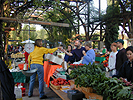

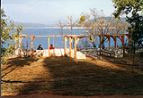

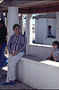

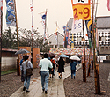

Depicted here are some places we have built. Mouseover to enlarge.

  Building Beauty: Creating Living Wholeness in the Built World, a post graduate program that continues the legacy of Christopher Alexander [*www.buildingbeauty.org*](http://www.buildingbeauty.org) Write to <hello@buildingbeauty.org> to explore how you can be a part of it.

If you are one of **a group of friends** who are talking about building a new place to live a better life, this website can show you ways of working that are inspiring and related to the things which matter in your lives. The ACTION & PRACTICE pages will guide you.

If you are a **developer** or **landowner**, this website can show you ways of working that are more capable of creating healthy, hospitable and beautiful places for people to live, than present forms of practice typically allow. It does not cost more. See the DEVELOPER'S PAGE.

If your **family** or **business** is helping to rebuild an old neighborhood, or moving to a new one, this website will give you tools and a voice which will be heard, so you can genuinely influence what happens.

If you are a **community organizer**, or a **leader** in a local community, this website will give you tools to be sure that residents and local businesses can play an effective and practical part in decision making, which will be heard.

If you are a **mayor**, **city manager**, **local official** or **city planner** who wants to help create a vibrant addition to your town or city, the ACTION & PRACTICE pages will show you how to support and become involved in such a process so it can be effective.

If you are a **builder** or a **craftsperson**, this site will show you a way of offering your services that allows the making of beauty in buildings to be a fundamental part of your contribution -- more so than is typically allowed in the present commercial context.

If you are an **architect** or **engineer**, this site will show you how working with a community, when done well, is likely to create a neighborhood with real beauty and spirit.

If you are a **teacher** or a **student** or an **academic** you will find material throughout this website that naturally forms a basis for class instruction, research, and student projects. To consider teaching the use of generative codes, visit the THEORY & EXAMPLES section. The archive page provides academic papers, history and background of how generative codes were developed.

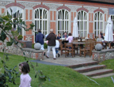

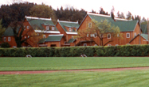

**Our goal is to help everyone make our neighborhoods places of belonging, places of health and well-being, and places where people will want to live and work. This has become possible through the use of Generative Codes, Christopher Alexander's latest work in the effort to make possible conception and construction of living, beautiful communities that have real guts -- not the sugary sweetness of pseudo-traditional architecture.**

The tools offered are intended for the use of ordinary people, families, communities, developers, planners, architects, designers and builders; public officials, local representatives, and neighbors; business owners and people who have commercial interests. The processes here are expressed in the belief that the common-sense, plain truth about laying out a neighborhood, or repairing one, is equally valid for all comers, amateurs and professionals. They help people build or rebuild neighborhoods in ways that contribute something to their lives. Many of the tools have their origin in 30 years of work published in Alexander's [*The Nature of Order*](ideas/the-nature-of-order.md).

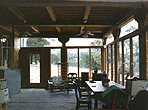

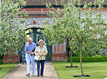

**In our view, almost any part of the environment may be viewed as a neighborhood.** A neighborhood can be very small (less than an acre), or quite large (hundreds of acres). It can be a hospital, a business, a group of workshops, a place where people live and work. A neighborhood is any group of people and their activities, animals, buildings, plants, and public space. Neighborhoods of different sizes are usually nested inside one another.

**In this spirit, piece by piece, we of our generation, and the next generations, may be able to rebuild the world.**

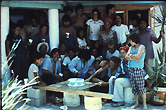

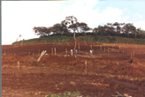

*This website is written by Chris Alexander, Maggie Moore Alexander, Randy Schmidt, Nick Littlestone,\
with Bev Behrman and Howard Davis.*

Center for environmental structure established 1967

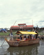

There is a great deal of material posted on this website, especially under the headings of ACTION & PRACTICE and THEORY & EXAMPLES -- more than one would expect to find on a typical website. We are using this medium so that we can make these generative codes and building practices available to a world-wide audience quickly, and at as low a cost as possible. Our efforts to write and organize the material for easy use continue.

 If you would like information, please **[CONTACT](about/contact.md)** us If you would like help, please check our

## Services

. If you represent a **community organization** or a **professional developer**, and would like to consider applying the methods described on this website, to one of your projects, please **[E-MAIL US](mailto:interestedlist@livingneighborhoods.org)** , and tell us what kind of help you might need.

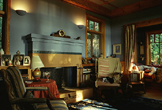

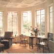

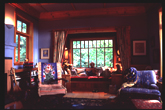

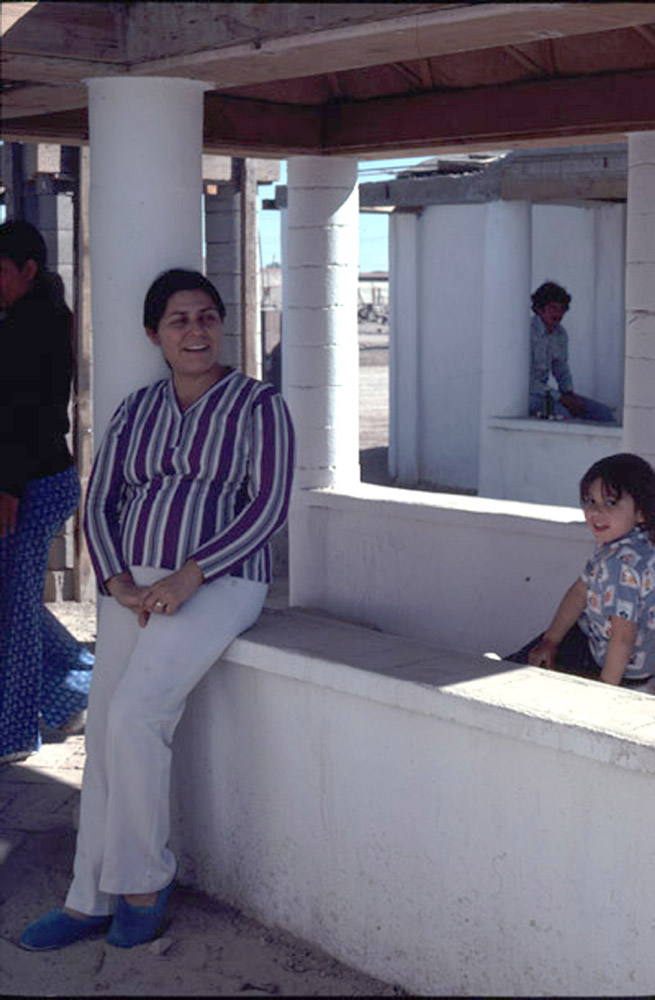

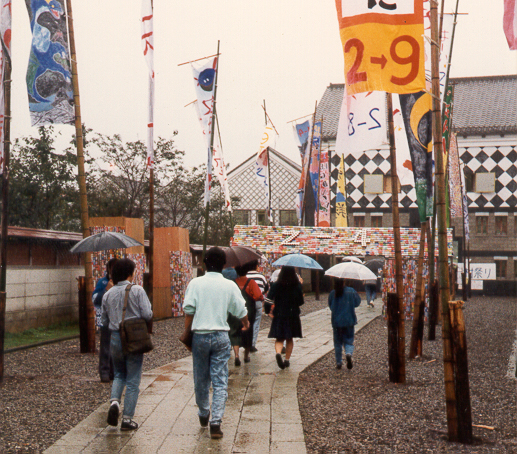

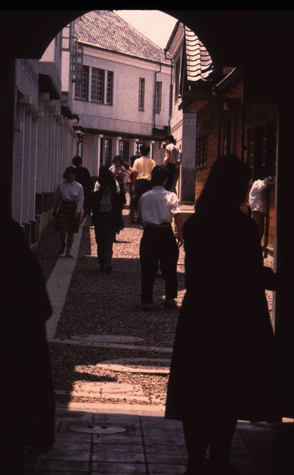

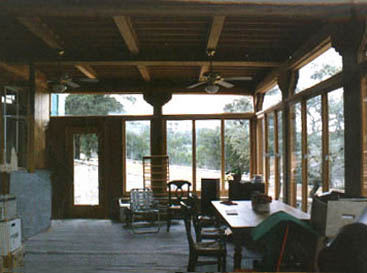

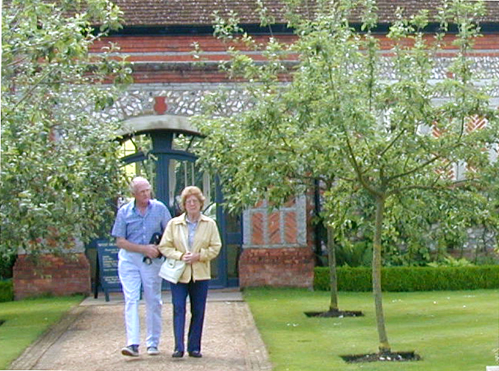

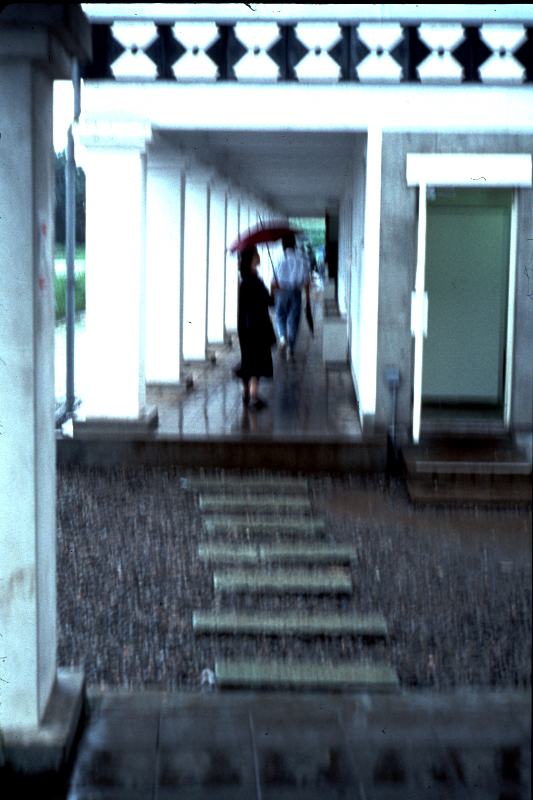

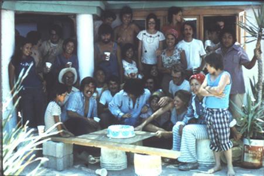

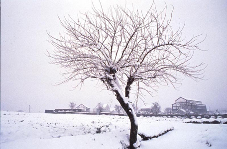

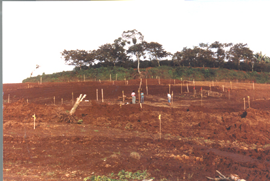

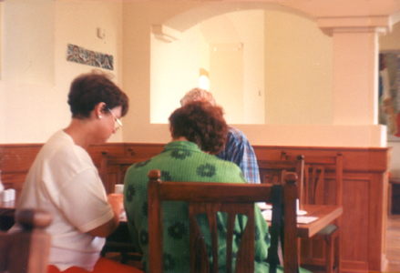

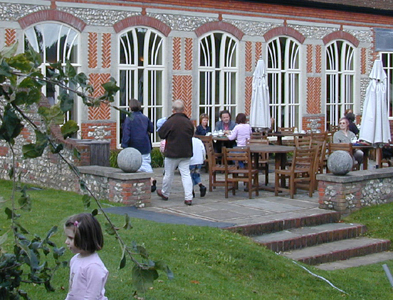

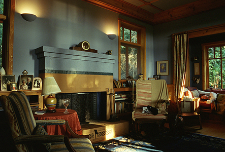

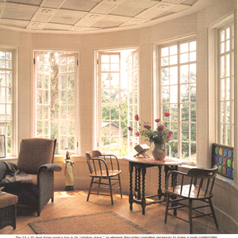

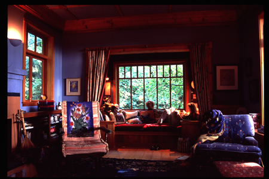

## Overall process explanation

## Overview

## Of the building process

This website gives you a step-by-step process, for laying out large neighborhoods, small neighborhoods, building complexes, and buildings, using generative code.

The process begins with large and general aspects of layout, and gradually works its way down to detailed issues of planning, buildings, road layout, common public space, gardens. It also includes material helping you to manage, or build, the implementation, or parts of the implementation of such a project.

To lay out a neighborhood, or any portion of a neighborhood, you use the "unfoldings" that appear on the ACTION & PRACTICE pages (see menu to the left), one at a time. This will allow the design, layout and structure of the neighborhood to unfold, step by step, until it is complete.

The unfoldings are arranged in groups, each dealing with a typical phase in creating or repairing a neighborhood. To simplify your tasks, use the groups of unfoldings roughly in the order they are presented. As you become familiar with and work with the unfoldings, you'll find that you can modify them, and create new ones that are specific to the physical attributes and culture of your neighborhood.

Print out the unfoldings in groups, or individually, to study them carefully at the site on which you are building. The WORKBOOK is offered to support the work you do by yourself and with others, making the unfoldings and other materials easily accessible. All these materials and your ideas and notes can be assembled together there.

The DRAWING PAD is also a vitally useful tool. With it, you can create realistic site maps and drawings on which each new unfolding is built, gradually bringing coherence to the whole project.

## This is an evolving web site

**WHY IS THIS SITE RUNNING, WHEN IT IS NOT YET FINISHED?\
SHOULD IT BE DESIGNATED AS A BETA-SITE?**

We are working hard every day to make this site useful to you. Even in its current state, we believe it will help you significantly, if you use the material.

Several newly introduced sections now form the core of the site's operational purpose. These include the WORKBOOK, the DRAWING PAD, and the extensive LIST OF UNFOLDINGS (see menu, left and above). They are, for the time being, in an experimental state. We need to build a very substantial number of unfoldings -- possibly several hundred unfoldings, before the site works fully. We also need months of further refinement on the drawing pad, which is a vitally important part of the site.

All this will require months of ongoing, live experiments, so that we can modify the way the material is presented in a form that works as well as possible, for people who are using it to help themselves lay out new neighborhoods, or buildings.

We could have chosen to wait until these experiments were complete, before opening the site to the public. However, this is a non-profit site, and our aim is not financial, but to give people help, in a practical setting, so that the huge change ultimately implied by the way this website works, has a chance to catch up on contemporary forms of planning, and construction, and development.

**In addition, we cannot make the necessary changes and innovations effective, unless we do it with your help!**

If you have comments, please let us hear from you.

THANK YOU to all our users, for sharpening our wits, and for allowing us to serve you.

*From* Building Living Neighborhoods *by Christopher Alexander, Maggie Moore Alexander, Randy Schmidt and Nick Littlestone, with Bev Behrman and Howard Davis. © Center for Environmental Structure. [Original page](https://www.livingneighborhoods.org/ht-0/bln-exp.htm).*
