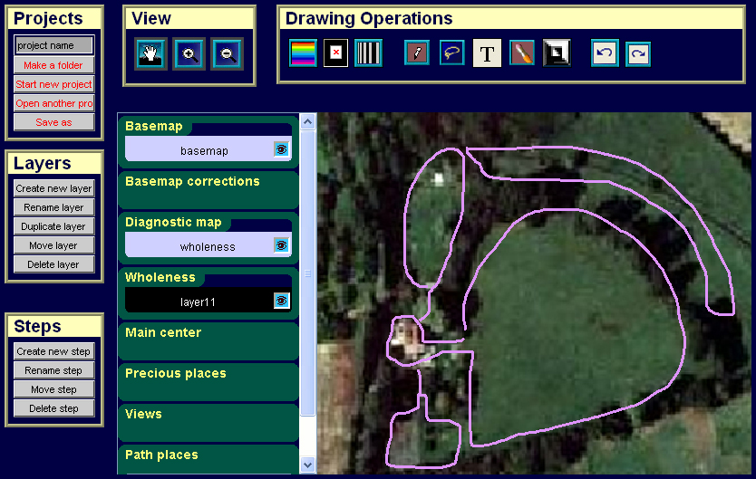

***Building Living Neighborhoods***

Coming soon: not yet fully operational

## The drawing pad

and HOW TO USE IT

This drawing pad can be used to articulate each unfolding. It is more than a method that helps you capture your ideas at each step. Its use is important because it helps each unfolding to come into being. Then each new unfolding is built on top of the last, creating geometrical coherence in design, function, and a sense of place. As you learn to do this, you move towards giving unity to the whole.

As you develop each "layer" on the drawing pad, print it, and include it in your WORKBOOK

(see menu to the left).

. . . where you can draw . . . and see the layers of successive unfoldings, turn them on and off, draw new layers to describe the unfolding configurations created by the next unfolding process.

With practice, we hope this will enable you, gradually, to bring the whole to a harmonious order.

## Instructions

The unfolding process happens:

1.  IN PEOPLE'S MINDS -- to some extent in the minds of the people who live and work in the place, thinking about the neighborhood.

2.  ON THE LAND -- to some extent on the land itself, when people notice the shape, position, and other physical aspects, and realize that certain new things belong there, and mark them physically with stakes to remember their position.

3.  ON DRAWINGS OF THE LAND -- to a large extent it happens on the drawing of the site, which represents the land where action is to be taken.

All three of these aspects are used in combination, and by using the drawpad all three will be captured.

Since the third of these -- the drawing -- is very concrete, it is the place where one can most easily see the neighborhood developing and unfolding as a whole -- always provided that it is the first two considerations which mainly govern what is drawn on this basemap.

It is on the basemap that you will most clearly witness, experience, and help to control the neighborhood process of unfolding, and see what results it brings. What follows is a list of steps to take on the drawing pad, in roughly the order you should take them.

Each new drawing you make is to be coupled with a particular unfolding. And each gets its own "layer". Its name will appear in the list of layers at the left hand edge of the map.

1.  Aerial Photo layer. Get an aerial photo of the land, and place this photo in a file of your choosing, on your own computer. Make this your first layer, and call it Aerial photo.

2.  Basemap layer (unfolding \#1.4). Make another layer, above the aerial photo, and make all kinds of marks to show things that are not clear in the aerial -- things that make it easier to grasp recognizable features like roads, buildings, trees, and landmarks. Call this second layer Basemap. You may correct the basemap over time. As you recognize that you need more detail in a particular place, go out and pace it off or measure it, and then correct the drawing on this layer to reflect the real situation more exactly.

3.  Diagnosis layer (unfolding \#2.5). Now, by following the unfolding called Diagnosis map, you can draw important or beautiful views, special small places, special public places, natural paths which suggest themselves, valuable trees, particularly nice buildings which may play an important role in the future growth of the neighborhood, and so on. Call this layer Diagnosis. You can add to the diagnosis layer gradually as you get to know what matters in the site.

## Wizard

### Choose what you would like to do

## Load demo

This choice is recommended for first time users.

## Start new project

Choose this when you are ready to start working on your own project

## Load existing project

## Save as

Choose this if you are working on a project and want to change the file it is being saved in.

If you are a first time user, this wizard will guide you to load a demo to explore how this drawing pad works.

Before getting started, the java applet that powers the drawing pad needs to be loaded. In order for the applet to save the work that you do, you must agree to trust the applet. When you click on **NEXT**, you will be asked if you want to run the applet and to trust it (unless you have already been asked and the computer remembers your answer). You will need to answer "run" or "yes" in order to be able to save your work from one session to the next.

*What if I say that I do not wish to trust the applet, and then I change my mind?*

To get another chance to answer the question, you may need to completely shut down the browser, closing all of the browser windows, and then visit this page again. There will not be a way to save any work that you do before you answer "yes".

*Click on* **NEXT** *to load the drawing pad applet*

The applet is being loaded ...

The drawing applet is now loading...

Going to drawing pad...

Before you do anything else, you must choose a folder on your own computer, which will hold your project files. We recommend that you create a new folder called **livingneighborhoods projects**, just for this purpose. The computer will remember that this folder is the place to store your drawings. It will store an updated version of each drawing as you work on it, and will bring it back automatically, when you re-open the drawing pad. **The following folder will be used**

*Click browse if you wish to choose a different folder namee or a different location for the folder. When you are ready to start work, the folder that you choose will be created if it does not exist.*

Do not save files on my computer.

Check this checkbox if you are unable to create a folder or would like just to look at a demo without saving anything you do. However, we recommend choosing a folder now, so that the drawing pad can remember any experiments that you do.

2\. Once you have created a drawing-files folder, you can begin using the drawing-pad. We recommend that the best way to get started, is to load an existing project, and play with it, to get a feel for the controls, drawing tools, switching layers on and off, erasing and correcting and rebuilding layers, and rearranging the sequence of steps.

Or you can immediately start work on your own project.

(NO FOLDER) 2. Once you have created a drawing-files folder, you can begin using the drawing-pad. We recommend that the best way to get started, is to load an existing project, and play with it, to get a feel for the controls, drawing tools, switching layers on and off, erasing and correcting and rebuilding layers, and rearranging the sequence of steps.

*Click on the Browse button to find the file that holds the project you wish to load.*

Choose a name for your project

Now choose a background image for your drawing. This should be a map or an aerial or satellite photo of your site. It should be stored on your computer as an image file (for example, as a jpeg file). *Click on the Browse button to find the background image that you wish to use.*

## The applet page

Current  Project

## Demo

project name

**Caution. DEMO ONLY. This part of the website is not yet working properly. You can play with it, and see what it can soon bring you, but it is not yet ready for serious use.**

**To edit the step list right click the steps or the layer. This will give you options that allow you to edit the list, rename them, create them, and move items,**

project

project file

selected step

selected layer

current map width in feet

BASEMAP   First find an aerial photograph of the area where the future neighborhood will be. You can get it from many sources, save it as a jpg in your file for the project. It is the reality of this photograph, with trees, water, roads, buildings, that will make it possible to conceive a place that grows naturally from the details of the land itself.

## Basemap corrections

Now improve the detail of the background map to include details and dimensions that are important, or that will be important to have in exactly the right place during the unfolding. You can draw this on a separate layer, and continue to improve these details, while your overall process goes forward.

DIAGNOSIS   Now look for places, all over the neighborhood area, where beautiful things need to be protected and enhanced, and bad places where improvements need to be made. Draw these in, on this map layer. The places you identify and draw on the maplayer, should be in the following categories:

Beautiful views, which give you pleasure standing there.

Spots that are inherently lovely, or fun, or pleasant, which should be protected and enhanced.

Places where latent centers exist, that have the potential for being made more beautiful.

WHOLENESS   Try to make a diagram which captures the most important pattern or wholeness of the place: a structure which comes from that place, is of that place, and embraces the whole extent of the neighborhood.

## Main center

Find the main center of the neighborhood: that place in the land, or among the existing built places, which is the most natural and magnetic center, which will have the quality that people in the neighborhood will be drawn to it, and without thinking, will go there all the time.

*From* Building Living Neighborhoods *by Christopher Alexander, Maggie Moore Alexander, Randy Schmidt and Nick Littlestone, with Bev Behrman and Howard Davis. © Center for Environmental Structure. [Original page](https://www.livingneighborhoods.org/drawing-pad/intro.htm).*
