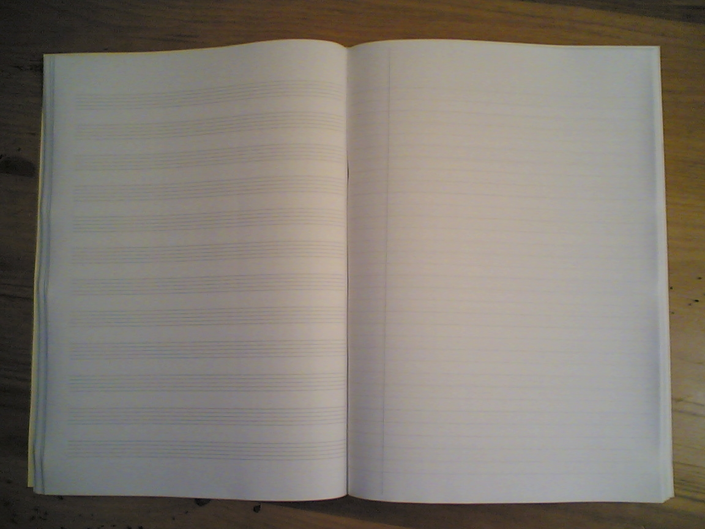

***Building Living Neighborhoods***

## Workbook section 1

## Startup and vision

## Contents

This section of the workbook should contain:

The five unfolding pages listed below, printed from the website;

The five complementary instructional worksheets, to match the unfolding pages. These sheets are attached to this page, and will print out when you print this page.

Your own handwritten notes, and the hand-drawn sketches developed through discussion with others;

Drawings and sketches from the Drawing Pad on the website, *when it becomes operational*.

## Five worksheets

1.1 Parameters

1.2 People

1.3 Vision

1.4 Base Map

1.5 Poetic Language

End of page

\*\*\*\*\*\*\*\*\*start worksheet 1.1\*\*\*\*\*\*\*\*\*\*\*\*

## Worksheet

## For

## 1.1 parameters

**1.1 Parameters**

The Parameters page on the website asks you to fill out and submit a worksheet to get started on defining the loose parameters of your project. If you have not competed the worksheet yet, please do so. It is important to have a record of your original thoughts about your project - this is the beginning of the unfolding of your dream.

Visitors to the earlier version of the www.livingneighborhoods.org website may have completed "Your Basic Worksheet". If so, it was sent to you via email at the time you submitted it. That is the same worksheet the Parameters page refers to, and it should be inserted here.

You may have additional thoughts about how you would like your neighborhood to grow and thrive. Record those thoughts here. In particular, say as much as you can about what the place will be like, feel like, and grow into, as the questions on the worksheet lead you to consider.

## Your input, notes, sketches, community decisions, etc

End of Page

\*\*\*\*\*\*\*\*\*start worksheet 1.2\*\*\*\*\*\*\*\*\*\*\*\*

## Worksheet

## For

## 1.2 people

**1.2 People**

Start right away involving people in discussions about what this place can be, walking the land together, and imagining what they would like to see happen there. Share your thoughts with others who could be involved, and ask them to record their thoughts as well.

As ideas are generated, summarize them here.

## Your input, notes, sketches, community decisions, etc

End of Page

\*\*\*\*\*\*\*\*\*start worksheet 1.3\*\*\*\*\*\*\*\*\*\*\*\*

## Worksheet

## For

## 1.3 vision

**1.3 Vision**

The Vision page on the website describes several different questions to explore with people who are interested in the project. First, together, close your eyes, and imagine the neighborhood as you wish it to be. Wait for it, and it will come of its own accord into your eyes-shut mind.

Many questions are listed on the web page for Vision. These are additional questions that might help stimulate descriptions of what you have in mind:

What kind of experience are you hoping to have in your neighborhood?

As you see people moving around this wonderful, imaginary place, what things are they doing that contribute to the feelings you have in your mind's eye?

If you are moved, or thrilled, by the image of your neighborhood, what is it that makes you feel that way?

If you have experience in a neighborhood that even faintly resembles what you have in mind for yours, what features give it the qualities you like?

.oOo.

Conversations that attend to these questions, and probably others as well, help to fill in details that may be illusive. Share the ideas as you wrote them with others who are interested in the project. Make simple sketches of the ideas if that is helpful. Edit it until it is more or less agreed to among all of you. It should be written in as much detail as you feel you know. It is hoped that this vision is largely shared, but if there are points of disagreement or opinion, not settled yet, then write those down as well. Change what needs changing as new ideas come up.

As you move into the next phase of unfoldings, Diagnosis of the Land, your vision will get grounded in the land itself. You will have the opportunity to consider the issues deeply, and resolve them.

## Your input, notes, sketches, community decisions, etc

End of Page

\*\*\*\*\*\*\*\*\*start worksheet 1.4\*\*\*\*\*\*\*\*\*\*\*\*

## Worksheet

## For

## 1.4 basemap

**1.4 Basemap**

The instructions on the Base Map Unfolding page describe several ways in which to develop the map you need. One of them, the Drawing Pad, is not yet operational. However, even without this tool, you can assemble aerial photos of your neighborhood site and hand-drawn maps, and also obtain surveyor maps, if you wish. The point is to become very aware of your neighborhood's physical shape and attributes and create a base from which to work with unfoldings. Place the maps you assemble in this section to keep them handy for future reference.

Produce a scale map of the whole neighborhood on which you and your colleagues have written a record of your observations while walking the land:

Use arrows to show important views.

Use circles to designate important precious places.

Mark good places to come into the site; and

Mark good places to leave by.

## Your input, notes, sketches, community decisions, etc

End of Page

\*\*\*\*\*\*\*\*\*start worksheet 1.5\*\*\*\*\*\*\*\*\*\*\*\*

## Worksheet

## For

## 1.5 poetic language

**1.5 Poetic Language**

In words, write down a poetic vision of the place, in the most emotional language. Describe recurring themes from previous conversations with others. Deliberately describe the most touching aspects this place could have. The work that you have done prior to this step, will inform you of the times when you had emotional reactions; the times when you felt excited just imagining your neighborhood finished. You are trying to draw a picture of of your emotional reaction o the land. Poetry is a way to do that.

## Your input notes, sketches, community decisions, etc

End of Page

*From* Building Living Neighborhoods *by Christopher Alexander, Maggie Moore Alexander, Randy Schmidt and Nick Littlestone, with Bev Behrman and Howard Davis. © Center for Environmental Structure. [Original page](https://www.livingneighborhoods.org/packets/workbook-section1.htm).*
