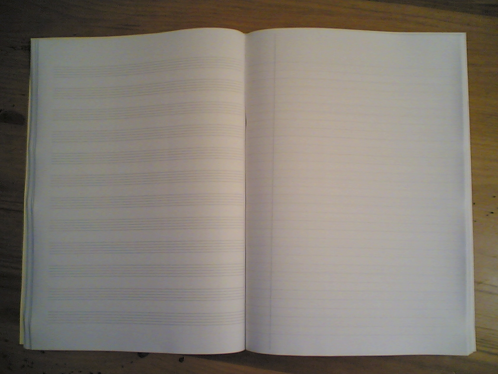

***Building Living Neighborhoods***

## The workbook

and HOW TO USE IT

## What goes in your workbook

There are three kinds of things to put in your workbook:

**Unfoldings**. A printed copy of each unfolding you want to use. This can be printed directly from the appropriate page on this website.

**Worksheets**. A printed copy of the worksheets that go with each unfolding, and on which you make your own comments, drawings and modifications. These are available section by section, and may be printed that way from the workbook-section pages.

**Drawings**. A printed copy of each drawing you have made, as the unfoldings proceed. If you make these drawings on the DRAWING PAD (see menu to the left), then these should also be printed and kept in the workbook.

## Using the workbook

This workbook can serve to help you think about and implement the Unfoldings described on this website in a step by step manner for your project. It will also help you organize the information you generate with others. You will have a record that supports your discussion with architects, city planners, neighbors who are joining the project, or whoever you might want to explain your project to. Careful documentation can be very useful when talking with city planners, architects, engineers and other professionals - an added benefit to taking detailed notes.

The worksheets in this workbook correspond with each "Unfolding" page on the website. The Unfolding pages provide direction on what to do. The worksheets provide space in which you record your observations, thoughts, pictures, decisions, conclusions or processes for each Unfolding. The workbook is a living record of your project and helps you recall details, should you want to convey them to others, or backtrack to see how you got to where you are.

When you work through the sections that come later in the process of building your neighborhood, the documentation from the earlier sections will be available for review. This will help you recall earlier choices and decisions in light of current questions, and consider whether they should be adjusted to serve the whole project as it moves forward.

The LivingNeighborhoods.org website guides your understanding of how to grow a neighborhood. The workbook, which you can print and keep in a binder, allows you to document each step you take.

## Instructions

## Your living neighborhoods workbook

**To be used in conjunction with the Website**

This workbook can serve to help you think about and implement the Unfoldings described on this website in a step by step manner for your project. It will also help you organize the information you generate with others. You will have a record that supports your discussion with architects, city planners, neighbors who are joining the project, or whoever you might want to explain your project to. Careful documentation can be very useful when talking with city planners, architects, engineers and other professionals - an added benefit to taking detailed notes.

The worksheets in this workbook correspond with each "Unfolding" page on the website. The Unfolding pages provide direction on what to do. The worksheets provide space in which you record your observations, thoughts, pictures, decisions, conclusions or processes for each Unfolding. The workbook is a living record of your project and helps you recall details should you want to convey them to others, or backtrack to see how you got to where you are.

When you work through the sections that come later in the process of building your neighborhood, the documentation from the earlier sections will be available for review. This will help you recall earlier choices and decisions in light of current questions, and consider whether they should be adjusted to serve the whole project as it moves forward.

The livingneighborhoods.org website guides your understanding of how to grow a neighborhood. The workbook, which you can print and keep in a binder, allows you to document each step you take.

**Workbook Assembly**

To compile the workbook, please follow these instructions. For each section of Unfoldings (see menu under ACTION & PRACTICE):

1.  Print the website Unfolding pages directly from the website, so they are available for easy use when you are away from your computer. Use the print button in the browser controls at the top of your screen. You are free to select color or black ink.

2.  Print the corresponding worksheets that apply to the section you are ready to work on. These will help you organize each task.

3.  Assemble the printed pages in a binder.

4.  For each Unfolding, label a page divider with the number and name of the Unfolding. Place the Unfolding pages from the website behind the divider. Next, place the worksheets that correspond to that Unfolding.

5.  As you work with each Unfolding, keep your notes and drawings in the workbook so that they can be easily found and shared with others.

## Instructions for use with the website

## Your living neighborhoods workbook

**To be used in conjunction with the Website**

This workbook will help you think about and implement the Unfoldings described on the website, livingneighborhoods.org, in a step by step manner for your own project. It will also help you organize the information you generate with others. Then you will have a record that supports discussion with others -- architects, city planners, neighbors who are joining the project, or whoever you might want to explain your project to. Careful documentation can be very useful when talking with city planners, architects, engineers and other professionals - an added benefit to taking detailed notes.

The pages in this workbook correspond with each "unfolding" page on the website. The unfolding pages on the website provide direction. The workbook pages provide space in which your project can be described, and each decision you make can be recorded with its reasoning for future reference.

With the livingneighborhoods.org website, you will gradually build your understanding of how to grow a neighborhood. This workbook, which you can print and keep in a binder, will allow you to document each step you take. Every investment of time and energy can be described here and shared.

**Workbook Assembly**

To assist you with completing and documenting each unfolding, we suggest compiling this workbook in which you can gather all the information that is pertinent to your project. There are ten (?) major phases in which all the unfolding tasks are described on the website and in the table of contents below.

1.  Print the website unfolding pages directly from the website.

2.  Download and print the corresponding workbook pages that apply to the phase you are ready to work on. These will help you organize each task.

3.  Assemble the printed pages in a binder. For each unfolding, place the website unfolding pages after a page divider that is labeled with the number and name of the unfolding. After the website unfolding pages, place the workbook pages that correspond with that unfolding.

4.  As you work with each unfolding, keep your notes and drawings centralized in this one place so that they can be shared easily with others.

5.  When you work through the phases that come later in the process, the documentation from the earlier phases will be available for review. This will help you recall earlier choices and decisions in light of current questions, and consider whether they should be adjusted to serve the whole project as it moves forward.

The following phases are currently available for download: 1.0 Start-up / Vision

## Downloads

You can download and print out the material for your workbook, in phases, one phase at a time. Each phase contains the published unfoldings, together with a worksheet for each unfolding which gives you additional information about how to carry out the unfolding effectively.

This phase includes five unfoldings, and the five worksheets that go with them, for your notes, comments, and drawings

[Download Worksheets for Phase 1](workpad-startup-and-vision.md) 1.1 Setting key parameters 1.2 Talking with people 1.3 Vision 1.4 Getting a basemap for the neighborhood 1.5 Defining the quality of the neighborhood in poetic terms

Download Worksheets for Phase 2 1.1 Setting key parameters 1.2 Talking with people 1.3 Vision 1.4 Getting a basemap for the neighborhood 1.5 Defining the quality of the neighborhood in poetic terms

The following phase is currently available for download: 1.0 Startup & Vision

**Workbook Downloads**

This table of contents corresponds to the "Unfolding List" on the website. (Press ACTION, then any of the links on the ACTION & Practical Work page.) PHASE 1     STARTUP & VISION 1.0 Start-up & Vision 1.1 Worksheet: Fill out a worksheet of the basic facts. 1.2 People: Slowly and deliberately, bring in people you know who will want to be involved. 1.3 Vision: Together, close your eyes, and imagine the neighborhood as in a true vision. You wait for it, and let it come of its own accord into your eyes-shut mind. 1.4 Basemap: Make a basemap of the place where the neighborhood will be. 1.5 Poetry: In words, write down a poetic vision of the place, in the most emotional language. 2.0 Diagnosis of the Land 2.6 Introduction: Introduction to Diagnosis. 2.7 The Whole: Observe and sketch the deep configuration of the whole. 2.8 Precious Places: Identify the most beautiful and precious places. 2.9 Repair: Identify spots and areas that most need repair. 2.10 Draw: Draw your diagnosis of the land on your map. 2.11 GPS: Use GPS for exact positioning, and transfer to the map. 3.0 Customize Our Generative Code to Fit Your Project 4.0 Place, Size, and Shape Major Public Spaces 5.0 Begin Decisions About Building Positions etc.

## Assembly

**Workbook Assembly**

To compile the workbook, please follow these instructions. For each group of Unfoldings on the menu under ACTION & PRACTICE, you will find corresponding groups of worksheets for the Workbook):

1.  Print the website Unfolding pages -- one at a time -- directly from the website, so they are available for easy use when you are away from your computer. Use the print button in the browser controls at the top of your screen. You are free to select color or black ink.

2.  Print the corresponding worksheets that apply to the section you are ready to work on. These will help you organize each task. Select the section you want to print, and use the print button in the browser controls at the top of your screen.

3.  Assemble the printed pages in a binder.

4.  For each Unfolding, label a page divider with the number and name of the Unfolding. Place the Unfolding pages from the website behind the divider. Next, place the worksheets that correspond to that Unfolding.

5.  As you work with each Unfolding, keep your notes and drawings in the workbook so that they can be easily found and shared with others.

**Printing**

- The entire website has been designed so that all pages print directly onto A4 paper or 8.5 by 11 paper, without requiring any special provisions. They should come out symmetrically placed on the page.

- Whenever possible we have placed page breaks to make the pages break neatly. We have not done this where it would require radical change in the design of the page.

- We recommend that you print in color, if you can afford to do it. Of course, the pictures come out much better.

- We also believe you will find the worksheets in the workbook more enjoyable to look when they have the colored panels that are visible on the website. (We are currently working out how this can be achieved).

- You may print the Unfolding pages one by one, as you see fit.

- If you wish to print out an entire section of Unfoldings, we will make this a possible option, but it is not yet available.

- To print out the worksheets, go to the worksheet section you are interested in, and print that page. The individual worksheets will come out on separate pages (not working yet).

## Printing pages

**To use the website effectively, you need copies of various pages. Printing pages from the website, to use them, read them, study them, look at them while walking about the neighborhood site or in the comfort of your own home or office, is an essential part of the way this website works.**

**To print an individual page**. Every page has a print instruction near the head of the page. To print the page out, simply click print, and you will get a better job than if you use your printer to print the html page. By using the print button you will get material neatly formatted for A4 or 8.5 x 11 paper. You are free to select color or black and white.

**To print a packet of pages**. Every page has a print instruction near the head of the page. To print the page out, simply click print, and you will get a better job than if you use your printer to print the html page. By using the print button you will get material neatly formatted for A4 or 8.5 x 11 paper. You are free to select color or black and white.

**To print the entire manual in its current state**. Every page has a print instruction near the head of the page. To print the page out, simply click print, and you will get a better job than if you use your printer to print the html page. By using the print button you will get material neatly formatted for A4 or 8.5 x 11 paper. You are free to select color or black and white.

*From* Building Living Neighborhoods *by Christopher Alexander, Maggie Moore Alexander, Randy Schmidt and Nick Littlestone, with Bev Behrman and Howard Davis. © Center for Environmental Structure. [Original page](https://www.livingneighborhoods.org/ht-0/workbook.htm).*
