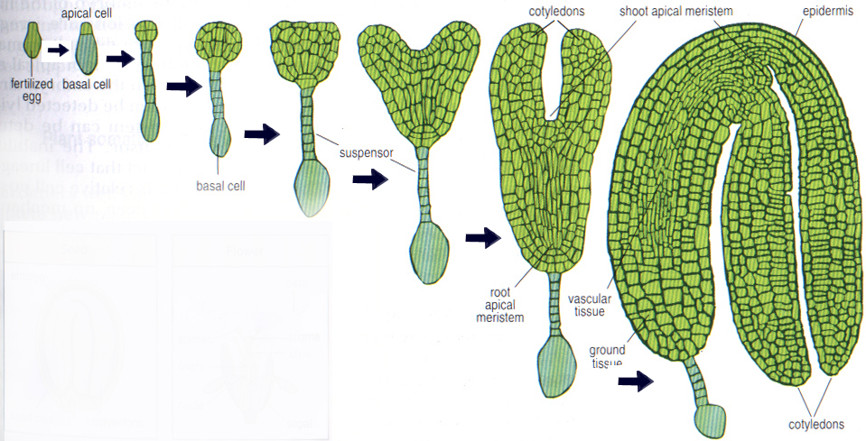
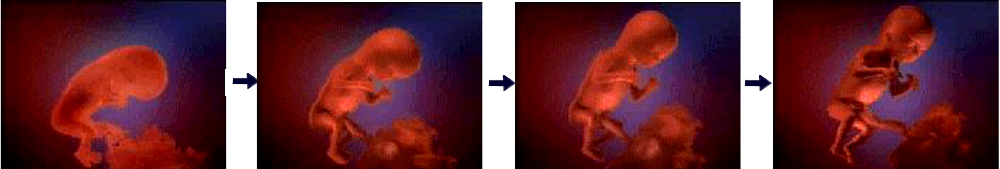
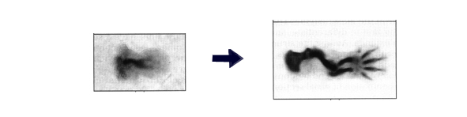

## What is an unfolding?

The elements of a generative code are **"unfoldings"**. Whether in the evolution of a neighborhood or in the evolution of a building, each unfolding is an operation which gets you from one stage or moment of development (whether conceptual or physical), to the next moment of development. The full sequence of unfoldings gets you all the way from the first stages of conception when a project is no more than a gleam in somebody's eye, all the way to the final stages of physical, built completion and use.

Unfoldings slightly resemble patterns, in that they are nuggets of information, which help you shape some part or aspect of the environment. However, unfoldings are vastly different from patterns in the way they work, and it is these differences which give them their power and effectiveness.

Each unfolding has three key features which define its operation and its effect.

Unlike a pattern, which is a static configuration, an unfolding is **dynamic**. It **acts** to generate form.

Unlike a pattern, an unfolding arises **from** the **whole**, is shaped **by** the whole, and acts **upon** the whole

An unfolding is by its nature **personal**, and requires human input and human feeling from the people doing the work, as an essential part of its contribution to the formation of the environment.

1

**Unlike a pattern, which is a static configuration that merely serves as a model, an unfolding is **dynamic**. It **acts** to generate form.**

1.1

An unfolding is a process which gets you from one stage or moment of development to the next moment of development, in the evolution of a neighborhood or in the evolution of a building.

1.2

It is helpful to compare such unfoldings with similar phenomena in plant morphogenesis and embryology. Both in the angiosperm shown below, and in the embryo shown beneath it, you can picture each unfolding as a limited and brief process which in the first one gradually shapes the seed, and in the second, takes the blur that is the beginning of a hand in the embryo, to the next stage of development where the hand gets its first outline fingers.

Diagram of a typical angiosperm (flowering plant) unfolding

Photographs of a human embryo unfolding

Two photographs, three days apart, of a mouse foot unfolding

1.3

An unfolding is a process that operates on the whole. But unfoldings may be very short in duration, or longer. In the angiosperm example, the unfolding that happens between one frame and the next is relatively short in duration, and accomplishes a modest task. The entire sequence of seven pictures for the angiosperm may also be viewed as one unfolding packet, composed of the seven smaller unfoldings happening in a coordinated sequence.

1.4

That, too, happens in our neighborhood unfoldings. The individual unfoldings described on the right hand side of the tables in the library are small, of shorter duration, and easy to focus on. But like the biological ones, these unfoldings may also be bundled into packets, described on the left hand side of the tables in the library.

1.5

Such unfoldings are the key process elements of every generative code. Only unfoldings can gradually, and one by one, cause the creation of a **living** neighborhood. Their attention to the whole, and their capacity to generate minute and careful adaptation, step by step, results in the infinite variety and beautiful fitness that we see throughout nature, and in the work of countless thousands of traditional builders in different cultures.

1.6

In providing this first sketch of a library on this website, we are doing our best to pass on, and make public, a first cache of the source material from which a neighborhood can actually be made living: and above all, in a form that can be **generated** by the neighborhood people themselves, if given the proper framework

1.7

**Pattern Languages**. For those who have studied pattern languages, it may be useful to make a brief comparison of patterns and unfoldings.

Originally, the patterns in *A Pattern Language* were thought of as unfoldings. The languages of traditional society did work like that -- by unfolding building designs. Pattern languages were intended to be similar. However, as my colleagues and I worked on the pattern language throughout the sixties and early seventies, the functional content of the patterns, though humane and sensible, was at that time profoundly inconsistent with the modern way of looking at architecture that was then fashionable: in short, modern architecture, for all its talk about functionalism, was not focused on function at all. Indeed modern architecture was studiously avoiding it. In order to make the (then) radical nature of the true functionalism of the pattern language as persuasive as possible, and in order to communicate with people who had lost sight of real function, we spent more and more of our energy writing functional background, to make it clear that these functional things and their spatial correlates raised in the patterns really were **true**.

As a result, the crucial and central importance of **unfolding** as the main attribute of patterns became less visible, was obscured, and even our own work on that aspect had temporarily to slow down.

So, it is not surprising that the unfoldings presented here do, in terms of functional content and their overall network relations to one another, resemble the patterns in a pattern language. But the inner content of the unfoldings is different, and it goes back to the intention that originally inspired the pattern language in the first place.

1.8

The actual *content* of an unfolding, is entirely different from the *content* of a pattern.

A **pattern** describes a **static** configuration that should be made present in a neighborhood, and gives no information, really, about how to make this pattern appear within an ongoing process of design or construction. As a result the design process, which dominates the result of any neighborhood and architectural planning, has little power to be profoundly affected by the pattern.

An **unfolding** is primarily **dynamic**. It describes "how to get there from here", how and when a particular emerging morphology is to be injected into an emerging design, and what actions must be taken to make the appearance succeed geometrically. **Thus an unfolding is a hugely different thing from a pattern, and a most important step forward.**

In addition, the unfolding (as the very word itself suggests) unfolds the currently existing **whole** -- eg. a building in its environment, a neighborhood in a city. It is focused on the whole at all times, and shows how this whole unfolds, to give birth to new form and new differentiations. This explicit reference to the whole and its unfolding, provides us with a new conception of architecture as that which is being born from the pre-existing whole, and continuing it, thus always helping to give continuity to the city and the earth.

**The concept of an unfolding provides an entirely different vision of the nature of architecture and planning, one which is, in principle, at last capable of helping living structure to come into being.**

2

**Unlike a pattern, an unfolding arises from the particular whole in which it is forming. It is shaped by the whole, and acts upon the whole, and causes the rebirth of the whole.**

2.1

An unfolding, is a glimpse of wholeness, a small microcosm of "the" whole, the whole seen within a small portion of the universe, the world in a grain of sand.

2.2

Imagine the universe as a fountain. It is composed of quarks, electrons, fields, light, and motion. But all this apparatus -- the apparatus shown to us by modern physics -- has one purpose only. It is as if the purpose of this apparatus, were to create a fountain, which can give forth unending novelty and harmony. It is a fountain in which the drops may be whole worlds or galaxies; and in which the supply of newness that comes from this fountain, is dazzling and inexhaustible.

And the newness comes forth from unfolding. This means, literally, that what comes forth, is always, and continuously, coming from what is there already. In fact, it depends on what is there already to suggest its form.

You know how flake pastry is made. You roll it, and then fold it; roll it and then fold it. What comes out is always the same and always different. That is what this fountain of plenty does.

2.3

Consider a simple unfolding: the process by which house fronts are to be placed in such a way as to create positive space between them. This is not merely an **arrangement** of house fronts, nor an arrangement of houses. It is a kind of stirring of space, in which house fronts are to be imagined, and placed, in such a way that beautiful space is formed between them. This stirring of space, animates space -- creates feeling there. It cannot be imagined by placing prefabricated objects.

2.4

It used to be thought that an electron was a very small object, moving around the atomic nucleus. But the insight of quantum mechanics says something different. In order to see what sort of thing is going on, we have to imagine that the electron is a waveform, extending in the vicinity of the nucleus as a kind of cloud that is, say, the size of an apple. It is a shadowy entity, interpenetrating others, but large, ghostly, and present (as far as atomic dimensions are concerned) everywhere. When we recognize that a small dust particle contains millions of atoms, and millions of electrons -- and we begin to see that each one of all these millions is the size of an apple -- we begin to see what a hugely different picture this gives us of reality.

Each unfolding is like the apple-size electron. It reaches out, and it is part of the greater whole. It is not a fragment, like a matchbox. It embraces a considerable part of the world beyond itself. It embraces reality, and is reality.

2.5

Consider a relatively simple pattern, like *Light on Two Sides of Every Room*. This pattern, appears as \#159 in *A Pattern Language*. The problem is stated as follows:

**When they have a choice, people will always gravitate to those rooms which have light on two sides, and leave the rooms which are lit only from one side unused and empty**.

The solution is then given as follows:

**Locate each room so that it has outdoor space outside it on at least two sides, and then place windows in these outdoor walls so that natural light falls into every room from more than one direction**.

This pattern gives us powerful insight about one of the conditions that makes a room pleasant. But it is still abstract, and it is up to us to make use of it, by holding it up as a target of some design process.

What does it mean to say that it is "abstract"? It focuses attention on the end state that is desired: but it does not tell us how to get there. Indeed, producing this pattern in a building, is quite difficult, because it will only come about by some decisions having to do with the volume of the building, by making sure that the building has, at least in some degree, wings of light which are narrow and not too thick, and placing of rooms on the corners of these wings. There is no one moment in the unfolding of the design, in your mind, or on paper, when you can undertake all these acts together -- so it is difficult to visualize the action as a real process. It does not fit, in a commonsense way, into the real time when you are making these decisions.

So, you understand what is desired, but you do not have a concrete, and practical picture of how to get there.

2.6

Now imagine an **unfolding** which tells us that in an important room, we must begin to reshape the exterior walls of the room, its position in the house, the container like quality that is created by the windows bringing light from both sides to the place where we are standing.

First, this unfolding is plainly dynamic, it tells us to do something. It does not merely give us something as a target. This reflects the dynamic quality of every unfolding. But it also mobilizes our emotional energy and emotional engagement, in an entirely different way. If we imagine standing in the place, and are then (in our minds) made comfortable by the sun shining in on us, by the beauty of the light, at the same time coming from another direction, this tells us in a new way -- in an entirely new way -- the emotional impact which this unfolding has, and ought to have on our actions, and on our results.

The final result of this engagement is that the room, its exterior, its interior, its windows, the relative placement of the windows as they stand around us -- all these are mobilized, and the whole, THE WHOLE, is now being transformed and modified in a profound kind act of awakening.

The pattern gives us very useful information. But the unfolding ignites a new sensation that is much deeper than mere information, and that has a much deeper effect on the building which is being formed, and on the mentality and feeling of those who are doing it.

Unfoldings, which are dynamic in nature **embrace feeling**, and show us the world unfolding and becoming, through the advent of feeling.

3

**An unfolding is by its nature **personal**, and requires human input and human feeling from the people doing the work, as an essential part of its contribution to the formation of the environment.**

3.1

Unfoldings are written in common language. They describe what happens as one moves around in space, sees, feels, and takes an action. They involve the feeling and participation of the doer, so that a person acting to undertake an unfolding, is fully engaged, can visualize both the feeling, and the necessity, and then the simplicity of the thing that is taking place, and the simple, but beautiful field which then takes form before our eyes.

I believe these unfoldings, for this reason, come finally, very much closer to the framework of engagement with people which first set me on this architectural path, almost fifty years ago. I believe that at last, I may have found a way -- the simplest of all -- of engaging people's feelings -- all people's feelings -- in the process of building, in such a way as to undo the results of mechanical, and mechanical-mental oppression -- which we have all suffered, through nobody's fault, during this last age of the two hundred years from 1800 to 2000.

*From* Building Living Neighborhoods *by Christopher Alexander, Maggie Moore Alexander, Randy Schmidt and Nick Littlestone, with Bev Behrman and Howard Davis. © Center for Environmental Structure. [Original page](https://www.livingneighborhoods.org/ht-0/whatisanunfolding.htm).*
