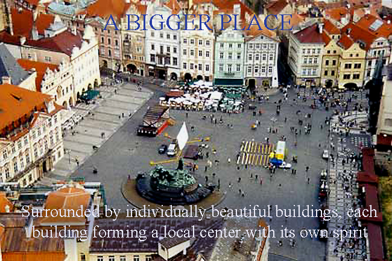

|  |
|:--:|
| A Fragment of the Generative Code for Neighborhoods  |
| [Back to Public Spaces ](../packets/publicspaces.htm) |

\

------------------------------------------------------------------------

|                                           |
|:------------------------------------------|
|  TEXT Coming |

------------------------------------------------------------------------

 SUMMARY OF TASKS FOR THIS UNFOLDING:

------------------------------------------------------------------------

 

- 

\

------------------------------------------------------------------------

[Back to Public Spaces](../packets/publicspaces.htm)

\

© 2006 CES

Terms of Use & Copyright Notice 
