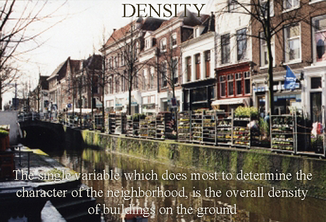

|  |
|:--:|
| A Fragment of the Generative Code for Neighborhoods  |
| [Back to Building Volumes Group ](../packets/buildingvolumes.htm) |

\

------------------------------------------------------------------------

<table width="549" data-align="center" data-border="0" data-padding-left="0px">
<colgroup>
<col style="width: 100%" />
</colgroup>
<tbody>
<tr>
<td style="text-align: left;"><table data-align="center" width="549" data-border="0" data-bgcolor="ffffdd">
<colgroup>
<col style="width: 25%" />
<col style="width: 25%" />
<col style="width: 25%" />
<col style="width: 25%" />
</colgroup>
<tbody>
<tr>
<td colspan="4" width="560">One very simple way to measure density, is by the total area of built space, as a fraction of the total area of the neighborhood. This is known as the floor area ratio. 
Consider an imaginary neighborhood of 5 hectares (about 12 acres). Here is a table of some possible densities in this five-hectare neighborhood: 
</td>
</tr>
</tbody>
</table>
<table width="560" data-align="center" data-border="3" data-bgcolor="ffffdd" data-bordercolor="0000ff">
<tbody>
<tr>
<td width="200px" data-valign="top">Photo</td>
<td width="100px" data-valign="top">Number of houses</td>
<td width="100px" data-valign="top">Density (FAR)</td>
<td width="100px" data-valign="top">Average size of garden</td>
</tr>
<tr>
<td width="200px" data-valign="top">Photo</td>
<td width="100px" data-valign="top">1</td>
<td width="100px" data-valign="top">.005</td>
<td width="100px" data-valign="top">10 acres</td>
</tr>
<tr>
<td width="200px" data-valign="top">Photo</td>
<td width="100px" data-valign="top">2</td>
<td width="100px" data-valign="top">.01</td>
<td width="100px" data-valign="top">5 acres</td>
</tr>
<tr>
<td width="200px" data-valign="top">Photo</td>
<td width="100px" data-valign="top">4</td>
<td width="100px" data-valign="top">.02</td>
<td width="100px" data-valign="top">2.5 acres</td>
</tr>
<tr>
<td width="200px" data-valign="top">Photo</td>
<td width="100px" data-valign="top">8</td>
<td width="100px" data-valign="top">.04</td>
<td width="100px" data-valign="top">1.25 acres</td>
</tr>
<tr>
<td width="200px" data-valign="top">Photo</td>
<td width="100px" data-valign="top">16</td>
<td width="100px" data-valign="top">.08</td>
<td width="100px" data-valign="top">0.6 acres</td>
</tr>
<tr>
<td width="200px" data-valign="top">Photo</td>
<td width="100px" data-valign="top">32</td>
<td width="100px" data-valign="top">.16</td>
<td width="100px" data-valign="top">0.3 acres</td>
</tr>
<tr>
<td width="200px" data-valign="top">Photo</td>
<td width="100px" data-valign="top">64</td>
<td width="100px" data-valign="top">.32</td>
<td width="100px" data-valign="top">0.15 acres</td>
</tr>
<tr>
<td width="200px" data-valign="top">Photo</td>
<td width="100px" data-valign="top">128</td>
<td width="100px" data-valign="top">.64</td>
<td width="100px" data-valign="top">0.07 acres</td>
</tr>
</tbody>
</table>
 
 Whenever you start a project, or whenever you begin to take action, you must always looks for those sparks of life, among the buildings, or in the open land -- places that, just very slightly, have a quality that make you feel fractionally a little more alive and a little more inclined to love life.

You need to be very discriminating when you do this. If you get good at recognizing such places, they may be fragments, only. in the middle of stuff that is not worth much.

These small fragments are too precious to be swept carelessly out of the way, or destroyed, or casually rebuilt. They are capaable, like seeds, of starting the new life of the place, like fresh shoots.

Indeed, if you start with nothing but these fragments -- a bench here, the base of a tree that has primroses around it in spring, an archway from an ancient building, a piece of a brick wall with lovely scarlet bricks -- keep <strong>all</strong> of them. These are what we mean by "magic configurations." You can always find a way to build whatever new you are going to build, without destroying these magic configurations.

If you follow this rule, it will give the place you are making, an altogether different character.

Do not think that you can achieve the same end, by plucking the beautiful fragment, and replanting it, or inserting it into some other structure. That will always be damage, as if one had hacked out a piece of life and pasted it into a new place. It can't be done, because the life that exists in a thing, always comes from the larger context -- it is both its existence in the land, as it is, and the thing itself, which are capable of giving continuity to life.
</td>
</tr>
</tbody>
</table>

------------------------------------------------------------------------

 SUMMARY OF TASKS FOR THIS UNFOLDING:

------------------------------------------------------------------------

 

- Follow the rules written down above, exactly as they are written.

\

------------------------------------------------------------------------

[Back to Building Volumes Group](../packets/buildingvolumes.htm)

\

© 2006 CES

Copyright notice 

© 2006 CES

Terms of Use & Copyright Notice 
