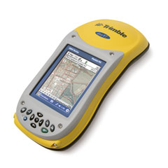

|  |
|:--:|
| A Fragment of the Generative Code for Neighborhoods  |
| [Back to Diagnosis Section](../packets/diagnosis-phase.htm) |

<table width="550" data-align="center" data-border="0">
<colgroup>
<col style="width: 100%" />
</colgroup>
<tbody>
<tr>
<td width="560"> ACCURACY OF POSITION</td>
</tr>
<tr>
<td width="560"></td>
</tr>
<tr>
<td width="500"> 
&#10;Take unusual care in marking the places that have been identified, with stakes, and also in transferring them to your base map so you have a truly accurate picture of where they are.</td>
</tr>
</tbody>
</table>

<table width="550" data-align="center" data-border="0">
<colgroup>
<col style="width: 50%" />
<col style="width: 50%" />
</colgroup>
<tbody>
<tr>
<td style="text-align: left;">
</td>
<td></td>
</tr>
<tr>
<td style="text-align: left;"> <strong>WHAT MATTERS VERY GREATLY, IS ACCURACY OF POSITION ON THE LAND</strong>

At the time of making a diagnosis, we usually observe by "feel", and notice roughly where something is right, or something is going wrong.

But before using the diagnosis map as a a basis for further unfolding, it is important that the boundaries of each area, their positions, their diameters, and so on, are all recorded accurately.

A certain spot may be very lovely... but move five feet to the left, and it can be a very different experience. If you make a mistake of five feet in recording it, and then build a wall, or a building, a road, or even a seat in the wrong place, the thing that seemed precious when you first saw it, will no longer be as precious. Indeed, the true value of it may have been permenently erased.

In recent years the best way to make these measurements is by using a central station method of surveying. Much easier is to use a handheld GPS (Global positioning system) device like the one illustrated above. If you walk to the various different places on the ground, and click when you reach the key points defining the center and boundary points of the place you want to identify, the machine will give you the coordinates.

We hope, before too long, to have a way these coordinates can be fed directly from that machine to your computer. They can then be plotted on the base map in your drawing pad.

A high-end GPS machine costs about US$5000 at present; these machines can be accurate to within a foot or even a few inches. But you can buy a less accurate one for as little as $200, and these cheaper ones will be accurate to within about a meter.

If this technology is too far out, or too expensive, you can certainly make do with old-fashioned methods of measuring distances, always triangulating. But in any case it is important that positions of key points in the land should be recorded accurately.

<strong></strong>
</td>
<td></td>
</tr>
<tr>
<td colspan="2" style="text-align: left;" data-bgcolor="ffffff">

 TASKS TO COMPLETE 
IN ORDER TO ACHIEVE THIS UNFOLDING

 
<ul>
<li>Get your boots on. Take a bunch of stakes with you -- or chalk if it is an urban area. Go around all the places you have identified, in your preliminary walk around, and now locate the extent and edges of each of the areas.</li>
<li>To the extent possible, measure the exact positions of these marks, relative to other fixed points in the landscape, and with dimensions accurate to a foot or so.</li>
<li>Put a copy of these drawings in your workbook!</li>
</ul>
 
&#10;

<a href="../packets/diagnosis-phase.htm">Back to Diagnosis Section</a>
 
&#10;© 2006 CES
Terms of Use &amp; Copyright Notice </td>
</tr>
</tbody>
</table>

