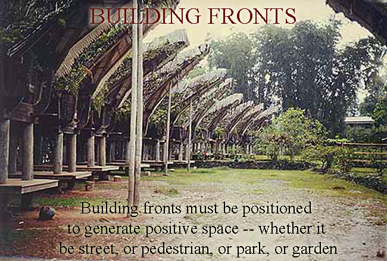

|  |
|:--:|
| A Fragment of the Generative Code for Neighborhoods  |
| [Back to Building Volumes Group ](../packets/buildingvolumes.htm) |

\

------------------------------------------------------------------------

<table width="549" data-align="center" data-border="0" data-padding-left="0px">
<colgroup>
<col style="width: 100%" />
</colgroup>
<tbody>
<tr>
<td style="text-align: left;">At any given moment, in any part of the world, there is a deep wholeness which exists there. This deep wholeness is the structure of the whole. That means, it is the structure of the global, it is the largest and deepest configuration which is present there, and which may be felt or seen. 

The most fundamental rule, to be followed always, is that we must do our best to leave this deep structure of that place, as far as possible intact. This does not mean we must do nothing there. It means that we should, as far as possible, honor and respect the deep structure of what is there, try to preserve this deep configuration, in whatever new things we do.

It means that the new should always grow out of respect for what is there now, and what was there before.

It means that we should never knowingly violate the deep structure of what is there; that means, when we contemplate what is there, and what we are going to do there, we act out of respect for what is there, and we act out of the knowledge that if we violate the deep structure, then we shall not only violate the place, but will at a profound lvel, also damage our own feelings and our own sensibility. That we should never do.
</td>
</tr>
</tbody>
</table>

------------------------------------------------------------------------

 SUMMARY OF TASKS FOR THIS UNFOLDING:

------------------------------------------------------------------------

 

- As far as possible, try to become aware, intutively, of the deep structure which is there.
- Act in sympathy for your own feelings about the deep structure that is there.
- Do not play with words, when it comes to judging this. Be true to the feelings you carry inside of you, and do your best to protect the earth.
- Try your best to make a new thing which as far as possible, reflects, respects, and honors what is there already.

\

------------------------------------------------------------------------

[Back to Building Volumes Group](../packets/buildingvolumes.htm)

\
 © 2006 CES <a href="javascript:clickWindow(&#39;../clickagreement/clickagreementces.htm&#39;,&#39;window2&#39;)" data-;="">Copyright Notice</a> 

© 2006 CES

Terms of Use & Copyright Notice 
