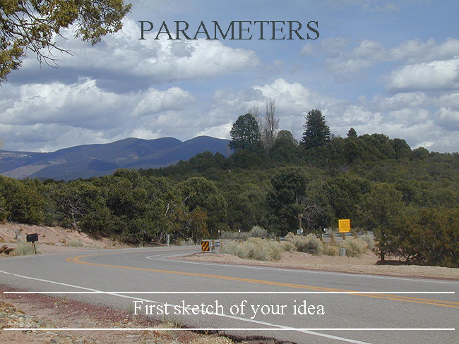
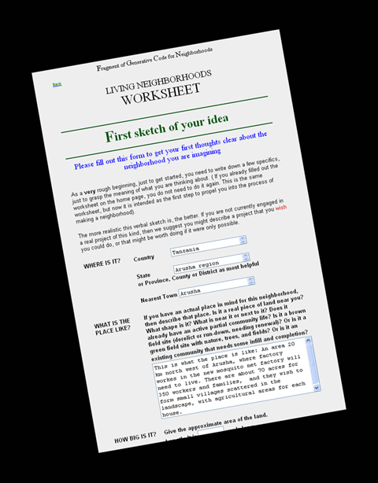
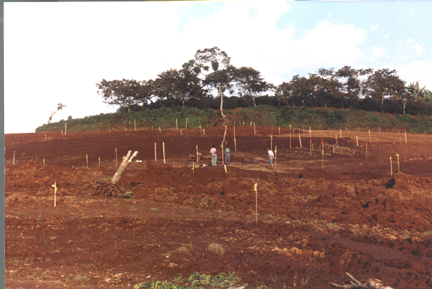
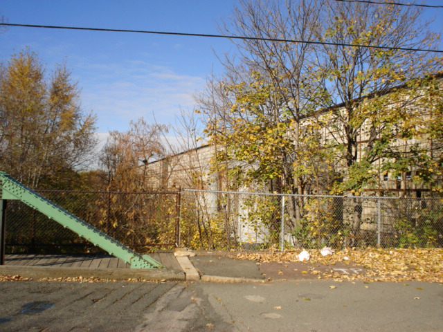
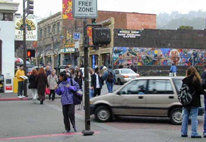
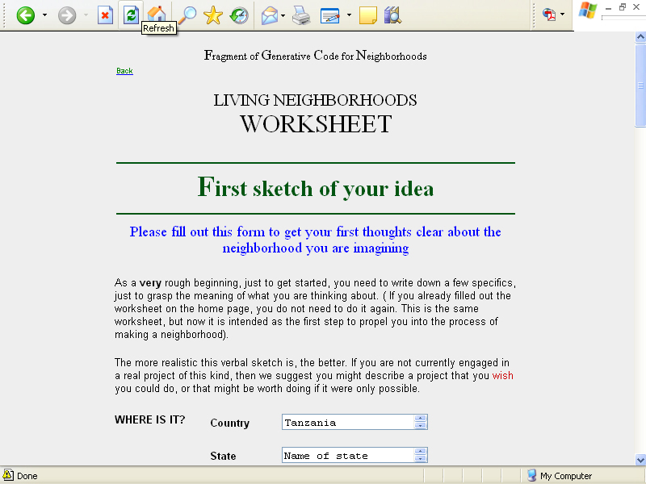

|  |
|:--:|
| A Fragment of the Generative Code for Neighborhoods  |
| [Back to Startup & Vision Section](../packets/vision-phase.htm) |

------------------------------------------------------------------------

#  Please fill out this form to get your first thoughts clear about the neighborhood you may be imagining

<table width="165" data-align="left" data-border="1">
<colgroup>
<col style="width: 100%" />
</colgroup>
<tbody>
<tr>
<td></td>
</tr>
<tr>
<td height="40px"> </td>
</tr>
<tr>
<td>Below you will find pictures of some of the kinds of places where your neighborhood might be. It makes a difference, because according to these circumstances, you need a different approach to making the neighborhood 
</td>
</tr>
<tr>
<td><a href="javascript:void(0)" onmouseover="javascript:togglePic(&#39;greenfield&#39;); " onmouseout="javascript:togglePic(&#39;greenfield&#39;);"> 
Greenfield site</a></td>
</tr>
<tr>
<td><a href="javascript:void(0)" onmouseover="javascript:togglePic(&#39;brownfield&#39;); " onmouseout="javascript:togglePic(&#39;brownfield&#39;);"> 
Brownfield site</a></td>
</tr>
<tr>
<td><a href="javascript:void(0)" onmouseover="javascript:togglePic(&#39;infill&#39;); " onmouseout="javascript:togglePic(&#39;infill&#39;);"> 
Infill urban</a></td>
</tr>
</tbody>
</table>

<table width="385" data-align="center" data-border="0" data-padding-left="10px">
<colgroup>
<col style="width: 100%" />
</colgroup>
<tbody>
<tr>
<td style="text-align: left;" width="385"> As a <strong>very</strong> rough beginning, just to get started, write down a few specifics, to grasp the meaning of what you are thinking about. 

The more realistic this verbal sketch is, the better. If you are not currently engaged in a real project, then we suggest you might describe a project that you <strong>wish</strong> you could do, or that might be worth doing if it were only possible.

WHERE IS IT? 
Country           

State               
or Province, County or District as most helpful

Nearest Town 

WHAT IS THE PLACE LIKE? 

If you have an actual place in mind for this neighborhood, then describe that place. Is it a real piece of land near you? What shape is it? What is near it or next to it? Does it already have an active partial community life? Is it a brown field site (derelict or run-down, needing renewal)? Or is it a green field site with nature, trees, and fields? Or is it an existing community that needs some infill and completion?

HOW BIG IS IT?

 Give the approximate area of the land. 
Length: It is yards long 
Width:   It is yards wide. 
Area: The total area is roughly acres 

If you prefer metric, use these boxes. 
Length: It is meters long 
Width:   It is meters wide. 
Area: The total area is roughly hectares

 WHAT WILL IT BE LIKE IN THE NEW NEIGHBORHOOD?

 Give a thumbnail sketch of the character of the place you hope to create. Imagine, in your mind's eye, a kind of neighborhood, or small community, where it would be fun to work, live, enjoy yourself. Choose it so that it really appeals to you and as far as possible, all the people you are speaking for. Don't worry about money; for now, just assume that the money will be forthcoming.

 HOW MANY PEOPLE?

How many people (roughly) may be working and living there? If you don't know, make it up. This is to give you a realistic intuitive feel for the place, and what it might be like as a community. 
less than 10 
less than 30 
30-150 
200-1000 
more than 1000

HOW MANY BUILDINGS?

Guess roughly how many buildings might be there when it is finished? Just make this up, intuitively. Don't try to calculate. 
less than 5 
5-10 
10-50 
more than 50 
more than 200 
more than 1000

 HOW MUCH PUBLIC OPEN LAND?

How much public open land, public gardens, and public streets will there be when it is finished? Write it as a percentage of the area of the whole neighborhood: 
10% 
20% 
30% 
50% or more 
more than 75%

 REAL OR IMAGINARY?

Is your project a real project, an entirely fictitious project, or half and half? 
A real project 
Entirely made up 
Half and half

 YOUR NAME?

Please write your name, so we know who you are:

 YOUR E-MAIL?

Please give us your e-mail address, so that we can communicate with you to hear about your experience on the website. This will be of great help in our effort to make the website work better for you.
</td>
</tr>
</tbody>
</table>

------------------------------------------------------------------------

\

When you have filled out this form, press the submit button. You will receive a copy of it via email for your file.\

================================================================================================================================================

Then go on to the next step in the unfolding process.

------------------------------------------------------------------------

[Back to Startup & Vision Section](../packets/vision-phase.htm)

 \
By answering these questions, a very vague picture will have begun to develop in your mind. If you have submitted the form, a copy of your form will go back to you, so you will have a record of what you sent, and a copy will also be emailed to us. When we receive it, we will contact you by email to see if you would like to talk about your initial work. This will allow us to refine the website, and make it more useful. So please do fill it out!

\

\

------------------------------------------------------------------------

[Back to Diagnosis Group](../packets/diagnosis.htm)

\

© 2006 CES

Terms of Use & Copyright Notice 

