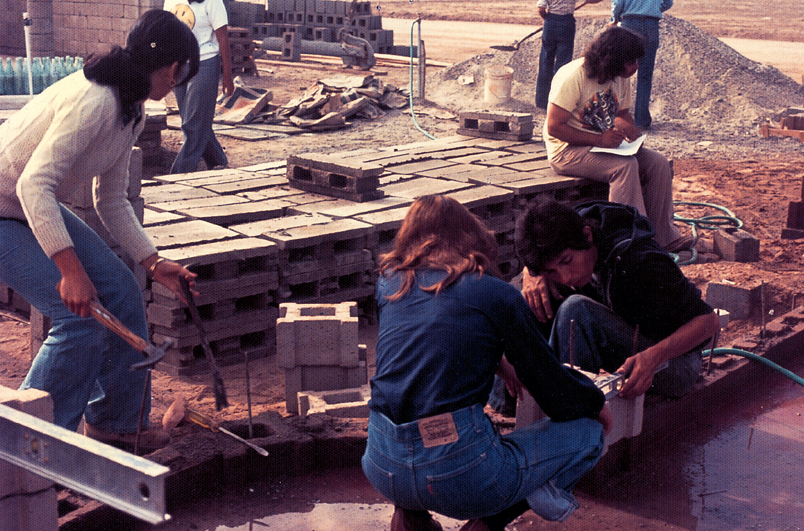

 

<table width="560" data-align="center" data-bgcolor="#ff1111" data-border="1">
<colgroup>
<col style="width: 33%" />
<col style="width: 33%" />
<col style="width: 33%" />
</colgroup>
<tbody>
<tr>
<td style="text-align: left;" width="150"></td>
<td style="text-align: center;" width="260"> <strong><em>Building Living Neighborhoods</em></strong> 
</td>
<td style="text-align: right;" width="150"> 
</td>
</tr>
</tbody>
</table>

<table width="560" data-align="center" data-border="1" data-bgcolor="ff1111">
<colgroup>
<col style="width: 100%" />
</colgroup>
<tbody>
<tr>
<td style="text-align: center;">ACTION &amp; PRACTICE 
A Generative Code for Modern Neighborhoods</td>
</tr>
</tbody>
</table>

<table width="560" data-align="center" data-border="1" data-bgcolor="ffffdd" data-cellpadding="4">
<colgroup>
<col style="width: 33%" />
<col style="width: 33%" />
<col style="width: 33%" />
</colgroup>
<tbody>
<tr>
<td colspan="3" style="text-align: left;">
<blockquote>
In the generative code, each major part of the design and making process is called a "Phase." 
&#10;* * *
Each Phase is made up of several "Unfoldings" , which are the small steps one needs to undertake, in sequence, to achieve the goal of that Phase. 
&#10;* * *
Begin with Phase 1, Startup &amp; Vision, to take the first practical steps towards imagining, designing, and building your neighborhood project.
</blockquote></td>
</tr>
</tbody>
</table>

|     |
|:---:|
|     |

<table width="560" data-align="center" data-border="1" data-cellpadding="0">
<colgroup>
<col style="width: 50%" />
<col style="width: 50%" />
</colgroup>
<tbody>
<tr>
<td style="text-align: center;" width="260" data-valign="middle" data-bgcolor="#ff1111"></td>
<td style="text-align: left;" width="300" data-valign="top" data-bgcolor="ffffdd">   PHASES:
<blockquote>
<a href="../packets/vision-phase.htm"><strong>1. STARTUP &amp; VISION 
 
 2. DIAGNOSIS OF LAND 
 
 3. SETTING DENSITY 
 
 4. MODIFYING THE CODE 
 
 5. PUBLIC SPACES 
 
 6. BUILDING VOLUMES 
 
 7. BUILDING LAYOUT 
 
 7. BUILDING DESIGN  
 
 8. PROJECT MANAGEMENT 
 
 9. CRAFT AND CONSTRUCTION</strong> </a>
</blockquote>
Partial list of currently available phases and unfoldings 
</td>
</tr>
<tr>
<td colspan="2" style="text-align: left;" width="560" height="50" data-bgcolor="ffffdd" data-valign="middle">
<blockquote>

  
When you have had a look at the unfoldings, and are familiar with the way they work, the first task is to select the unfoldings that are relevant to your project, and place them in your WORKBOOK (see menu to the left). As you go forward collect pages, your own notes, sketches and ideas about the neighborhood, together with printed pages of the unfoldings you feel to be appropriate.

The DRAWING PAD (see menu to the left) provides a greater level of support to understand the land, and the unfoldings, as they occur.

</blockquote></td>
</tr>
<tr>
<td colspan="2" style="text-align: center;" width="560" height="25" data-bgcolor="ff1111" data-border="1" data-valign="middle">  
</td>
</tr>
<tr>
<td colspan="2" style="text-align: center;" width="560" height="25" data-bgcolor="ff1111" data-border="1" data-valign="middle">  
</td>
</tr>
</tbody>
</table>

\

© 2006 CES

Terms of Use & Copyright Notice \

